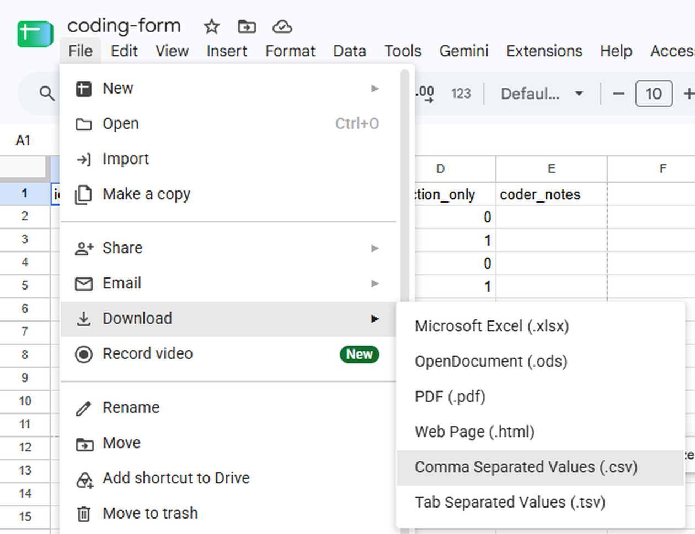
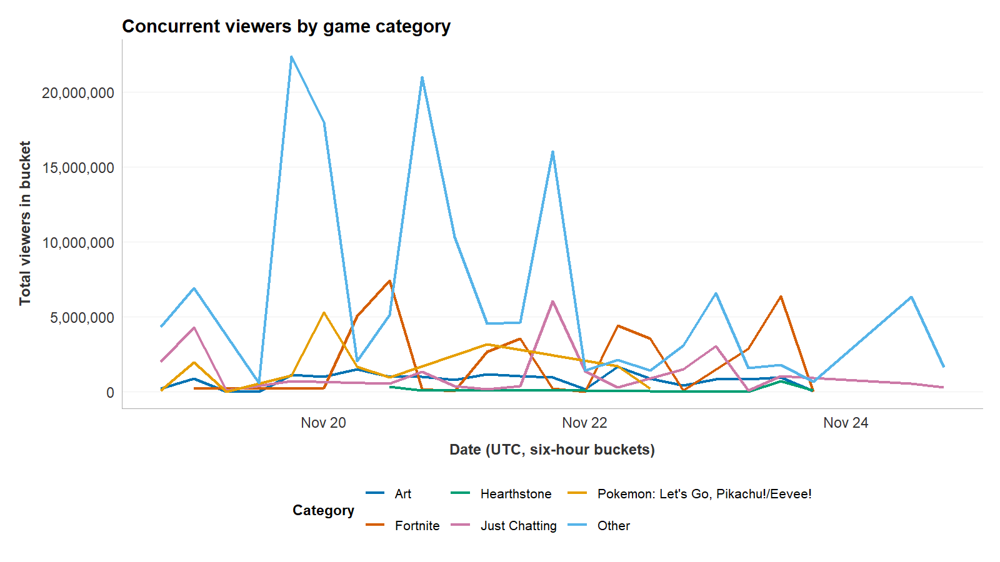
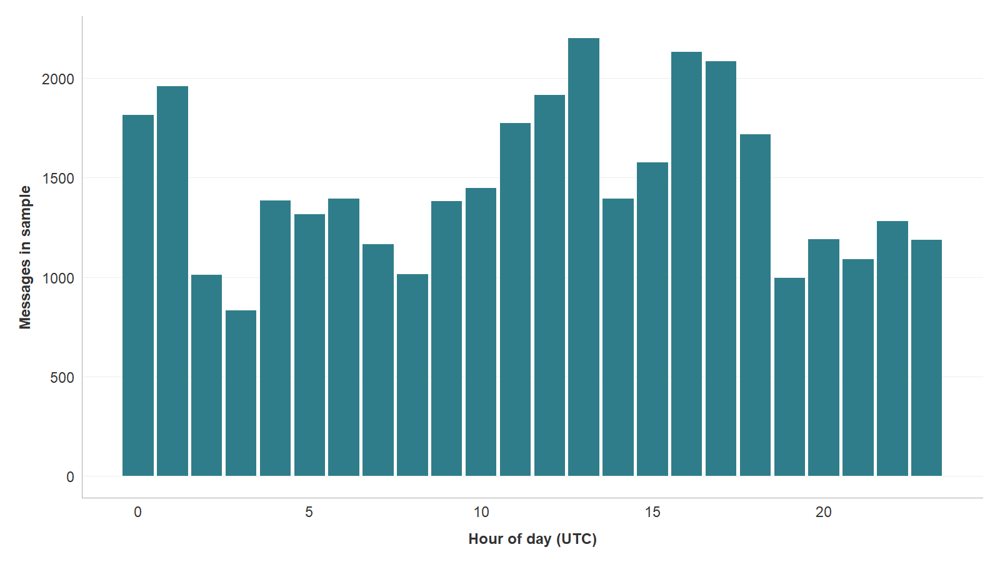
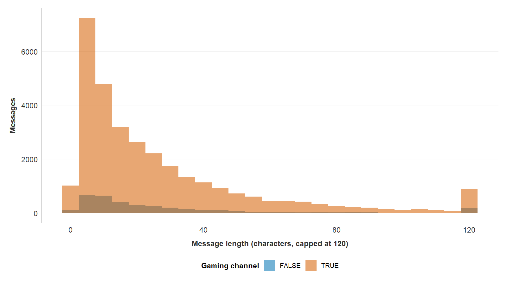

## Today's Agenda

- Coming up: what is due, and when
- Before Friday: save your Data Wrangling codes as a CSV and check them in R
- The Twitch job, part 2: the Describing Data worksheet
- The grammar of graphics: every plot is built from the same three parts
- Three chart types: a line chart, a bar chart, and a histogram
- The design choices a figure has to disclose to its reader
- Why the mean and the median of the same variable disagree

## Upcoming Assignments

| What | Due | Have done by |
|---|---|---|
| [Data Wrangling in R](https://aura-lab.siue.edu/v2v-hub/mc451-assignments.html#data-wrangling-in-r), 50 points | Fri, Nov 13, 11:59 PM | Codes saved as a CSV before Thursday's lab |
| [Describing Data in R](https://aura-lab.siue.edu/v2v-hub/mc451-assignments.html#describing-data-in-r), 75 points | Fri, Nov 20, 11:59 PM | Started in Thursday's lab |
| [Weekly reading journal](https://aura-lab.siue.edu/v2v-hub/mc451-assignments.html#weekly-reading-journal) | Fri, Nov 13 and Fri, Nov 20, 11:59 PM | Chapter 12, then Chapter 13 |

No class Nov 23 to 29: Thanksgiving Break.

## Upcoming Assignments (cont.)

| What | Due | Have done by |
|---|---|---|
| [Inferencing Data in R](https://aura-lab.siue.edu/v2v-hub/mc451-assignments.html#inferencing-data-in-r), 100 points | Fri, Dec 4, 11:59 PM | Taught Nov 17 and 19 |
| Coded dataset and re-code pushed ([White Paper](https://aura-lab.siue.edu/v2v-hub/mc451-assignments.html#white-paper) dated step) | Fri, Dec 4, 11:59 PM | First coding pass done by Tue, Dec 1 |
| Week 15 reading journal | Fri, Dec 4, 11:59 PM | Chapter 14 |
| [White Paper](https://aura-lab.siue.edu/v2v-hub/mc451-assignments.html#white-paper), 250 points | Fri, Dec 18, 11:59 PM | Results built from your own data |

## Save Your Codes as a CSV

[Data Wrangling worksheet, Task 0.3]{.eyebrow}

::: {.define}
**CSV:** a table saved as plain text, one row per line, with a comma between each column.
:::

- R reads your codes from `data/coding-form.csv`, so the file must be a CSV
- Google Sheets keeps your codes online, so you download them as a CSV
- Then you move that file into the `data` folder and name it `coding-form.csv`
- Keep the `id` column exactly as it is

## Download It as a CSV

1. In your coding sheet in Google Sheets, click **File**
2. Point to **Download**
3. Click **Comma Separated Values (.csv)**
4. The file lands in your **Downloads** folder

- Its name has the tab's name added, such as `coding-form - Sheet1.csv`
- You fix the name in VS Code, two slides from now

## Download It: What You See

{.run-figure fig-alt="Google Sheets with a sheet named coding-form open. The File menu is open with Download highlighted, and its submenu lists Microsoft Excel (.xlsx), OpenDocument (.ods), PDF (.pdf), Web Page (.html), Comma Separated Values (.csv), and Tab Separated Values (.tsv). The pointer rests on Comma Separated Values (.csv)."}

## Move It into the Data Folder

1. In the VS Code Explorer, right-click the old `coding-form.csv` inside `data`, click **Delete**, and confirm
2. Open your Downloads folder beside VS Code, as in [Put a Worksheet in Your Workspace](https://aura-lab.siue.edu/v2v-hub/guides/mc451/14-put-a-worksheet-in-your-workspace.html)
3. Drag the downloaded file onto the folder named **data** in the VS Code Explorer, and let go
4. Right-click the file inside `data`, click **Rename...**, type `coding-form.csv`, and press **Enter**

## Check the Coding Sheet in R

```r
read_csv("data/coding-form.csv") %>%
  glimpse()
```

- `read_csv()` reads a CSV file into a table
- `glimpse()` prints how many rows and columns it has, and each column's type
- `"data/coding-form.csv"` means: start in the folder open in VS Code, go into `data`, open `coding-form.csv`
    - The folder open in VS Code is the name at the top of the Explorer
- Run it from the worksheet or the R terminal: the start is the same

## Check the Coding Sheet: Output

```{.term .tall code-line-numbers="false" step="22-read-form"}
> read_csv("data/coding-form.csv") %>%
+   glimpse()
Rows: 30 Columns: 5
── Column specification ────────────────────────────────────────────────
Delimiter: ","
chr (2): channel, message
dbl (2): id, reaction_only
lgl (1): coder_notes

ℹ Use `spec()` to retrieve the full column specification for this data.
ℹ Specify the column types or set `show_col_types = FALSE` to quiet this message.
Rows: 30
Columns: 5
$ id            <dbl> 16240927, 182383, 19530370, 12102429, 7123505, 2…
$ channel       <chr> "bobross", "bobross", "bobross", "bobross", "bob…
$ message       <chr> "press F to bring back bob", "BIG TREE", "CoolSt…
$ reaction_only <dbl> 0, 0, 1, 0, 0, 0, 1, 1, 1, 0, 0, 1, 1, 1, 1, 0, …
$ coder_notes   <lgl> NA, NA, NA, NA, NA, NA, NA, NA, NA, NA, NA, NA, …
```

- `Rows: 30`, `Columns: 5`, and `reaction_only` as `<dbl>` (a number): the sheet is right

## When the Check Goes Wrong

- Same line, when the downloaded file still has its long name

```r
read_csv("data/coding-form.csv") %>%
  glimpse()
```

## When the Check Goes Wrong: Output

```{.term code-line-numbers="false"}
> read_csv("data/coding-form.csv") %>%
+   glimpse()
Error: 'data/coding-form.csv' does not exist in current working directory ('C:/Users/you/Documents/mc451-workspace').
```

- `does not exist`: no file in `data` has exactly that name
- The folder in brackets is the one open in VS Code; yours shows your own

## Find the Name It Has

```r
list.files("data")
```

- `list.files("data")` lists every file in the `data` folder

## Find the Name It Has: Output

```{.term code-line-numbers="false"}
> list.files("data")
[1] "coding-form - Sheet1.csv" "twitch_analysis.RDS"
```

- The download kept its long name
- Rename it to `coding-form.csv` in the VS Code Explorer, then run the check again

## What We Build Today

[Describing Data, 75 points, due Friday, November 20, 11:59 PM]{.eyebrow}

- Chapter 11 left you an `analysis` table of about 35,000 rows
    - Nobody reads 35,000 rows, so a figure is how you make the data visible
- Today we build three figures and one summary table from the example data
    - Each chart type fits a different kind of question
    - The same three figures, built from your own data, become the Results section of your White Paper

Your first version of each figure will look wrong. Fixing it takes about three lines.

## The Twitch Job, Part 2

- The Describing Data worksheet is part 2 of the Twitch job
    - It loads `data/twitch_analysis.RDS`, with your thirty codes inside
- Frequency tables, mean, median, and sd, a cross-tabulation, and three figures
- Your interpretation and your alt text are never filled in for you

[MC 451 worksheet](https://aura-lab.siue.edu/v2v-hub/starters/12-describing-data-mc451.qmd) · [Describing Data risks guide](https://aura-lab.siue.edu/v2v-hub/resources/risks/describing-data.html)

- Click the link: your browser saves 12-describing-data-mc451.qmd in your Downloads folder
- Move it into your workspace's top folder, next to README.md and the Data Wrangling worksheet: [Put a Worksheet in Your Workspace](https://aura-lab.siue.edu/v2v-hub/guides/mc451/14-put-a-worksheet-in-your-workspace.html)

## Load the Saved Table

Three lines start every Describing session: two packages, then the table Data Wrangling saved.

```r
library(tidyverse)
library(v2v)
analysis <- read_rds("data/twitch_analysis.RDS")
```

- `library()` switches a package on for this session
- `read_rds()` reads the saved file and names the table `analysis`
- If R says `cannot open the connection`, the file is not in your `data` folder

## Load the Table: Output

```{.term .tall code-line-numbers="false" step="01-setup"}
> library(tidyverse)
── Attaching core tidyverse packages ──────────────── tidyverse 2.0.0 ──
✔ dplyr     1.1.4     ✔ readr     2.1.6
✔ forcats   1.0.1     ✔ stringr   1.6.0
✔ ggplot2   4.0.1     ✔ tibble    3.3.0
✔ lubridate 1.9.4     ✔ tidyr     1.3.1
✔ purrr     1.2.0
── Conflicts ────────────────────────────────── tidyverse_conflicts() ──
✖ dplyr::filter() masks stats::filter()
✖ dplyr::lag()    masks stats::lag()
ℹ Use the conflicted package (<http://conflicted.r-lib.org/>) to force all conflicts to become errors
> library(v2v)
v2v 0.3.9 loaded.
  setup()  checks that R, Quarto and Git are ready
  ?v2v     lists what this package gives you
> analysis <- read_rds("data/twitch_analysis.RDS")
```

- The two `masks` lines are normal, not errors
- `read_rds()` prints nothing: the table went into `analysis` quietly

## A First Look at the Table

```r
glimpse(analysis)
```

- `glimpse()` prints one line per column: its name, its type, and its first few values
- Use it every time you load a table, before you draw anything

## A First Look: Output

```{.term .tall code-line-numbers="false" step="02-glimpse"}
> glimpse(analysis)
Rows: 35,267
Columns: 16
$ id             <dbl> 89, 551, 1033, 2094, 2803, 10406, 16104, 22571,…
$ channel        <chr> "sodapoppin", "xqcow", "forsen", "sodapoppin", …
$ sender         <chr> "madzee", "prometheanow", "spectre155", "itsjer…
$ message        <chr> "???????????????????????", "TriEasy Clap TriEas…
$ date           <dbl> 1.542578e+12, 1.542578e+12, 1.542578e+12, 1.542…
$ ts             <dttm> 2018-11-18 21:55:27, 2018-11-18 21:55:35, 2018…
$ message_length <int> 23, 441, 8, 12, 206, 37, 6, 7, 4, 7, 3, 4, 12, …
$ snapshot_ts    <dttm> NA, NA, NA, NA, NA, 2018-11-18 21:56:40, 2018-…
$ game           <chr> NA, NA, NA, NA, NA, "Artifact", "Marble It Up!"…
$ viewers        <int> NA, NA, NA, NA, NA, 15300, 28076, 4703, 19239, …
$ main_game      <chr> "Hand Simulator", "Just Chatting", "The Elder S…
$ is_gaming      <lgl> TRUE, FALSE, TRUE, TRUE, FALSE, TRUE, TRUE, TRU…
$ channel_type   <fct> gaming, non-gaming, gaming, gaming, non-gaming,…
$ median_viewers <dbl> 22944, 16176, 10163, 22944, 16176, 10163, 22944…
$ viewer_band    <fct> large, medium, medium, large, medium, medium, l…
$ reaction_only  <fct> NA, NA, NA, NA, NA, NA, NA, NA, NA, NA, NA, NA,…
```

- 35,267 rows, one per chat message, and 16 columns
- `reaction_only` is `NA` except on your thirty coded messages

## The Grammar of Graphics

**ggplot2** is not a catalog of chart types. It is one idea from Wilkinson's *The Grammar of
Graphics*: every plot is built from the same few parts.

- **Data:** the table being shown
- **Aesthetic mappings:** which column goes to the x axis, the y axis, or the color
- **Geometry:** the kind of mark used to draw the data, such as a line or a bar

Choose those three parts and the plot is fully specified.

## The Skeleton in Code

```r
ggplot(data, aes(x = ..., y = ...)) +
  geom_line()
```

`ggplot()` names the data and, inside `aes()`, says which column maps to which visual
property. `geom_line()` says what mark to draw, and `+` stacks layers on top of each other.

Swap `geom_line()` for `geom_col()` and the same data is drawn as bars.

## Exercise: Choose a Chart for Your Own Variable {.discuss}

Pick one variable from your own codebook.

- What **shape** do you expect its values to have: a few large values and many small ones, an even spread, or a daily rhythm?
- Which chart answers your question best: a line chart (change over time), a bar chart (a count per category), or a histogram (the shape of a numeric variable)?
- Describe one result that would surprise you if the chart showed it

## A Line Chart Shows Change Over Time

```r
viewers_over_time <- twitch_viewers_over_time()
viewers_over_time
```

- The course package ships this table ready to draw
    - The stream snapshots are grouped into six-hour blocks, the top five games kept, the rest lumped into "Other," and the viewers in each block added up
- Typing the table's name on its own line prints it

## The Viewers Table: Output

```{.term .tall code-line-numbers="false" step="03-viewers-print"}
> viewers_over_time <- twitch_viewers_over_time()
> viewers_over_time
# A tibble: 97 × 3
   six_hour            category                           total_viewers
   <dttm>              <fct>                                      <int>
 1 2018-11-18 18:00:00 Art                                       238217
 2 2018-11-18 18:00:00 Just Chatting                            2034123
 3 2018-11-18 18:00:00 Pokemon: Let's Go, Pikachu!/Eevee!         99909
 4 2018-11-18 18:00:00 Other                                    4333423
 5 2018-11-19 00:00:00 Art                                       870710
 6 2018-11-19 00:00:00 Fortnite                                  258780
 7 2018-11-19 00:00:00 Just Chatting                            4312125
 8 2018-11-19 00:00:00 Pokemon: Let's Go, Pikachu!/Eevee!       1991196
 9 2018-11-19 00:00:00 Other                                    6933016
10 2018-11-19 06:00:00 Art                                        12444
# ℹ 87 more rows
```

- Three columns: the six-hour block, the category, and the viewers added up inside it
- R prints the first ten rows and says how many more there are

## Count the Categories

```r
viewers_over_time %>%
  count(category)
```

- `count()` makes one row per category and counts the rows in each
- Three judgment calls were made for you here; `?twitch_viewers_over_time` says how

## Count the Categories: Output

```{.term code-line-numbers="false" step="04-viewers-count"}
> viewers_over_time %>%
+   count(category)
# A tibble: 6 × 2
  category                               n
  <fct>                              <int>
1 Art                                   21
2 Fortnite                              17
3 Hearthstone                            9
4 Just Chatting                         18
5 Pokemon: Let's Go, Pikachu!/Eevee!    10
6 Other                                 22
```

- Six categories, so six rows; `n` is how many six-hour blocks each one has

## Drawing the Line Chart

```r
ggplot(viewers_over_time,
       aes(x = six_hour, y = total_viewers,
           color = category)) +
  geom_line(linewidth = 0.9) +
  scale_y_continuous(labels = scales::label_comma()) +
  labs(title = "Concurrent viewers by game category",
       x = "Date (UTC, six-hour buckets)",
       y = "Total viewers in bucket",
       color = "Category") +
  v2v::scale_colour_v2v() +
  v2v::theme_v2v()
```

Time goes on the x axis, summed viewers on the y axis, and category to color. `label_comma()`
writes 20,000,000 instead of 2.0e+07, and `theme_v2v()` gives every figure in the set one consistent look.

## Drawing the Line Chart: Output

{.run-figure fig-alt="A line chart of total viewers per six-hour block from November 18 to 25, 2018, one line per category. The Other line towers over the rest, peaking above 22 million; Art, Fortnite, Hearthstone, Just Chatting, and Pokemon stay mostly under 7.5 million."}

- In VS Code the chart opens in its own Plot tab, beside your code

## What the Line Chart Shows

- The "Other" category dominates, spiking above 20 million viewers
    - One reading: viewership really does have a long tail of small categories
    - The other reading: lumping fifty categories into one guarantees that one wins
- That design choice has a real cost
    - The five named lines are pressed flat against the bottom axis

A dominant series crowds out the rest. Notice that in your own figure, and say so in the caption.

## A Bar Chart Shows a Count per Category

Hour of day is 24 separate categories, and we want a count of messages in each one.

```r
chat_by_hour <- analysis %>%
  mutate(hour = hour(ts)) %>%
  count(hour, name = "messages")
chat_by_hour
```

- `hour()` pulls the hour, 0 to 23, out of each message's time stamp
- `count()` then counts the messages in each hour and names the count `messages`

## Messages per Hour: Output

```{.term code-line-numbers="false" step="06-hour-table"}
> chat_by_hour <- analysis %>%
+   mutate(hour = hour(ts)) %>%
+   count(hour, name = "messages")
> chat_by_hour
# A tibble: 24 × 2
    hour messages
   <int>    <int>
 1     0     1816
 2     1     1959
 3     2     1013
 4     3      833
 5     4     1384
 6     5     1317
 7     6     1393
 8     7     1165
 9     8     1016
10     9     1381
# ℹ 14 more rows
```

- One row per hour; R shows the first ten and says 14 more are there

## Find the Busiest Hour

```r
chat_by_hour %>%
  arrange(desc(messages))
```

- `arrange()` sorts the rows; `desc()` puts the biggest count first
- Sorting is how you find the peak before you draw it

## Find the Busiest Hour: Output

```{.term code-line-numbers="false" step="07-hour-sorted"}
> chat_by_hour %>%
+   arrange(desc(messages))
# A tibble: 24 × 2
    hour messages
   <int>    <int>
 1    13     2201
 2    16     2132
 3    17     2084
 4     1     1959
 5    12     1915
 6     0     1816
 7    11     1775
 8    18     1717
 9    15     1578
10    10     1449
# ℹ 14 more rows
```

- The busiest hour is 13:00 UTC, with 2,201 messages

## Drawing the Bar Chart

```r
ggplot(chat_by_hour, aes(x = hour, y = messages)) +
  geom_col(fill = "#2f7d8a") +
  labs(x = "Hour of day (UTC)",
       y = "Messages in sample") +
  v2v::theme_v2v()
```

`geom_col()` draws a bar whose height is a number you already computed.

## Drawing the Bar Chart: Output

{.run-figure fig-alt="A bar chart of messages in the sample for each hour of the day, 0 to 23 UTC. The tallest bar is 13:00 at about 2,200 messages, with high bars again at 16:00 and 17:00; the shortest is 03:00 at about 830."}

## What the Bar Chart Shows

[Twitch, November 2018]{.eyebrow}

- The example chat has a clear daily pulse, busiest through UTC midday
- The peak is 13:00 UTC, with 2,201 messages
- The low point is 03:00 UTC, with 833 messages, a swing of more than two to one
- The pattern is not mysterious: the audience sat in the Americas and Europe

Twenty-four numbers become a rhythm you can read in one glance.

## A Histogram Shows the Shape of a Numeric Variable

::: {.define}
**Histogram:** a bar chart of a number variable; each bar counts the values in one range, such as the messages 0 to 5 characters long.
:::

First, the table the histogram draws from:

```r
msglen <- analysis %>%
  filter(!is.na(is_gaming)) %>%
  mutate(length_shown = pmin(message_length, 120))
msglen %>%
  count(is_gaming)
```

## The Histogram Table

- `filter()` drops the messages from channels with no gaming label
- `pmin()` keeps each length, but shows anything over 120 as 120
- `count(is_gaming)` checks how many messages each group has left

## The Histogram Table: Output

```{.term code-line-numbers="false" step="09-msglen"}
> msglen <- analysis %>%
+   filter(!is.na(is_gaming)) %>%
+   mutate(length_shown = pmin(message_length, 120))
> msglen %>%
+   count(is_gaming)
# A tibble: 2 × 2
  is_gaming     n
  <lgl>     <int>
1 FALSE      3457
2 TRUE      31309
```

- `FALSE` is non-gaming: 3,457 messages, about one in ten
- `TRUE` is gaming: 31,309 messages

## Check the Cap

```r
msglen %>%
  summarize(
    longest = max(message_length, na.rm = TRUE),
    longest_shown = max(length_shown, na.rm = TRUE)
  )
```

- `max()` finds the biggest value; `na.rm = TRUE` skips the empty messages
- One line compares the real longest message with the longest one the chart will show

## Check the Cap: Output

```{.term code-line-numbers="false" step="10-cap-check"}
> msglen %>%
+   summarize(
+     longest = max(message_length, na.rm = TRUE),
+     longest_shown = max(length_shown, na.rm = TRUE)
+   )
# A tibble: 1 × 2
  longest longest_shown
    <int>         <dbl>
1     501           120
```

- The longest message is 501 characters; the chart draws it at 120

## Drawing the Histogram

```r
ggplot(msglen,
       aes(x = length_shown, fill = is_gaming)) +
  geom_histogram(binwidth = 5, position = "identity",
                 alpha = 0.55) +
  labs(x = "Message length (characters, capped at 120)",
       y = "Messages",
       fill = "Gaming channel") +
  v2v::scale_fill_v2v() +
  v2v::theme_v2v()
```

- `binwidth = 5` makes each bar five characters wide; `alpha` lets the overlap show through

## Drawing the Histogram: Output

{.run-figure fig-alt="Two overlaid histograms of message length in characters, capped at 120, for gaming (TRUE) and non-gaming (FALSE) channels. Both pile up under 20 characters and thin out to the right, with a small spike in the last bar at 120. The non-gaming bars are so short they barely show."}

## The Warning Under the Chart

The terminal also prints this under the histogram code:

```{.term code-line-numbers="false" step="11-plot-hist"}
> ggplot(msglen,
+        aes(x = length_shown, fill = is_gaming)) +
+   geom_histogram(binwidth = 5, position = "identity",
+                  alpha = 0.55) +
+   labs(x = "Message length (characters, capped at 120)",
+        y = "Messages",
+        fill = "Gaming channel") +
+   v2v::scale_fill_v2v() +
+   v2v::theme_v2v()
Warning message:
Removed 4 rows containing non-finite outside the scale range
(`stat_bin()`).
```

- A **warning** is not an error: the chart still drew
- The 4 rows are the empty messages, which have no length to draw

## Counts Hide the Smaller Group

- By count, non-gaming (one message in ten) barely shows
- The R Companion's **Histogram comparing two groups** draws each group as **shares** instead, so the two shapes compare

## Two Choices You Must Disclose

- `binwidth = 5` makes each bar five characters wide
    - A wider bin smooths the shape and a narrower bin roughens it, so report the width you used
- `pmin(message_length, 120)` caps the display at 120 characters
    - The longest message is 501 characters, so the last bar is a pile-up of everything longer
    - Capping keeps the bulk of the data legible

An unannounced cap is a quiet distortion. Label the axis with the cap, as `labs(x = ...)` did.

## What the Histogram Shows

::: {.define}
**Skew:** a lopsided shape. Right-skewed means most values are small and a few are very large, like message length here.
:::

- Both groups are heavily right-skewed
    - A tall stack of very short messages, then a long thin tail of longer ones
    - Most Twitch chat messages are brief: a word or an emote
- A minority of long messages stretches the range

The skew is the most important thing the figure reveals, and no single summary number can show it.

## Summarize Each Group

::: {.define}
**Mean:** the average, the total divided by the count. **Median:** the middle value once the values are sorted. Example: the mean message is 29.0 characters long, the median 17.
:::

```r
msglen %>%
  group_by(is_gaming) %>%
  summarize(
    n      = sum(!is.na(message_length)),
    mean   = mean(message_length, na.rm = TRUE),
    median = median(message_length, na.rm = TRUE),
    sd     = sd(message_length, na.rm = TRUE),
    .groups = "drop"
  )
```

## Summarize Each Group (cont.)

- `group_by(is_gaming)` splits the table into the two groups
- `summarize()` makes one row per group: the count (n), the mean, the median, and the standard deviation (sd)
- `na.rm = TRUE` leaves the four empty messages out of each number

## Summarize Each Group: Output

```{.term code-line-numbers="false" step="12-summary"}
> msglen %>%
+   group_by(is_gaming) %>%
+   summarize(
+     n      = sum(!is.na(message_length)),
+     mean   = mean(message_length, na.rm = TRUE),
+     median = median(message_length, na.rm = TRUE),
+     sd     = sd(message_length, na.rm = TRUE),
+     .groups = "drop"
+   )
# A tibble: 2 × 5
  is_gaming     n  mean median    sd
  <lgl>     <int> <dbl>  <int> <dbl>
1 FALSE      3457  33.7     16  60.7
2 TRUE      31305  28.5     17  38.5
```

## Mean and Median Disagree

- **Non-gaming:** n 3,457, mean 33.7, median 16, sd 60.7
- **Gaming:** n 31,305, mean 28.5, median 17, sd 38.5
    - 31,305, not 31,309: the four empty messages have no length to count

## Why the Mean and the Median Disagree

::: {.define}
**Standard deviation (sd):** how far values typically sit from the mean. Example: non-gaming chat's sd of 60.7 says its lengths are more spread out than gaming chat's 38.5.
:::

- **The mean says non-gaming chat is longer:** 33.7 characters to 28.5
- **The median says the two groups are nearly identical:** 16 against 17, and pointing the other way
- The mean is pulled upward by a long tail of long messages; the median is not
    - Non-gaming chat has the heavier tail, and its larger standard deviation records that

The gap in means is real arithmetic, but it is the work of the tail, not of the typical message.

## Checkpoint

You should now be able to:

- Pick a chart for a trend over time, a count per category, and the shape of a number
- Say why the mean and the median of message length disagree
- Name the bin width and any cap a figure must disclose

## Charts From the R Companion

- The R Companion writes a first version of each chart, ending in `theme_v2v()`
- Click the **AURA Lab R Companion** icon on VS Code's left edge
- Under **Describe**, click the chart you need, such as **Histogram** or **Line chart over time**

If a figure will not render, check that every `+` ends the line above it.

## Re-Code Again, Like the Pilot

- You already re-coded your pilot: 48 hours later, first codes hidden
- The White Paper repeats that re-code on a subsample of your full corpus
- Finish the first pass on your full corpus by **Tuesday, December 1**
- **By Friday, December 4, 11:59 PM:** push your full coded dataset and the re-code
- Your Methods reports stability from this re-code

## Re-Code at Least 50

- At least 50 units or 20 percent of your corpus, whichever is larger
- Your pilot items may count or be left out; say which in your Methods
- Leave out your immersion items
- Draw it and hide your first codes: [Guide 15](https://aura-lab.siue.edu/v2v-hub/guides/mc451/15-draw-a-pilot-and-make-a-blind-recode-sheet.html)

| Your corpus | 20 percent | Re-code |
|---|---|---|
| 200 units | 40 | 50 |
| 250 units | 50 | 50 |
| 400 units | 80 | 80 |

## Before Next Time

- Due Friday, November 13, 11:59 PM: [Data Wrangling in R](https://aura-lab.siue.edu/v2v-hub/mc451-assignments.html#data-wrangling-in-r), 50 points
- Due Friday, November 20, 11:59 PM: [Describing Data in R](https://aura-lab.siue.edu/v2v-hub/mc451-assignments.html#describing-data-in-r), 75 points
- Finish the first coding pass on your own full corpus by Tuesday, December 1; the re-code and push are due Friday, December 4, 11:59 PM
- Thursday is a lab: you fill the Describing Data worksheet
    - Check that `data/twitch_analysis.RDS` is in your workspace's data folder

## Before Next Time (cont.)

- Read [Chapter 12](https://aura-lab.siue.edu/v2v/chapters/chapter12.html), especially "A histogram for shape"
- Step by step: [Describe the Data: Tables and Charts](https://aura-lab.siue.edu/v2v-hub/guides/mc451/09-describing-tables-and-charts.html), with its [walkthrough video](https://siue.yuja.com/V/Video?v=17490672&a=193714265)
- **Check yourself on this week's terms:** [Week 12 self-check](https://aura-lab.siue.edu/v2v-hub/self-checks/mc451-week12.html), ungraded, with the answer after each question

A figure can frame the question. It cannot answer it.

## Questions, Comments, or Concerns? {.titlecard}
