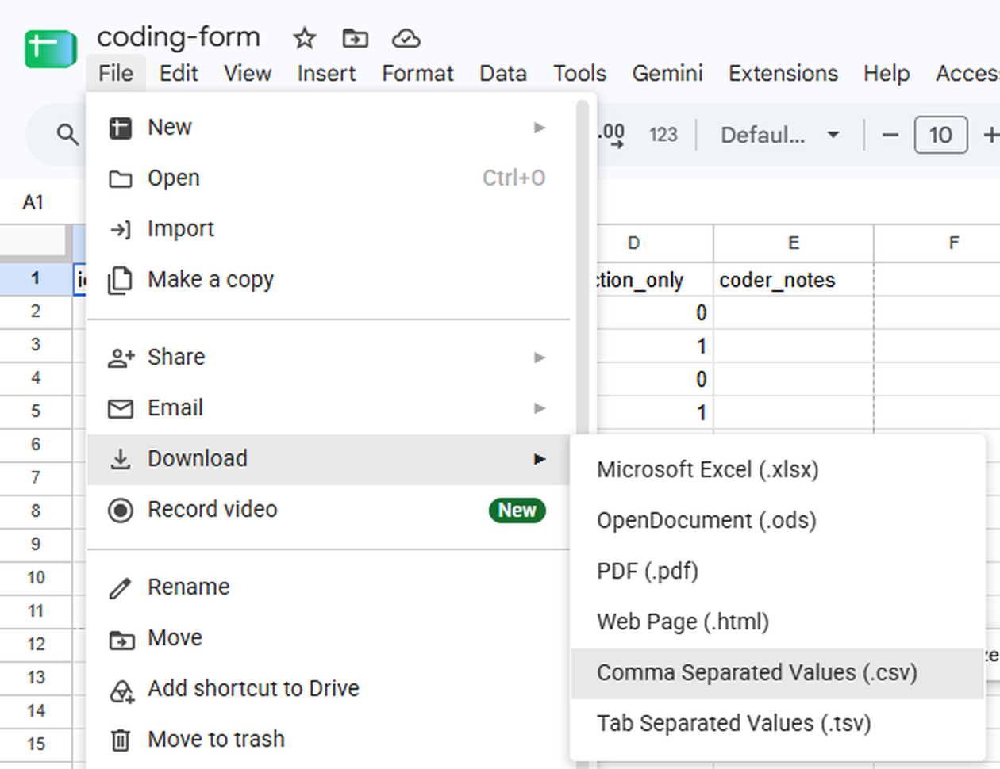
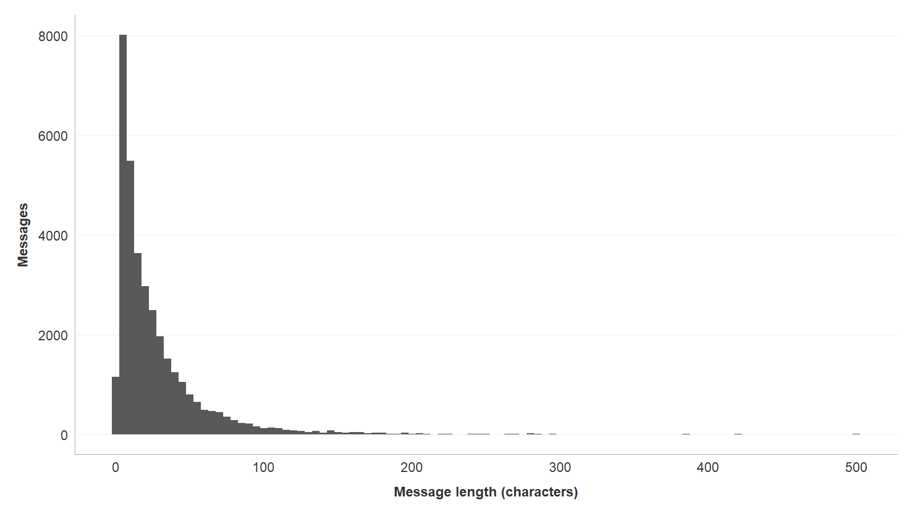
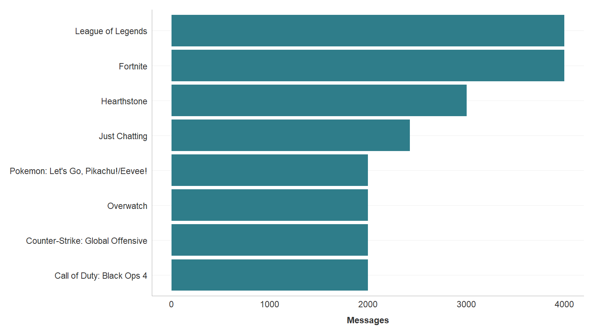
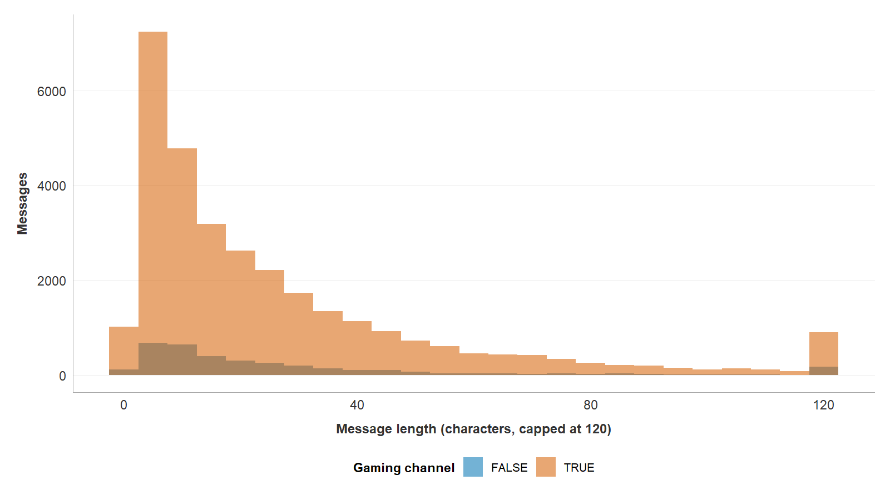

## Today's Agenda

- Coming up: what is due, and when
- Part 1: finish Data Wrangling, due Friday
    - Save your codes as a CSV, check the data folder, render, and upload
- Part 2: start the Describing Data worksheet
    - Load, summarize, draw, label, and save each figure

## Upcoming Assignments

| What | Due | Have done by |
|---|---|---|
| [Data Wrangling in R](https://aura-lab.siue.edu/v2v-hub/mc451-assignments.html#data-wrangling-in-r), 50 points | Fri, Nov 13, 11:59 PM | Codes saved as a CSV today |
| [Describing Data in R](https://aura-lab.siue.edu/v2v-hub/mc451-assignments.html#describing-data-in-r), 75 points | Fri, Nov 20, 11:59 PM | Started today, after Data Wrangling renders |
| [Weekly reading journal](https://aura-lab.siue.edu/v2v-hub/mc451-assignments.html#weekly-reading-journal) | Fri, Nov 13 and Fri, Nov 20, 11:59 PM | Chapter 12, then Chapter 13 |

No class Nov 23 to 29: Thanksgiving Break.

## Upcoming Assignments (cont.)

| What | Due | Have done by |
|---|---|---|
| [Inferencing Data in R](https://aura-lab.siue.edu/v2v-hub/mc451-assignments.html#inferencing-data-in-r), 100 points | Fri, Dec 4, 11:59 PM | Taught Nov 17 and 19 |
| Coded dataset pushed ([White Paper](https://aura-lab.siue.edu/v2v-hub/mc451-assignments.html#white-paper) dated step) | Fri, Dec 4, 11:59 PM | First coding pass done by Tue, Dec 1 |
| Week 15 reading journal | Fri, Dec 4, 11:59 PM | Chapter 14 |
| [White Paper](https://aura-lab.siue.edu/v2v-hub/mc451-assignments.html#white-paper), 250 points | Fri, Dec 18, 11:59 PM | Results built from your own data |

## Where You Should Be Starting

- If the check at the end of worksheet Part 7 prints `35267`, Data Wrangling is nearly done
    - Render it, upload it, then start Part 2
- If not, Part 1 first: it walks the last steps of Data Wrangling
- Work in the worksheet, not in the console (the R terminal, where typed lines are not saved)

Say out loud when you are stuck. That is what this session is for.

## Part 1: Finish Data Wrangling {.titlecard}

## Save Your Codes as a CSV

[Data Wrangling worksheet, Task 0.3]{.eyebrow}

::: {.define}
**CSV:** a table saved as plain text, one row per line, with a comma between each column.
:::

- R reads your codes from `data/coding-form.csv`, so the file must be a CSV
- Google Sheets keeps your codes online, so you download them as a CSV
- Then you move that file into the `data` folder and name it `coding-form.csv`
- Keep the `id` column exactly as it is

## Download It as a CSV

1. In your coding sheet in Google Sheets, click **File**
2. Point to **Download**
3. Click **Comma Separated Values (.csv)**
4. The file lands in your **Downloads** folder

- Its name has the tab's name added, such as `coding-form - Sheet1.csv`
- You fix the name in VS Code, two slides from now

## Download It: What You See

{.run-figure fig-alt="Google Sheets with a sheet named coding-form open. The File menu is open with Download highlighted, and its submenu lists Microsoft Excel (.xlsx), OpenDocument (.ods), PDF (.pdf), Web Page (.html), Comma Separated Values (.csv), and Tab Separated Values (.tsv). The pointer rests on Comma Separated Values (.csv)."}

## Move It into the Data Folder

1. In the VS Code Explorer, right-click the old `coding-form.csv` inside `data`, click **Delete**, and confirm
2. Open your Downloads folder beside VS Code, as in [Put a Worksheet in Your Workspace](https://aura-lab.siue.edu/v2v-hub/guides/mc451/14-put-a-worksheet-in-your-workspace.html)
3. Drag the downloaded file onto the folder named **data** in the VS Code Explorer, and let go
4. Right-click the file inside `data`, click **Rename...**, type `coding-form.csv`, and press **Enter**

## Check the Coding Sheet in R

```r
read_csv("data/coding-form.csv") %>%
  glimpse()
```

- `read_csv()` reads a CSV file into a table
- `glimpse()` prints how many rows and columns it has, and each column's type
- `"data/coding-form.csv"` means: start in the folder open in VS Code, go into `data`, open `coding-form.csv`
    - The folder open in VS Code is the name at the top of the Explorer
- Run it from the worksheet or the R terminal: the start is the same

## Check the Coding Sheet: Output

```{.term .tall code-line-numbers="false" step="22-read-form"}
> read_csv("data/coding-form.csv") %>%
+   glimpse()
Rows: 30 Columns: 5
── Column specification ────────────────────────────────────────────────
Delimiter: ","
chr (2): channel, message
dbl (2): id, reaction_only
lgl (1): coder_notes

ℹ Use `spec()` to retrieve the full column specification for this data.
ℹ Specify the column types or set `show_col_types = FALSE` to quiet this message.
Rows: 30
Columns: 5
$ id            <dbl> 16240927, 182383, 19530370, 12102429, 7123505, 2…
$ channel       <chr> "bobross", "bobross", "bobross", "bobross", "bob…
$ message       <chr> "press F to bring back bob", "BIG TREE", "CoolSt…
$ reaction_only <dbl> 0, 0, 1, 0, 0, 0, 1, 1, 1, 0, 0, 1, 1, 1, 1, 0, …
$ coder_notes   <lgl> NA, NA, NA, NA, NA, NA, NA, NA, NA, NA, NA, NA, …
```

- `Rows: 30`, `Columns: 5`, and `reaction_only` as `<dbl>` (a number): the sheet is right

## When the Check Goes Wrong

- Same line, when the downloaded file still has its long name

```r
read_csv("data/coding-form.csv") %>%
  glimpse()
```

## When the Check Goes Wrong: Output

```{.term code-line-numbers="false"}
> read_csv("data/coding-form.csv") %>%
+   glimpse()
Error: 'data/coding-form.csv' does not exist in current working directory ('C:/Users/you/Documents/mc451-workspace').
```

- `does not exist`: no file in `data` has exactly that name
- The folder in brackets is the one open in VS Code; yours shows your own

## Find the Name It Has

```r
list.files("data")
```

- `list.files("data")` lists every file in the `data` folder

## Find the Name It Has: Output

```{.term code-line-numbers="false"}
> list.files("data")
[1] "coding-form - Sheet1.csv" "twitch_analysis.RDS"
```

- The download kept its long name
- Rename it to `coding-form.csv` in the VS Code Explorer, then run the check again

## Where R Starts

```r
list.files()
```

- `list.files()` lists what is in the folder R started in
- In your workspace, R starts in the folder open in VS Code
    - That folder's name is at the top of the Explorer
    - It does not matter which file you run a line from

## Where R Starts: Output

```{.term code-line-numbers="false" step="20-list-top"}
> list.files()
 [1] "_templates"              "00-check-your-setup.qmd"
 [3] "00_Inbox"                "01_Journal"
 [5] "02_Literature"           "03_Project"
 [7] "04_Resources"            "11-wrangling-data.qmd"
 [9] "data"                    "LICENSE"
[11] "README.md"
```

- The same names as your Explorer: R started in the workspace's top folder
- `data` is in the list, beside `README.md`

## No Data Folder?

- Older copies of the workspace came without a `data` folder
- Data Wrangling Task 0.2 makes it when you run that chunk
- To make it by hand:
    1. In the Explorer, right-click the empty space below the file list (on a Mac, Control-click)
    2. Select **New Folder...**
    3. Type `data` and press **Enter** (**Return** on a Mac)
- It worked if `data` sits beside `README.md`, not inside another folder

## What Is in the Data Folder

```r
list.files("data")
```

- `"data"` again means: start in the folder open in VS Code, go into `data`
- Run this before you submit Data Wrangling

## What Is in the Data Folder: Output

```{.term code-line-numbers="false" step="21-list-data"}
> list.files("data")
[1] "coding-form.csv"     "twitch_analysis.RDS"
```

- `coding-form.csv`: your thirty codes, saved as a CSV
- `twitch_analysis.RDS`: the table Part 7 saved
- Both files go to Blackboard with the worksheet

## Check the Saved Table

```r
read_rds("data/twitch_analysis.RDS") %>%
  nrow()
```

- The last line of worksheet Part 7
- `read_rds()` loads the saved file back, and `nrow()` counts its rows

## Check the Saved Table: Output

```{.term code-line-numbers="false" step="24-rds-check"}
> read_rds("data/twitch_analysis.RDS") %>%
+   nrow()
[1] 35267
```

- `35267`: one row per chat message, nothing lost and nothing added
- Describing Data and Inferencing Data both start from this file

## Render: The Final Check

- Rendering runs the whole worksheet from the top, in a fresh R session
- If it renders, it runs

1. Save the worksheet: **File**, then **Save**
2. Open the Command Palette: **View**, then **Command Palette...**
3. Type `Quarto: Render Document` and press **Enter**
4. If a list of formats opens, select **Render HTML**

## Render: Output

The last line of the Terminal panel:

```{.term code-line-numbers="false"}
Output created: 11-wrangling-data.html
```

- `Output created` means it worked
- `11-wrangling-data.html` appears beside the worksheet in the Explorer

## Render Starts in the File's Folder

- Running lines starts in the folder open in VS Code
- Render starts in the folder the **`.qmd` file** is saved in
- Saved in the top folder, beside `README.md`: both starts are the same folder
- Saved inside another folder, such as `03_Project`: render looks for `data` inside that folder, and stops

## Render Starts in the File's Folder: Output

The same worksheet, saved in `03_Project` and rendered:

```{.term .tall code-line-numbers="false"}
Error:
! 'data/coding-form.csv' does not exist in current working directory ('C:/Users/you/Documents/mc451-workspace/03_Project').
Backtrace:
    ▆
 1. ├─read_csv("data/coding-form.csv") %>% clean_names()
 2. ├─janitor::clean_names(.)
 3. ├─readr::read_csv("data/coding-form.csv")
 4. │ └─vroom::vroom(...)
 5. │   └─vroom:::vroom_(...)
 6. └─vroom (local) `<fn>`("data/coding-form.csv")
 7.   └─vroom:::check_path(path)

Quitting from 11-wrangling-data.qmd:425-429 [read-codes]
Execution halted
```

- The folder in brackets ends in `03_Project`: that is where render started
- The fix: drag the worksheet up to the top folder, beside `README.md`, and render again

## What to Upload

[Data Wrangling in R, Blackboard]{.eyebrow}

- One ZIP file of your whole workspace, the folder open in VS Code, holding:
    - `11-wrangling-data.qmd`, with no `___` left
    - `11-wrangling-data.html`, the rendered page
    - `data/coding-form.csv`, your thirty codes
    - `data/twitch_analysis.RDS`, the saved table
    - The AI-use log, saved beside `README.md`, with an entry or the no-AI box checked
- Make the ZIP file: [Submit Your Work as One ZIP File](https://aura-lab.siue.edu/v2v-hub/guides/mc451/11-render-a-quarto-document.html#submit-your-work-as-one-zip-file)

## Part 2: Start Describing Data {.titlecard}

## Today's Job

[Describing Data, 75 points, due Friday, November 20, 11:59 PM]{.eyebrow}

- Tuesday you watched three figures being built on the example data
- Today you fill the Describing Data worksheet, with help in the room
    - The same moves on your own data become your White Paper's Results section
- In VS Code's Explorer, open `12-describing-data-mc451.qmd`, saved in your workspace's top folder beside `README.md`
    - [A fresh copy of the worksheet](https://aura-lab.siue.edu/v2v-hub/starters/12-describing-data-mc451.qmd), if you need one
- [Describing Data risks guide](https://aura-lab.siue.edu/v2v-hub/resources/risks/describing-data.html)

## Loading and Looking

```r
library(tidyverse)
library(v2v)
analysis <- read_rds("data/twitch_analysis.RDS")
```

- `library()` switches a package on for this session
- `read_rds()` loads the table Data Wrangling saved and names it `analysis`
- The R Companion writes these lines too: in its panel, under **Data**, **Load your saved analysis (RDS)**

## Loading and Looking: Output

```{.term .tall code-line-numbers="false" step="01-setup"}
> library(tidyverse)
── Attaching core tidyverse packages ──────────────── tidyverse 2.0.0 ──
✔ dplyr     1.1.4     ✔ readr     2.1.6
✔ forcats   1.0.1     ✔ stringr   1.6.0
✔ ggplot2   4.0.1     ✔ tibble    3.3.0
✔ lubridate 1.9.4     ✔ tidyr     1.3.1
✔ purrr     1.2.0
── Conflicts ────────────────────────────────── tidyverse_conflicts() ──
✖ dplyr::filter() masks stats::filter()
✖ dplyr::lag()    masks stats::lag()
ℹ Use the conflicted package (<http://conflicted.r-lib.org/>) to force all conflicts to become errors
> library(v2v)
v2v 0.3.9 loaded.
  setup()  checks that R, Quarto and Git are ready
  ?v2v     lists what this package gives you
> analysis <- read_rds("data/twitch_analysis.RDS")
```

- The two `masks` lines are normal, not errors
- `read_rds()` prints nothing: the table went into `analysis` quietly

## A First Look

```r
glimpse(analysis)
```

- `glimpse()` prints every column with its type and its first few values
- Before you plot anything, look at what you actually have

## A First Look: Output

```{.term .tall code-line-numbers="false" step="02-glimpse"}
> glimpse(analysis)
Rows: 35,267
Columns: 16
$ id             <dbl> 89, 551, 1033, 2094, 2803, 10406, 16104, 22571,…
$ channel        <chr> "sodapoppin", "xqcow", "forsen", "sodapoppin", …
$ sender         <chr> "madzee", "prometheanow", "spectre155", "itsjer…
$ message        <chr> "???????????????????????", "TriEasy Clap TriEas…
$ date           <dbl> 1.542578e+12, 1.542578e+12, 1.542578e+12, 1.542…
$ ts             <dttm> 2018-11-18 21:55:27, 2018-11-18 21:55:35, 2018…
$ message_length <int> 23, 441, 8, 12, 206, 37, 6, 7, 4, 7, 3, 4, 12, …
$ snapshot_ts    <dttm> NA, NA, NA, NA, NA, 2018-11-18 21:56:40, 2018-…
$ game           <chr> NA, NA, NA, NA, NA, "Artifact", "Marble It Up!"…
$ viewers        <int> NA, NA, NA, NA, NA, 15300, 28076, 4703, 19239, …
$ main_game      <chr> "Hand Simulator", "Just Chatting", "The Elder S…
$ is_gaming      <lgl> TRUE, FALSE, TRUE, TRUE, FALSE, TRUE, TRUE, TRU…
$ channel_type   <fct> gaming, non-gaming, gaming, gaming, non-gaming,…
$ median_viewers <dbl> 22944, 16176, 10163, 22944, 16176, 10163, 22944…
$ viewer_band    <fct> large, medium, medium, large, medium, medium, l…
$ reaction_only  <fct> NA, NA, NA, NA, NA, NA, NA, NA, NA, NA, NA, NA,…
```

- 35,267 rows and 16 columns
- `reaction_only` is `NA` except on your thirty coded messages

## Keep the Labeled Messages

```r
msglen <- analysis %>%
  filter(!is.na(is_gaming)) %>%
  mutate(length_shown = pmin(message_length, 120))
msglen %>%
  count(is_gaming)
```

- `filter()` drops the messages from channels with no gaming label
- `pmin()` keeps each length, but shows anything over 120 as 120
- `count(is_gaming)` checks how many messages each group has left

## Keep the Labeled Messages: Output

```{.term code-line-numbers="false" step="09-msglen"}
> msglen <- analysis %>%
+   filter(!is.na(is_gaming)) %>%
+   mutate(length_shown = pmin(message_length, 120))
> msglen %>%
+   count(is_gaming)
# A tibble: 2 × 2
  is_gaming     n
  <lgl>     <int>
1 FALSE      3457
2 TRUE      31309
```

- `FALSE` is non-gaming: 3,457 messages
- `TRUE` is gaming: 31,309 messages

## A Summary Table First

```r
msglen %>%
  group_by(is_gaming) %>%
  summarize(
    n      = sum(!is.na(message_length)),
    mean   = mean(message_length, na.rm = TRUE),
    median = median(message_length, na.rm = TRUE),
    sd     = sd(message_length, na.rm = TRUE),
    .groups = "drop"
  )
```

- One row per group: the count, the mean, the median, and the standard deviation (sd)

## A Summary Table First: Output

```{.term code-line-numbers="false" step="12-summary"}
> msglen %>%
+   group_by(is_gaming) %>%
+   summarize(
+     n      = sum(!is.na(message_length)),
+     mean   = mean(message_length, na.rm = TRUE),
+     median = median(message_length, na.rm = TRUE),
+     sd     = sd(message_length, na.rm = TRUE),
+     .groups = "drop"
+   )
# A tibble: 2 × 5
  is_gaming     n  mean median    sd
  <lgl>     <int> <dbl>  <int> <dbl>
1 FALSE      3457  33.7     16  60.7
2 TRUE      31305  28.5     17  38.5
```

- The worksheet runs the same summary by channel type and by your hand-coded variable

## Exercise: Which Typical Length? {.discuss}

| Channels   | Messages | Mean | Median |
|------------|----------|------|--------|
| Non-gaming | 3,457    | 33.7 | 16     |
| Gaming     | 31,305   | 28.5 | 17     |

- Message length is counted in characters
- Someone asks how long a typical non-gaming message is: do you answer with the mean or the median, and why?

## A Cross-Tabulation

[Example data: episodes_analysis.RDS, Power Rangers episodes coded for threat and focus](https://aura-lab.siue.edu/v2v-hub/resources/examples/own-study-walkthrough/episodes_analysis.RDS)

::: {.define}
**Cross-tabulation:** a grid that counts every combination of two categories.
:::

```r
episodes <- read_rds("data/episodes_analysis.RDS")

episodes %>%
  filter(!is.na(focus)) %>%
  count(threat, focus) %>%
  pivot_wider(names_from = focus,
              values_from = n,
              values_fill = 0)
```

- `count()` with two columns: one row per combination
- `pivot_wider()` turns those rows into a grid, one column per `focus` code

## A Cross-Tabulation: Output

```{.term code-line-numbers="false" step="34-own-crosstab"}
> episodes <- read_rds("data/episodes_analysis.RDS")
>
> episodes %>%
+   filter(!is.na(focus)) %>%
+   count(threat, focus) %>%
+   pivot_wider(names_from = focus,
+               values_from = n,
+               values_fill = 0)
# A tibble: 3 × 4
  threat   team one_ranger other
  <fct>   <int>      <int> <int>
1 monster    15         21     1
2 villain    29         18     9
3 none       10         13     3
```

- One row per `threat` code, one column per `focus` code
- 15 episodes were coded `monster` and `team`
- Worksheet Task 3.1 builds the same kind of grid from the Twitch table

## Shares Within Each Row

```r
episodes %>%
  filter(!is.na(focus)) %>%
  count(threat, focus) %>%
  group_by(threat) %>%
  mutate(share = round(n / sum(n), 3))
```

- `group_by(threat)` makes `sum(n)` add up within each `threat` code
- So each code's shares add up to 1

## Shares Within Each Row: Output

```{.term .tall code-line-numbers="false" step="35-own-shares"}
> episodes %>%
+   filter(!is.na(focus)) %>%
+   count(threat, focus) %>%
+   group_by(threat) %>%
+   mutate(share = round(n / sum(n), 3))
# A tibble: 9 × 4
# Groups:   threat [3]
  threat  focus          n share
  <fct>   <fct>      <int> <dbl>
1 monster team          15 0.405
2 monster one_ranger    21 0.568
3 monster other          1 0.027
4 villain team          29 0.518
5 villain one_ranger    18 0.321
6 villain other          9 0.161
7 none    team          10 0.385
8 none    one_ranger    13 0.5
9 none    other          3 0.115
```

- `one_ranger`: 0.568 of the `monster` episodes, 0.321 of the `villain` ones

## Explain This Stage to the Client

- The worksheet ends with one paragraph to the client
    - A channel manager at a small creator agency, about to pitch a sponsor
    - The manager does not read R
- Say what you counted, measured, and charted
- Name the numbers that matter for their three questions
- Say what it does not show yet: whether a difference is bigger than chance
- No R, no column names, no words the manager would have to look up

## Figure One, the Shape of One Variable

```r
ggplot(analysis, aes(x = message_length)) +
  geom_histogram(binwidth = 5) +
  labs(x = "Message length (characters)",
       y = "Messages") +
  v2v::theme_v2v()
```

- One variable, one histogram; each bar is five characters wide
- The R Companion writes a first version: in its panel, under **Describe**, **Histogram**

## Figure One: Output

{.run-figure fig-alt="A histogram of message length in characters for all messages. A tall stack of short messages under about 20 characters, about 8,000 in the tallest bar, then a long thin tail to the right that reaches past 500 characters."}

## Reading Your Own Histogram

- The Terminal also printed `Removed 4 rows`: the four empty messages, which have no length
- Find the tall stack. That is the typical case
- Look for a long thin tail, and note which direction it runs
    - **Right-skewed** means most values are small and a few are very large
    - A skewed variable is the reason the mean and the median disagreed
- If you capped the axis with `pmin()`, say so in the axis label

## Figure Two, Counts by Category

```r
analysis %>%
  count(main_game, sort = TRUE) %>%
  head(8) %>%
  ggplot(aes(x = fct_reorder(main_game, n), y = n)) +
  geom_col(fill = "#2f7d8a") +
  coord_flip() +
  labs(x = NULL, y = "Messages") +
  v2v::theme_v2v()
```

- Count the messages per category, biggest first, and keep the top eight
- `fct_reorder()` sorts the bars by size; `coord_flip()` turns them sideways so long names fit

## Figure Two: Output

{.run-figure fig-alt="A horizontal bar chart of messages for the eight categories with the most chat, longest bar at the top: League of Legends and Fortnite at 4,000, Hearthstone about 3,000, Just Chatting about 2,400, then Pokemon: Let's Go, Overwatch, Counter-Strike: Global Offensive, and Call of Duty: Black Ops 4 at 2,000 each."}

- Each channel gives the course sample at most 1,000 messages, so these bars mostly count channels
- Worksheet Task 4.1 is a different bar chart: one bar per viewer band, each scaled to 100%

## Figure Three, Two Groups Overlaid

```r
ggplot(msglen,
       aes(x = length_shown, fill = is_gaming)) +
  geom_histogram(binwidth = 5, position = "identity",
                 alpha = 0.55) +
  labs(x = "Message length (characters, capped at 120)",
       y = "Messages",
       fill = "Gaming channel") +
  v2v::scale_fill_v2v() +
  v2v::theme_v2v()
```

- `position = "identity"` with `alpha` overlays the two groups so their shapes can be compared

## Figure Three: Output

{.run-figure fig-alt="Two overlaid histograms of message length in characters, capped at 120, for gaming (TRUE) and non-gaming (FALSE) channels. Both pile up under 20 characters and thin out to the right, with a small spike in the last bar at 120. The non-gaming bars are so short they barely show."}

- By count, the small group barely shows
- The R Companion's **Histogram comparing two groups** draws each group as shares instead
- Worksheet Task 4.2 compares your two coded groups with a boxplot

## Labels Are Not Optional

- Default labels are column names, which mean nothing to a reader
- `labs()` sets them: `x`, `y`, and `fill` in Figure Three
- Every axis gets its units, and every cap is named in the label
    - "Message length (characters, capped at 120)"

## Colorblind-Safe by Default

- Roughly one man in twelve has a color-vision deficiency
    - Red against green is the notorious pair, and not the only one
- Use `scale_colour_v2v()` and `scale_fill_v2v()`, which are built to be safe
- Do not let color carry the message alone
    - Add a line type, or split the groups into panels
- If the figure fails in grayscale, it fails for some readers

## Alt Text, Written Not Skipped

::: {.define}
**Alt text:** a sentence that says what a chart shows, for a reader who cannot see it. A screen reader reads it aloud.
:::

- With no alt text, the figure is simply missing for a screen-reader user
- Alt text is not the caption repeated
- Alt text says the chart type, the axes, and what the chart shows
- In Quarto it goes in the figure's `fig-alt` attribute
- The R Companion's chart code leaves an `alt =` line marked YOUR TURN inside `labs()`, and a `fig-alt` line when it opens a new chunk: write the sentence in both

## Saving Figures for the Paper

```r
dir.create("figures", showWarnings = FALSE)
ggsave(
  "figures/fig-top-categories.png",
  width = 7, height = 4.5, dpi = 300
)
list.files("figures")
```

- `ggsave()` writes the last chart drawn to a file, at a size you set
- `"figures/..."` starts in the folder open in VS Code, like `data`

## Saving Figures for the Paper: Output

```{.term code-line-numbers="false" step="31-s24-ggsave"}
> dir.create("figures", showWarnings = FALSE)
> ggsave(
+   "figures/fig-top-categories.png",
+   width = 7, height = 4.5, dpi = 300
+ )
> list.files("figures")
[1] "fig-top-categories.png"
```

- `ggsave()` prints nothing when the size is set
- `list.files("figures")` shows the saved file

## Common Errors and What They Mean

- **`object 'analysis' not found`:** R has no object (no named result) called `analysis` yet: you never ran the load line
- **`cannot open the connection`**, with **`No such file or directory`** under it: `twitch_analysis.RDS` is not in the `data` folder beside `README.md`
- **`could not find function "ggplot"`:** the tidyverse has not loaded
- **A blank gray panel:** `aes()` names a column that does not exist
- **`Error in +`:** a `+` is missing, or one is trailing at the end
- **Everything piles onto one bar:** your x column is text, not a number

## Any Other Error

- Select the error R printed in the terminal, then press **Ctrl+C** (**Cmd+C** on a Mac) to copy it
- Click the **AURA Lab R Companion** icon on VS Code's left edge; under **Help**, click **Explain an R error**: the copied error is filled in for you

## Checkpoint

You should now have, in your Describing Data worksheet:

- A grouped summary with n, mean, median, and sd
- The worksheet's figures, each using `theme_v2v()` and fully labeled
- Alt text drafted for each figure
- One sentence under each figure saying what it shows

## Before Next Time

- Due Friday, November 13, 11:59 PM: [Data Wrangling in R](https://aura-lab.siue.edu/v2v-hub/mc451-assignments.html#data-wrangling-in-r), 50 points
    - One ZIP file of your workspace, holding the five files from "What to Upload"
- Due Friday, November 20, 11:59 PM: [Describing Data in R](https://aura-lab.siue.edu/v2v-hub/mc451-assignments.html#describing-data-in-r), 75 points
- Check your worksheet against the [Describing Data risks guide](https://aura-lab.siue.edu/v2v-hub/resources/risks/describing-data.html)
- Step by step: [Describe the Data: Tables and Charts](https://aura-lab.siue.edu/v2v-hub/guides/mc451/09-describing-tables-and-charts.html), with its [walkthrough video](https://siue.yuja.com/V/Video?v=17490672&a=193714265)

## Before Next Time (cont.)

- Read Chapter 13, "Making the call," before Tuesday
- Tuesday we answer the questions your figures only framed
    - Bring the summary table you built today
    - There is no new math to learn in advance
- Finish the first coding pass on your own full corpus by Tuesday, December 1, and push it by Friday, December 4, 11:59 PM
    - Your Methods reports stability from your pilot re-code; there is no second re-code
- **Check yourself on this week's terms:** [Week 12 self-check](https://aura-lab.siue.edu/v2v-hub/self-checks/mc451-week12.html), ungraded, with the answer after each question

## Questions, Comments, or Concerns? {.titlecard}
