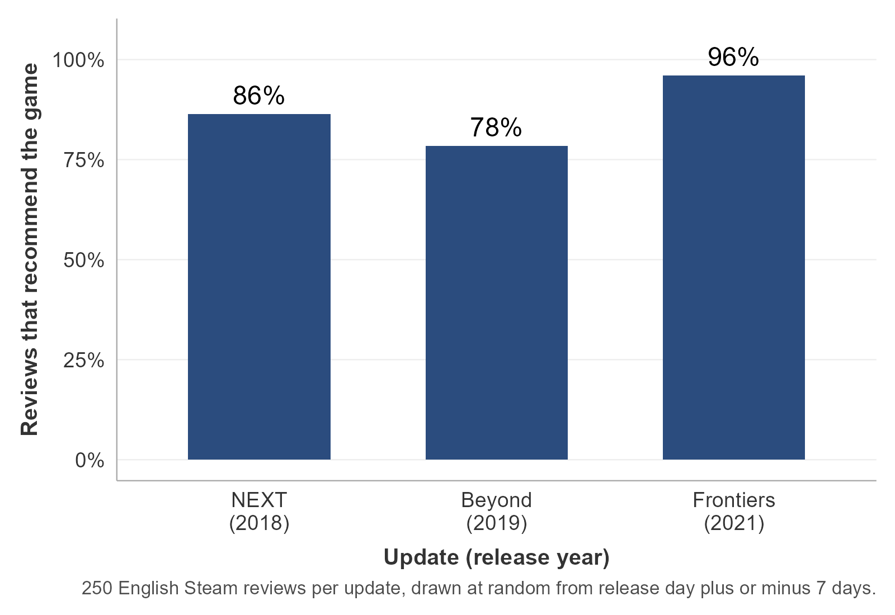
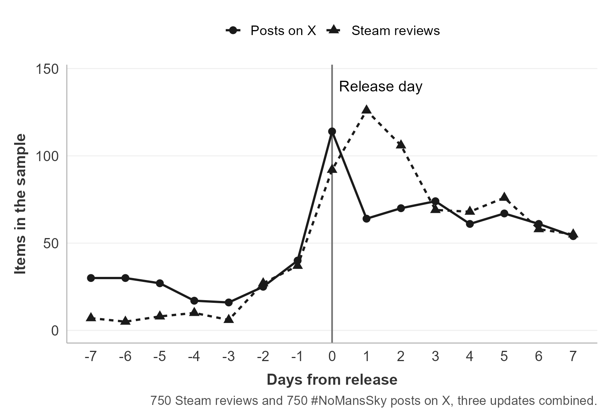

## Today's Agenda

- Your White Paper template
- A report that rebuilds itself
- IMRaD
- One study, four outputs
- Publishing the site

## Today's Starter File

- Click the [Chapter 14 starter file](https://aura-lab.siue.edu/v2v-hub/starters/14-publishing-your-paper.qmd) link: your browser saves 14-publishing-your-paper.qmd in your Downloads folder
- Move it into your workspace's top folder, next to README.md: [Put a Worksheet in Your Workspace](https://aura-lab.siue.edu/v2v-hub/guides/mc451/14-put-a-worksheet-in-your-workspace.html)
- It lists today's steps and what each one prints

## Your White Paper Template

- One folder, `white-paper`, with one file for each part of the paper
- Each file holds a gray note: what goes there, and what the rubric looks for
- You paste in your writing and your code, and the paper renders

::: {.define}
**Template:** a set of files already laid out, which you fill with your own work. Example: `02-methods.qmd` already has a heading for each piece the Methods row grades.
:::

## Get the Template

- Click the [MC 451 White Paper template](https://aura-lab.siue.edu/v2v-hub/starters/white-paper-mc451.zip): your browser saves `white-paper-mc451.zip` in your Downloads folder
- Right-click it, then **Extract All**, then **Extract** (on a Mac, double-click it)
- Move the `white-paper` folder into your workspace's top folder, next to README.md
- Step 2 of the Chapter 14 starter file walks each click

## Your Code Runs Unchanged

- The template runs its code from your workspace's top folder, where your worksheets run
- So a line from a worksheet works as it is:

```r
analysis <- read_rds("data/twitch_analysis.RDS")
```

- That line goes once, into the `setup` chunk at the top of `03-results.qmd`

## Where the Study Stands

- You have a question, a theory, and a tested codebook
- You have a defensible sample and a clean dataset
- You have three figures, and a test you ran in the Inference Lab
- The hardest parts are behind you, and the study is still not done

Scattered across a dozen files, the study is raw material, not a report.

## The Fragile Way to Write It Up

- Run the analysis in R
- Copy the numbers into a word processor
- Screenshot the figures and paste them in
- Write the prose around them

This works, and it is quietly fragile. Change one coding rule and every pasted number is
silently out of date, with nothing to tell you so.

## A Report That Rebuilds Itself

- Stop copying. Put the analysis inside the document
    - A **Quarto document** interleaves prose with **code chunks**
    - Rendering runs every chunk and places its output where the chunk sits
- Tables, figures, and statistics all arrive from the code

Nothing is typed by hand, so nothing can fall out of date.

## Numbers Computed Inline

```markdown
The analysis dataset held `r nrow(analysis)`
coded messages, of which `r n_labeled` carried
a gaming-status label.
```

- `n_labeled` comes from a chunk above the sentence:

```r
n_labeled <- analysis %>%
  filter(!is.na(is_gaming)) %>%
  nrow()
```

- Those backtick expressions become the actual counts in the rendered report
- Add a hundred messages to the data, re-render, and the sentence updates itself

## Figures Produced, Not Pasted

```r
#| label: fig-msglen
#| echo: false
#| fig-cap: "Message length by channel type."
#| fig-alt: "YOUR TURN: what this chart shows."
analysis %>%
  filter(!is.na(is_gaming)) %>%
  ggplot(aes(x = message_length, fill = is_gaming)) +
  geom_histogram(binwidth = 5) +
  v2v::theme_v2v()
```

The histogram is a chunk that redraws itself on every render. `echo: false` hides the code
and shows only the plot.

## Exercise: The Typed Number {.discuss}

- A draft sentence, typed by hand: "Non-gaming messages averaged 33.7 characters; gaming messages averaged 28.5"
- Next week the data gain 200 more coded messages
- Which numbers in that sentence are now wrong, with nothing in the report to warn you?

## Why a Reproducible Report Matters

- The report cannot drift from the analysis, because the report is the analysis
- Anyone with your source files and your data can render your results
    - That is the standard a scientific claim is meant to meet
- Knuth named this idea literate programming in 1984
    - Runnable code and the prose that explains it belong in one document

## IMRaD, the Shape of a Report

**I**ntroduction, **M**ethods, **R**esults, **D**iscussion, in that fixed order.

- It carries a reader from why, to what was done, to what was found, to what it means
- An abstract sits in front, and the references close it
- The template already holds the section files: `01-introduction.qmd` through `05-reflection.qmd`, with `index.qmd` for the abstract and `references.qmd`

## Introduction and Methods

- **Introduction:** the question, and why it is worth asking
    - For the example study: do the two kinds of channel differ in message length, and what does theory lead you to expect?
- **Methods:** what was done, in enough detail for someone else to repeat it
    - The codebook, the sampling, the reliability check, and the wrangling
- Methods is the section that earns the reader's trust

## Results and Discussion

- **Results:** what was found, without interpretation
    - The figures, the group means, and the test with its degrees of freedom, *p*, and effect size
- **Discussion:** what the result means, and the study's limits
    - For the example study: a real difference, but a negligible one
- A model write-up for each test: [Chapter 13](https://aura-lab.siue.edu/v2v/chapters/chapter13.html)

## One Book, Many Chapters

- The report is not the only document the study produced
    - The codebook, the sampling record, and the wrangling log are documents too
- They become chapters of one Quarto book, not one enormous file
- `_quarto.yml` lists the chapters in order: the five section files, the references, and your codebook as an appendix
- Rendering the project builds every chapter into one website and one PDF: Step 10 of the Chapter 14 starter file runs it

## Publishing Is More Than a Paper

- Your White Paper is one way to publish a study
- Most people in mass communication publish research in other forms
    - A campaign brief, a news story, a video
- Same data, a different reader, a different form

## One Study, Four Outputs

[aura-lab.siue.edu/v2v-hub/resources/examples/track-versions](https://aura-lab.siue.edu/v2v-hub/resources/examples/track-versions/){.eyebrow}

- No Man's Sky: a video game rebuilt through free updates after a rough 2016 launch
- The question: how did players respond to three updates, NEXT in 2018, Beyond in 2019, and Frontiers in 2021?
- The data: 750 Steam reviews and 750 posts on X, drawn at random from each release week

## What the Reviews Said

{fig-alt="A bar chart of the share of Steam reviews that recommend No Man's Sky for three updates. NEXT in 2018 is 86 percent, Beyond in 2019 is 78 percent, and Frontiers in 2021 is 96 percent, the tallest bar." width="70%"}

- Chi-square(2, N = 750) = 34.18, *p* < .001, Cramer's V = .21

## When Players Talked

{fig-alt="A line chart of items per day from seven days before release to seven days after, three updates combined. Posts on X jump to 114 on release day. Steam reviews reach 92 on release day and peak at 126 the day after, then both settle between about 55 and 75 a day." width="70%"}

## Two More Findings

- Reviews that did not recommend the game ran longer: 92.7 words against 57.6 (*d* = 0.38)
- Their writers had played less: a median of 13.6 hours against 37.9
- Posts on X with an image or video drew more likes: a median of 2 against 1

## As a White Paper

- Leads with the question and the theory
- Every test in full: chi-square(2, N = 750) = 34.18, *p* < .001, V = .21
- Written for researchers, who check the method
- Your own paper is this output

## Strategic Communication: The Brief

- Leads with what to do next, for a client's next launch
- **Insight:** unhappy reviewers had played under 14 hours, so help new players through their first ten
- **Timing:** put the effort on release day and the day after
- **KPI:** the share of reviews that recommend the game in week one

::: {.define}
**KPI (key performance indicator):** the number a team agrees to watch to judge whether a campaign worked. Example: the share of week-one reviews that recommend the game.
:::

## Strategic Communication: The Calendar

| Day | Post | Why, from the data |
|:--|:--|:--|
| -1 | Reminder with a video clip | Posts with images or video drew more likes |
| 0 | Launch post with video | Posts on X peak on release day |
| 1 | New-player guide | Reviews peak the day after; unhappy reviewers had played less |
| 2 | Patch notes and fixes | 43 percent of reviews arrive by day 2 |

## Journalism: The Story

- **Headline:** Players warmed most to No Man's Sky's Frontiers update
- **Lede:** 96 percent of sampled reviews recommended it, more than for two earlier updates
- "Larger than chance would produce, though modest in size" stands in for *p* and V
- The limits get one plain paragraph: only players who chose to write are counted

## Journalism: The Numbers Box

- **750** Steam reviews and **750** posts on X
- **96%** of Frontiers reviews recommended the game (Beyond: **78%**)
- **126** reviews on the day after release, the busiest day
- **0** reviews answered by the developer
- A source line under the box says where the numbers came from

## Media Production: The Treatment

- **Logline:** a game that failed at launch tries to win its players back, one update at a time
- Three acts, one per update: 86 percent, then 78, then 96
- In every act, reviews peak within two days of release: the beat the film repeats
- No review is read aloud word for word; the film paraphrases

## Media Production: Sixty Seconds

| Seconds | On screen |
|:--|:--|
| 0 to 5 | "Do players forgive a game?" |
| 5 to 20 | The bar chart builds: 86%, 78%, 96% |
| 20 to 35 | The line chart, release day marked |
| 35 to 50 | "13.6 hours" beside "37.9 hours" |
| 50 to 60 | The source, and one limit said aloud |

## Four Outputs, Side by Side

| Output | Leads with | Where the numbers go |
|:--|:--|:--|
| White Paper | The question and theory | Every test, in full |
| Brief | What to do next | Three numbers that drive the plan |
| News story | What happened | Two in the story, the rest in a box |
| Video | The story arc | On screen, one at a time |

## All Four, in Full

- [One Study, Four Outputs](https://aura-lab.siue.edu/v2v-hub/resources/examples/track-versions/): the study, its findings, and the White Paper abstract
- [Strategic Communication and Advertising](https://aura-lab.siue.edu/v2v-hub/resources/examples/track-versions/strategic-communication.html): a brief, a calendar, and an insight sheet
- [Journalism](https://aura-lab.siue.edu/v2v-hub/resources/examples/track-versions/journalism.html): a story, a numbers box, and a social post
- [Media Production](https://aura-lab.siue.edu/v2v-hub/resources/examples/track-versions/media-production.html): a treatment, a pitch, and a sixty-second video plan

## Going Live

- A site in a folder on a laptop is still private
    - Publishing means giving the site a public address
- The standard free option is GitHub Pages
- Your paper's address goes into the White Paper submission, beside one ZIP file holding the paper PDF and your AI-use log

## Publish in Two Steps

- Commit and push first: [Commit and Push with Git](https://aura-lab.siue.edu/v2v-hub/guides/mc451/12-commit-and-push-with-git.html)
- Then `v2v::deploy_portfolio(project)` runs the checks and publishes the site: Steps 12 and 13 of the Chapter 14 starter file
    - `project` is your White Paper folder's name, set in Step 2 of that file
- When it finishes, your paper is live at your repository's GitHub Pages address

## The Pre-Flight Checks

```r
v2v::deploy_portfolio(project)
```

```
── Pre-flight checks ──
ℹ No renv.lock found - skipping renv check
✔ no uncommitted changes
✔ _quarto.yml valid
──────────────────────
✔ Rendering 9 pages
Publish to GitHub Pages? [y/N] y
✔ Publishing to GitHub Pages
ℹ Published to https://your-username.github.io/your-repository/
✔ Portfolio live on GitHub Pages.
```

## The Pre-Flight Checks (cont.)

- Commit and push first, or the second check stops you ([Commit and Push with Git](https://aura-lab.siue.edu/v2v-hub/guides/mc451/12-commit-and-push-with-git.html))
- Three checks run first. Only if none fails does the book render
- It publishes only after you click in the R terminal, type `y`, and press **Enter**
- The renv check is skipped here because the course scaffold has no `renv.lock`

## What renv Is

::: {.define}
**renv:** an R package that records the exact version of every package your project uses in a file called `renv.lock`, so those same versions can be installed again later. Example: the first pre-flight check compares your installed packages against `renv.lock`.
:::

## Why the Checks Exist

- **renv in sync:** the site is built with the package versions your source declares, checked only when the project has a `renv.lock`
- **No uncommitted changes:** every saved change is also committed (a snapshot Git records and sends to GitHub), so the live site matches your files
- **`_quarto.yml` found:** R is pointed at your White Paper folder, not the workspace around it
- Each check heads off one specific, demoralizing failure

The last step of a long study should be the calm one.

## Before Next Time

- Thursday is a studio: peer review, and the reflection
- Bring a rendered draft, not notes toward one
    - It does not have to be finished. It has to render
- Bring your public URL, or the error message that is stopping you
- Step by step: [Render a Quarto Document](https://aura-lab.siue.edu/v2v-hub/guides/mc451/11-render-a-quarto-document.html), [Commit and Push with Git](https://aura-lab.siue.edu/v2v-hub/guides/mc451/12-commit-and-push-with-git.html), and [Publish Your Site](https://aura-lab.siue.edu/v2v-hub/guides/mc451/13-publish-your-site.html)

## Coming Due

- Due Friday, December 4, 11:59 PM: [Inferencing Data in R](https://aura-lab.siue.edu/v2v-hub/mc451-assignments.html#inferencing-data-in-r), 100 points
- Due Friday, December 4, 11:59 PM: your full coded corpus, pushed to your project repository ([White Paper dated step](https://aura-lab.siue.edu/v2v-hub/mc451-assignments.html#white-paper))
- Due Friday, December 18, 11:59 PM: [White Paper](https://aura-lab.siue.edu/v2v-hub/mc451-assignments.html#white-paper), 250 points

## Questions, Comments, or Concerns? {.titlecard}
