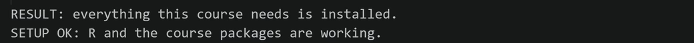
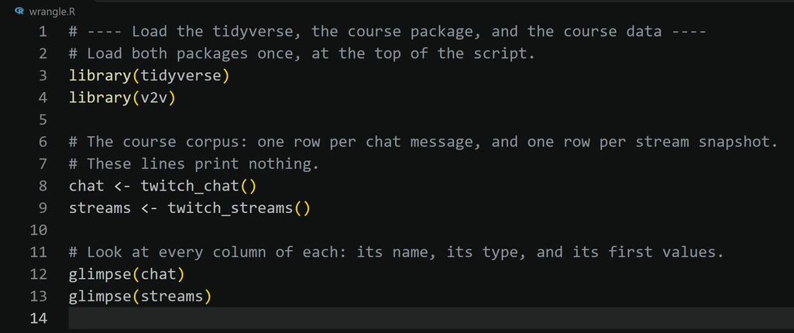
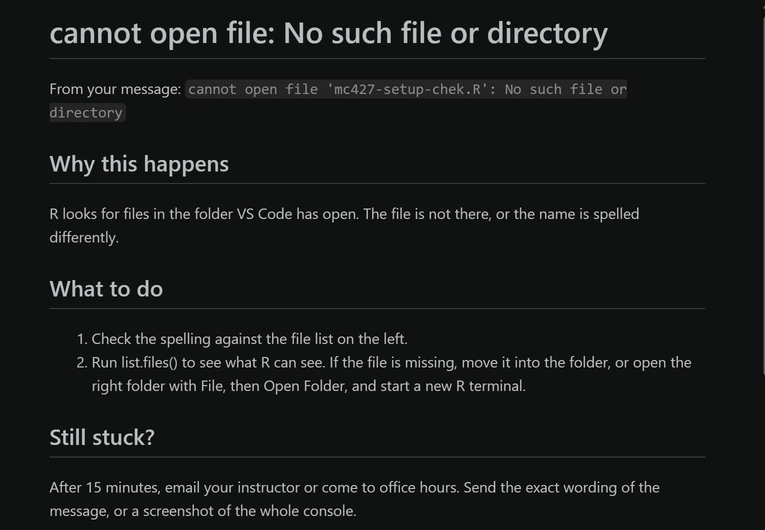

## Today's Agenda

- Install the AURA Lab R Companion and check your setup
- Build a project workspace that holds the whole study
- Write a provenance statement: a disclosure of where your data came from
- Load the shared example data and inspect it column by column
- Read the data against your codebook

## Meet the R Companion

- A free VS Code extension built for this course
    - Checks your setup and installs what is missing
    - Writes commented R code into your own script from menus
    - Explains R error messages in plain language
- Everything it writes is ordinary R you can read, explain, and cite in your provenance record
- It is not an AI tool, so using it needs no AI-use log entry

## Installing the Companion

- **Open the Extensions view:** Ctrl+Shift+X, or Cmd+Shift+X on a Mac
- Search for AURA Lab R Companion, then select Install
- Select View, then Command Palette, and run AURA: Check my setup
    - If it asks which course you are in, pick **MC 501 Research Methods (graduate)**
    - If a line says MISSING, run **AURA: Install what is missing**
- Every Companion command starts with **AURA:** in the Command Palette
- Step-by-step guide: [Check your setup](https://aura-lab.siue.edu/v2v-hub/guides/mc501/01-check-your-setup.html)

## What We Build Today

- **Due Monday, November 2, 11:59 PM:** Extended Codebook and Reliability Protocol
- A project workspace that holds the study in one folder
    - Your codebook installed as the rendered rulebook
    - The shared Twitch example data loaded and inspected
- **Assigned reading:** Munafo et al. (2017)

Tonight is the gentlest possible evening in R: you load data and look at it. Every step you
practice on the example data is a step you repeat on your own source.

## Why the Workspace Comes First

- Reproducible research depends on traceability
    - Files live in known places, not in commands typed once
- A project is one folder for one study
    - Data, code, codebook, and report travel together
    - Nothing depends on a file that exists only on your laptop
- Your Week 15 White Paper renders from this folder

## Scaffolding the Project

- Download the starter and save it in the top folder of your workspace, next to `README.md`
    - [aura-lab.siue.edu/v2v-hub/starters/09-coding-the-codebook.qmd](https://aura-lab.siue.edu/v2v-hub/starters/09-coding-the-codebook.qmd)
- In Step 4, change the name inside the quotes to one about your own study
    - Lowercase letters and hyphens, no spaces
- Click Run Cell on Step 3, then on Step 4
    - A green check appears, and a folder with your project's name joins the Explorer

What Step 4 runs for you:

```r
v2v::new_portfolio("twitch-portfolio")
```

## What the Scaffold Contains

```
twitch-portfolio/
├── _quarto.yml
├── index.qmd
├── 01-introduction.qmd ... 05-reflection.qmd
├── references.qmd, references.bib
├── codebook/codebook.qmd
├── R/
├── journals/week-01.qmd
├── data/raw/, data/derived/
└── figures/
```

The scaffold decides where every file goes and what it is named. The five numbered files are
the sections of your White Paper, already in order. An hour lost to file layout is an hour not
spent on the study.

## Confirming the Stack

- Run AURA: Check my setup from the Command Palette
    - It checks R, Quarto, Git, and every package this course uses
    - If a line says MISSING, run **AURA: Install what is missing**
- You met this check in Chapter 2, at installation
- Run it as a habit, every time you open a project
    - It reports a missing piece before that piece interrupts you

{fig-alt="The R Companion's Output panel after Check my setup. Two lines read: RESULT: everything this course needs is installed. SETUP OK: R and the course packages are working." width="100%"}

## The Codebook Becomes a Document

- One of the scaffolded files is `codebook/codebook.qmd`
    - Start it from your Definitions Practice: each variable's definitions and decision rules
    - Add a version line and a date
    - A codebook that renders has no broken structure
- What changes tonight is the codebook's status, not its content
    - It stops being a sketch and becomes the instrument

## What Monday Asks For

- **One document, two headed parts:** Extended Codebook and Reliability Protocol
    - The codebook, 1,200 to 2,000 words
    - The reliability protocol, 500 to 900 words
- **The protocol's five parts:** the statistic and its threshold, the stability procedure and a fresh sample, when it fails and how you report it, single-coder safeguards, and the second-coder counterfactual
- **The template carries every part as a heading:** [Word](https://aura-lab.siue.edu/v2v-hub/resources/templates/MC501-codebook-template.docx) or [Quarto](https://aura-lab.siue.edu/v2v-hub/resources/templates/MC501-codebook-template.qmd)
    - The Quarto version can serve as your `codebook/codebook.qmd`
- [Rubric](https://aura-lab.siue.edu/v2v-hub/resources/rubrics/MC501-rubric-extended-codebook-and-reliability-protocol.pdf), [worked example](https://aura-lab.siue.edu/v2v-hub/resources/examples/MC501-example-extended-codebook-and-reliability-protocol.pdf), and the [AI-use log](https://aura-lab.siue.edu/v2v-hub/resources/AI-use-log.docx)

## Loading the Data

- Run AURA: Write R code, then pick Load the course Twitch corpus under R2 Data
- The Companion writes a commented block into your script and runs it
    - It loads the tidyverse and the two example tables, named `chat` and `streams`
- Starter Step 8 holds the same block, with what it should print

What the Companion writes for you:

```r
library(tidyverse)
chat <- v2v::twitch_chat()
streams <- v2v::twitch_streams()
```

## What a Function Is

::: {.define}
**Function:** a named piece of code that does one job each time you call it, by writing its name followed by parentheses. Example: `v2v::twitch_chat()` hands back the chat table.
:::

- Whatever goes inside the parentheses tells the function what to work on, such as the file `read_csv()` should read

## Why a Function Call, Not a File Path

- A new user's first encounter with data is usually a pile of file-path errors
    - These functions reach inside the package and hand the data back
    - There is no path for you to get wrong
- The working sample is not the entire 2018 collection
    - The full collection runs to tens of millions of rows
    - What ships with the package is a working sample: real, and fast
- Your own source will be loaded from a file, with a path, using `read_csv()`
    - Every step after loading is the same

## The Companion Writes the Loading Block

{fig-alt="VS Code editor showing a script named wrangle.R. The R Companion inserted a commented block: library(tidyverse), library(v2v), chat <- twitch_chat(), streams <- twitch_streams(), glimpse(chat), and glimpse(streams)." width="100%"}

- The block arrives with its comments, so it can sit in a graded script
- It ends with `glimpse()` on each table, the look at the data the next slides read
- Step-by-step guide: [Load the course data](https://aura-lab.siue.edu/v2v-hub/guides/mc501/04-load-the-course-data.html)

## Provenance Is a Disclosure

::: {.define}
**Provenance:** a record of where your data came from and everything done to it since, so a stranger could trace it back to its source. Example: the platform, the channels, the dates, and how the messages were saved.
:::

- That record is written before the first line of analysis runs
- "I collected Twitch chat data" is not a methods section
- Replication requires exact knowledge of what was done, and the provenance record is that knowledge

## What a Provenance Sentence Looks Like

> I collected 14 days of Twitch chat from the top 10 most-viewed streams in the *Just
> Chatting* category, using Twitch API v2, between 2024-01-15 and 2024-01-28, saving raw
> JSON responses to `data/raw/` before any processing.

Every clause in that sentence is something a replicator would otherwise have to guess.
Write the same kind of sentence for your own source, whatever the platform.

## Munafo on Usability

> "Poor usability reflects difficulty in evaluating what was done, in reusing the
> methodology to assess reproducibility, and in incorporating the evidence into systematic
> reviews and meta-analyses."
>
> Munafo et al. (2017, p. 4)

- A study that can be found is not the same as a study that can be used
- A study can be public, cited, and still impossible to evaluate

## Exercise: Usability, Not Discoverability {.discuss}

[Munafo et al. (2017)]{.eyebrow}

> "Poor usability reflects difficulty in evaluating what was done, in reusing the
> methodology to assess reproducibility, and in incorporating the evidence into systematic
> reviews and meta-analyses."
>
> Munafo et al. (2017, p. 4)

- Which failure is worse for the field: a study nobody can find, or a study nobody can evaluate? Give one reason
- Name one thing your provenance statement owes a stranger who wants to repeat your study
- Name one step in your own workflow that a stranger could not repeat today

## Provenance for Other Kinds of Studies

- A study of match analysis videos on YouTube
    - The channels, the upload window, the date you collected, and how you chose each video
- A study of post-game interviews and fan comments on X
    - The interviews' source, the search terms for the comments, and the date range
- A study of campaign posts on Instagram and their comments
    - The accounts, the posting dates, how many comments per post, and their sort order
- Each clause answers a question a replicator would otherwise have to guess

## What the Provenance Record Includes

For data collected from a platform, whether through an API or by export, the record names:

1. The data source and the **API version** or export tool
2. The date and **time range** of collection
3. Any **filters, keywords, or account selectors** applied
4. The **format** in which the raw data was saved
5. The **git commit** at which the raw data was frozen

Item 5 is the audit trail: never re-run collection over a file a script already uses.

## Looking at the Chat Table

```r
glimpse(chat)
```

```
Rows: 35,267
Columns: 5
$ id      <int> 89, 551, 1033, 2094, 2803, …
$ channel <chr> "sodapoppin", "xqcow", "forsen", …
$ sender  <chr> "madzee", "prometheanow", "spectre155", …
$ message <chr> "???????????????????????", "TriEasy Clap TriEasy Clap …
$ date    <dbl> 1.542578e+12, 1.542578e+12, 1.542578e+12, …
```

`glimpse()` prints every column, its type, and its first values, without changing anything.

## Reading the Chat Glimpse

- The table has 35,267 rows, one chat message per row
- The values are real, and they are not tidy
    - Twenty-three question marks, then "TriEasy Clap" repeated
    - These are not errors. Your codebook must meet messages like these as they are
- `date` counts milliseconds since 1970, and it is unreadable as it stands

Converting it is Chapter 11's headline task.

## Looking at the Stream Table

```r
glimpse(streams)
```

```
Rows: 32,276
Columns: 6
$ id      <int> 4, 10, 18, 61, 105, …
$ channel <chr> "sodapoppin", "xqcow", "forsen", "giantwaffle", …
$ title   <chr> "Hello truckers\n44835158804929_2115841973", …
$ game    <chr> "Marble It Up!", "Just Chatting", "Artifact", …
$ viewers <int> 27934, 19381, 15300, 4697, 28076, …
$ date    <dbl> 1.542578e+12, 1.542578e+12, 1.542578e+12, …
```

## Reading the Stream Glimpse

- The table has 32,276 rows, one snapshot of one stream in each
- Row 1 is the row Chapter 2 opened with, at 27,934 viewers
    - Row 5 is the same channel minutes later, at 28,076 viewers
- `title` is as messy as chat
    - One title holds a line break inside the string and a long run of digits

Noticing this before any analysis is the reason first contact exists.

## Counting

- Run AURA: Write R code, then pick Count rows per group (count) under R2 Data
- **Choose the `streams` table, then the `game` column.** The Companion writes:

```r
streams %>%
  count(game, sort = TRUE)
```

```
# A tibble: 61 × 2
   game                                   n
   <chr>                              <int>
 1 Art                                 5298
 2 Fortnite                            3682
 3 Just Chatting                       2474
…
```

R prints ten rows, then `# ℹ 51 more rows`. Read `%>%` as "then".

## What the Count Tells You

- The example streams cover 61 distinct games, more than a study can examine one by one
- A handful of games hold most of the snapshots, and the long tail holds the rest
- Art tops the list, and one channel produced all of it
    - All 5,298 Art snapshots come from bobross, a channel restreaming old episodes of *The Joy of Painting*
    - So the count shows one popular channel in one week of November 2018, not that Art is popular in general
- A category total can be one source in disguise: check who produced it before you report it

`count()` is looking, not changing. The table is exactly as loaded.

## Checking the Corpus

- Run Count rows per group again, this time on the `chat` table and the `channel` column
- The result has 50 rows, one per channel
    - Chapter 1 described fifty channels, and here they are
- The same count on `streams` gives the same fifty
- The data you loaded is the corpus the book described, no more and no less

Run the same counts on your own source to confirm that it is what you were told it is.

## Reading the Data Against the Codebook

Open the codebook beside the `glimpse()` output and check, variable by variable, whether the
data contains what each variable needs. For the book's example codebook:

- **Message target:** coded from the message text plus the sender. Both columns exist, so the variable is supported
- **Message length:** a character count of `message`, so supported
- **Contains emote:** read from the same column, so supported

Then run the same check for every variable in your own codebook against your own source.
It is far better to confirm now than to find a missing column in the middle of coding.

## The Same Check on Other Studies

- Video and comments as two tables
    - Post-game interviews with fan comments, or a documentary series with its viewers' comments
    - Which column links each comment to the video it answers?
- Coding from a video timeline
    - Match analysis videos on YouTube
    - Does your record hold the time of each segment, or only the video's length?
- Comments under campaign posts
    - Does each comment row carry the post it sits under, and whether it is a reply?

## The Wrinkle Worth Carrying Into the Codebook

- A message begins "@xQcOW", and the `channel` column on that row reads "xqcow"
    - The display name the viewer typed differs from the stored login name
- A rule that matches on the channel name must allow for differences in capitalization
- Fix the rule in the codebook now, before a single case is coded

## A Second Worked Example: The VR Codebook

- One real study, from store pages to a published finding (Foxman et al., 2022)
    - The codebook as it should be written, beside where practice fell short
- [Walkthrough slides](https://aura-lab.siue.edu/v2v-hub/examples/vr-codebook/mc501-vr-codebook-walkthrough.html)
- **Extended Codebook and Reliability Protocol:** [Word](https://aura-lab.siue.edu/v2v-hub/examples/vr-codebook/files/MC501-vr-codebook-example.docx) or [Quarto](https://aura-lab.siue.edu/v2v-hub/examples/vr-codebook/files/MC501-vr-codebook-example.qmd)
- **Coded sample, 20 titles:** [vr-sample.csv](https://aura-lab.siue.edu/v2v-hub/examples/vr-codebook/files/vr-sample.csv), and the same titles [as recorded](https://aura-lab.siue.edu/v2v-hub/examples/vr-codebook/files/vr-sample-as-recorded.csv)

## When a Line Breaks

- **`could not find function "glimpse"`:** the tidyverse is not loaded
- **`object 'chat' not found`:** the assignment line has not run
- **`no package called 'v2v'`:** an installation problem, so run **Check my setup**

An error is information, not a verdict.
Copy the error and run **AURA: Explain an R error** from the Command Palette.

## What Explain an R Error Shows

{fig-alt="An R Companion panel titled object not found. It quotes the message object chat_dta not found, then explains why this happens (R has no value stored under that name: the line that creates it never ran, the name is misspelled, or text was typed without quotation marks) and what to do (run the line that creates it first, check the spelling and capital letters against the name you assigned, or put text in quotation marks)." width="40%"}

- The panel quotes your error, says why it happens, and lists what to do
- In this example, `chat_dta` is a misspelling of a name R never stored
- Step-by-step guide: [Explain an R error](https://aura-lab.siue.edu/v2v-hub/guides/mc501/03-explain-an-r-error.html)

## Checkpoint

You should now have:

- A project folder that **Check my setup** reports as sound
- `codebook/codebook.qmd` versioned, dated, and rendering cleanly
- `chat` and `streams` loaded in your session
- A written provenance statement for your own source, covering the five items of the record
- At least one codebook revision prompted by first contact

## Before Week 10

- **Due Monday, November 2, 11:59 PM:** Extended Codebook and Reliability Protocol
- Read Chapter 10, on sampling and on testing the codebook with a pilot
    - Re-read **Hayes and Krippendorff (2007)**, with your pilot in mind
- **Due Monday, November 9, 11:59 PM:** Sampling Plan and Pilot
    - Bring the codebook revisions first contact prompted, committed to your project
- Write a journal entry, 450 to 500 words

## Questions, Comments, or Concerns? {.titlecard}
