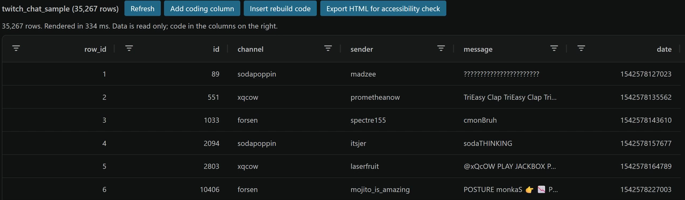

## Today's Agenda

- A recap: variables, mediators, and moderators
- Why an unbiased sample is not the same as a representative one
- Stratified sampling, and how your planned sample size meets the data
- The pilot test, and why the two coding passes must be independent
- Kappa and alpha, and what a failed pilot tells you to fix

## Two Jobs This Week

[Chapter 10]{.eyebrow}

- **Draw the sample: the items you will actually code**
- **Test the codebook with a pilot, which is what makes it an instrument**
    - The pilot can send you back to [Chapter 8](https://aura-lab.siue.edu/v2v/chapters/chapter08.html) to rewrite rules
    - Being sent back is a normal result, and it means the pilot did its job
- **Both are due together as the [Sampling Plan and Pilot](https://aura-lab.siue.edu/v2v-hub/mc501-assignments.html#sampling-plan-and-pilot-20-to-30-items), Monday, November 9, 11:59 PM**

## Variables, Revisited

[Recap from Week 5]{.eyebrow}

::: {.define}
**Variable:** something about a case that can change from one case to the next, where a case is one thing you study, such as one chat message. Example: the `game` column says Fortnite for one stream and Just Chatting for another.
:::

::: {.define}
**Independent variable (IV):** the proposed cause, or the predictor you measure. Example: stream type, gaming or non-gaming.
:::

::: {.define}
**Dependent variable (DV):** the outcome you think the IV changes. Example: the share of chat messages aimed at the streamer.
:::

All three come from [Chapter 5](https://aura-lab.siue.edu/v2v/chapters/chapter05.html#variables-the-building-blocks-of-hypotheses).

## Mediators and Moderators

[Recap from Week 5]{.eyebrow}

::: {.define}
**Mediator:** a variable in the middle that explains how or why the IV changes the DV.
:::

<svg class="diagram" viewBox="0 0 900 96" role="img">
<title>Mediator diagram: stream type leads to a conversational feel, which leads to more messages aimed at the streamer.</title>
<defs><marker id="arrow-med" viewBox="0 0 10 10" refX="9" refY="5" markerWidth="7" markerHeight="7" orient="auto"><path d="M0,0 L10,5 L0,10 z" fill="#101113"/></marker></defs>
<rect x="2" y="8" width="236" height="80" rx="8" fill="#ffffff" stroke="#101113" stroke-width="2"/>
<text x="120" y="42" text-anchor="middle" font-size="24" fill="#101113">Stream type</text>
<text x="120" y="70" text-anchor="middle" font-size="20" fill="#101113">(IV)</text>
<rect x="332" y="8" width="236" height="80" rx="8" fill="#f3efe4" stroke="#101113" stroke-width="3"/>
<text x="450" y="42" text-anchor="middle" font-size="22" font-weight="700" fill="#101113">Conversational feel</text>
<text x="450" y="70" text-anchor="middle" font-size="20" fill="#101113">(mediator)</text>
<rect x="662" y="8" width="236" height="80" rx="8" fill="#ffffff" stroke="#101113" stroke-width="2"/>
<text x="780" y="42" text-anchor="middle" font-size="24" fill="#101113">Messages to</text>
<text x="780" y="70" text-anchor="middle" font-size="24" fill="#101113">the streamer (DV)</text>
<line x1="240" y1="48" x2="328" y2="48" stroke="#101113" stroke-width="3" marker-end="url(#arrow-med)"/>
<line x1="570" y1="48" x2="658" y2="48" stroke="#101113" stroke-width="3" marker-end="url(#arrow-med)"/>
</svg>

::: {.define}
**Moderator:** a variable that changes how strong the IV's effect is, or its direction.
:::

<svg class="diagram" viewBox="0 0 900 160" role="img">
<title>Moderator diagram: stream type leads to messages aimed at the streamer, and audience size points at that arrow, changing how strong the link is.</title>
<defs><marker id="arrow-mod" viewBox="0 0 10 10" refX="9" refY="5" markerWidth="7" markerHeight="7" orient="auto"><path d="M0,0 L10,5 L0,10 z" fill="#101113"/></marker></defs>
<rect x="332" y="2" width="236" height="56" rx="8" fill="#f3efe4" stroke="#101113" stroke-width="3"/>
<text x="450" y="38" text-anchor="middle" font-size="24" font-weight="700" fill="#101113">Audience size</text>
<rect x="2" y="76" width="236" height="80" rx="8" fill="#ffffff" stroke="#101113" stroke-width="2"/>
<text x="120" y="110" text-anchor="middle" font-size="24" fill="#101113">Stream type</text>
<text x="120" y="138" text-anchor="middle" font-size="20" fill="#101113">(IV)</text>
<rect x="662" y="76" width="236" height="80" rx="8" fill="#ffffff" stroke="#101113" stroke-width="2"/>
<text x="780" y="110" text-anchor="middle" font-size="24" fill="#101113">Messages to</text>
<text x="780" y="138" text-anchor="middle" font-size="24" fill="#101113">the streamer (DV)</text>
<line x1="240" y1="116" x2="658" y2="116" stroke="#101113" stroke-width="3" marker-end="url(#arrow-mod)"/>
<line x1="450" y1="60" x2="450" y2="110" stroke="#101113" stroke-width="3" marker-end="url(#arrow-mod)"/>
</svg>

## What the Two Diagrams Say

- **Mediator:** non-gaming streams may feel more like a conversation, and that feeling is what invites messages to the streamer
- **Moderator:** the link between stream type and messages to the streamer might hold on small streams and fade on large ones
- **Together they turn "X relates to Y" into "X relates to Y, by this mechanism, under these conditions"**

## Why You Sample

- **Coding one message by hand takes about forty-five seconds**
    - The 35,267 messages in the example working sample would take over four hundred hours
    - The full 2018 collection would outlast your degree

::: {.define}
**Census:** coding every case in the population, which works only when the population is small. Example: the example stream table ships whole, about 32,000 snapshots of one stream at one moment.
:::

- **Chat is the opposite case: far too much to code, which is true of most content analysis studies**

A well-drawn sample makes the work finishable and still supports the conclusions.

## Population and Sample

::: {.define}
**Population:** everything your conclusions will apply to, defined by the platform, the accounts or outlets, and the time period. Example: every message in the fifty example channels that week.
:::

::: {.define}
**Sample:** the smaller set of cases you actually code. Example: thirty messages from each of those fifty channels.
:::

## Sampling Frame and the Gap

- **Sampling frame:** the actual list of items you can draw your sample from
    - Examples: the posts an API returns, a search result, an archive, or a list of channels
- **The gap:** the ways the frame differs from the population, stated in writing
    - Examples: deleted posts, private accounts, a rate limit, or a search term that misses synonyms
- Your Sampling Plan names all three, population, frame, and gap; the gap is the one most often left out

## Simple Random Sampling

::: {.define}
**Simple random sampling:** every message has the same chance of being picked, like drawing names from a hat. Example: R picks 1,000 messages from the whole chat table at random.
:::

::: {.define}
**Unbiased:** the way you pick favors no message over any other. Example: a message from a quiet channel has the same chance as one from a giant channel.
:::

- Its strength is real: the researcher cannot tilt the draw

## Chat Volume Is Right-Skewed

- **Chat volume in the example data is severely right-skewed**
    - The busiest channel logged over a million messages that week
    - The median channel (the middle one by size) logged about 1,440, and the quietest logged one

::: {.define}
**Right-skewed:** most values are small and a few are huge, so a chart of them has a long tail to the right. Example: a few giant channels and a long, thin tail of small ones.
:::

## Unbiased Is Not Representative

- **Forty-three of the fifty example channels are gaming channels**
- Draw at random and almost every message comes from giant gaming channels

::: {.define}
**Representative:** a sample that gives a fair picture of every group your question is about. Example: a sample with enough Bob Ross messages to say something about non-gaming chat.
:::

- A random draw here is unbiased and still unrepresentative of non-gaming chat

## Stratified Sampling

::: {.define}
**Stratified sampling:** split the population into groups, called **strata** (one group is a **stratum**), then draw from each group separately. Example: draw thirty messages from each of the fifty channels.
:::

- **Every stratum gets a place in the sample, in the proportion you decide**
- **The strata must matter for the research question**
    - In the example study the stratifying variable is the **channel**

## Stratifying by Channel

- **Whether a channel is a gaming channel is a property of the channel**
    - So stratifying by channel puts every non-gaming channel in the sample by construction
- For your own source, the stratum is whatever group your question compares: an account, a subreddit, a month, an outlet

## Strata for a Moderator

- **If you expect a moderator, your sample needs cases at every level of it**
- **Example: if audience size is the moderator, stratify by audience size**
    - Then small streams and large streams both appear in the sample
- **A random draw of messages would come mostly from the busiest channels**
    - Leaving too few small streams to see the moderator at work

## The Example Corpus Is a Stratified Design

- **Its fifty channels were not the fifty busiest**
    - Eight were fixed anchors: channels picked on purpose for variety
    - Bob Ross was among them, the deliberate non-gaming case
- **The other 42 came from ten volume bands, groups of channels with similar amounts of chat**
    - Every band was sampled

The skew is kept on purpose: small, middle, and giant channels are all in the corpus ([Chapter 10, Stratified sampling](https://aura-lab.siue.edu/v2v/chapters/chapter10.html#stratified-sampling)).

## Small Strata: Take All of It

- **Ask for 30 messages from a channel that produced 9, and there is no 30 to take**
    - The rule the tools follow: take everything that stratum has
- **Nineteen of the fifty example channels hold fewer than a thousand messages**
- **A stratum gives either its full share or everything it has**

Write this rule into your sampling plan, because it is a choice you made.

## Drawing the Sample

```r
coding_sample <- v2v::sample_messages(
  chat,
  n_per_channel = 30,
  seed = 409
)
```

- **`sample_messages()` treats each channel as a stratum**
- **`n_per_channel = 30` asks for thirty messages from each channel:** 1,350 across fifty channels
- **`seed = 409` fixes the draw so it can be repeated**
- Your own draw uses the same command with your own stratum column and number per stratum ([Chapter 10, Drawing the sample](https://aura-lab.siue.edu/v2v/chapters/chapter10.html#drawing-the-sample))

## The Seed Is Not Optional

::: {.define}
**Seed:** a number that fixes a random draw so it comes out the same every time. Example: `seed = 409` gives you the same 1,350 messages on every run.
:::

- **A random draw differs every time you run it**
    - The seed fixes the starting point of R's random number generator, because `sample_messages()` calls `set.seed()` with it before drawing
- **Without a seed your sample cannot be reproduced**
    - Nobody can check your results, including you

## The Seed Itself Is Arbitrary

- **The number itself is arbitrary: 409 means nothing**
- **What matters is that a seed is set and recorded, so the draw is frozen**

## What Power Means

::: {.define}
**Statistical power:** the chance your study detects an effect that is really there. Example: with only 80 messages, a real but small gap between gaming and non-gaming chat could easily go unseen.
:::

::: {.define}
**Effect size:** how big a difference or a relationship is, on a scale that does not grow with the sample. Example: how many more percentage points of messages are aimed at the streamer in non-gaming streams than in gaming ones.
:::

- **Underpowered:** a sample too small to give the study a good chance of detecting the effect it looks for

## Where Your Planned Sample Size Meets the Data

- **Sampling is not only about capturing variation**
    - Your [Research Proposal](https://aura-lab.siue.edu/v2v-hub/mc501-assignments.html#research-proposal-sentence-outline) specified a minimum sample size, *n*, the number of cases you code
    - This is the week that number meets your dataset
- **If you need 128 and the data offers 10,000, stratification solves the problem**
- **If you need 128 and the data offers 80, the study is underpowered**

Then you change the design, or you justify the limitation explicitly in the plan.

## Three Ways to Justify Your Sample Size

Your plan names the one you use and applies it consistently through the whole plan.

1. **An effect size from a named earlier study**, such as one you recorded in your [Annotated Manuscripts](https://aura-lab.siue.edu/v2v-hub/mc501-assignments.html#annotated-manuscripts-three-articles)
2. **The smallest effect that would matter**, with an argument for why a smaller difference would matter to no one
3. **A limit on your resources, such as time**, stated openly as a limit and paired with a sensitivity analysis
    - The sensitivity analysis states plainly what size of effect your sample can and cannot detect

Saying only that the study has 80 percent power does not justify the size; 80 percent is a convention ([Lakens, 2022](https://doi.org/10.1525/collabra.33267)).

## Setting Your Sample Size from Your Coding Time

- **Plan on two to four hours of coding in total**
    - About one third building and revising the codebook, two thirds coding with the finished codebook unchanged
- **Time how long you take to code twenty items, and work out your rate per item**
    - The table on the [assignment page](https://aura-lab.siue.edu/v2v-hub/mc501-assignments.html#sampling-plan-and-pilot-20-to-30-items) is only a planning estimate; your own timed rate replaces it
- **[Sampling Check](https://aura-lab.siue.edu/sampling-check/) on the Hub** converts your rate and your hours into a sample size

## The Minimum Sample and the Cost of Each Variable

- **Code at least fifty units**
    - If your rate allows fewer than fifty, change the unit of analysis instead of coding fewer units
- **Each added variable slows you down:** coding ten variables per item roughly halves your rate

## Lakens: Report How Informative a Study Was

> "Do not try to spin a story where it looks like a study was highly informative when it
> was not. Instead, transparently evaluate how informative the study was given effect sizes
> that were of interest, and make sure that the conclusions follow from the data."
>
> [Lakens (2022, p. 11)](https://doi.org/10.1525/collabra.33267)


## Purposive Sampling

::: {.define}
**Purposive sampling:** choosing cases on purpose, because you judge them the most useful for the question, rather than at random. Example: picking the channels where viewers most often address the streamer.
:::

- **Construct validity:** whether a measure behaves the way theory says the idea should
- Purposive sampling can improve construct validity; it does nothing for statistical power

## The Pilot Test

::: {.define}
**Pilot test:** a practice round, before any real coding, where you code a few items twice to see if your codebook's rules give the same answer both times. Example: code twenty-five sampled messages on a Monday, then again on Wednesday with Monday's codes hidden.
:::

- **In this course the pilot is twenty to thirty items; about 30 is the usual rule of thumb** ([Lombard et al., 2002](https://doi.org/10.1111/j.1468-2958.2002.tb00826.x))
- **The question the pilot answers:** applied independently, do these rules give the same codes?

## What Reliability Means

::: {.define}
**Reliability:** the codebook gives the same answer whoever holds it, and the same answer when you come back to it. Example: on both passes, a message that tags the streamer is coded "directed at the streamer."
:::

- **Each round of coding is a pass:** pass 1 and pass 2
- **The pilot turns reliability into a number you can report**

## Independent Coding Passes

::: {.define}
**Independent:** each coding pass is done without seeing, discussing, or remembering the other. Example: your first-pass codes stay in a hidden file until the second pass is finished.
:::

- **This is not suspicion of the coder: the pilot measures the codebook**
- **If you read your earlier codes, you measure your memory, not the clarity of the written rules**
- **When you code twice yourself, the isolation is a time gap and a blind**
    - At least 48 hours between passes, with the first codes out of sight

## Independence in Your Protocol

- **The written rules must carry each classification on their own**
- **Build the isolation into your protocol, and say so in the write-up**

## Why Raw Agreement Is Not Enough

::: {.define}
**Raw agreement:** the share of items where the two passes gave the same code. Example: the two passes match on 74 of 100 items, which sounds respectable.
:::

- **The founding example: two clinicians assigning categories blindly** ([Cohen, 1960](https://doi.org/10.1177/001316446002000104))
    - At the observed rates for each category, they still agree often
- **That agreement reflects the number of categories, not judgment**

With few categories, or one dominant category, coincidental agreement piles up fast.

## Exercise: Reliability First {.discuss}

[Hayes and Krippendorff (2007)]{.eyebrow}

> "Conclusions from such data can be trusted only after demonstrating their reliability."
>
> [Hayes and Krippendorff (2007, p. 77)](https://doi.org/10.1080/19312450709336664)

Answer each question in writing:

- A pilot scores a kappa of 0.62, and the threshold named before coding was 0.70. Does it clear the threshold? Answer yes or no
- Write the sentence you would put in the report about that result
- Name whose trust the reliability standard protects: the reader's, the coder's, or the field's, and say why

## Report What Your Pilot Could Not Settle

> "Do not try to spin a story where it looks like a study was highly informative when it
> was not."
>
> [Lakens (2022, p. 11)](https://doi.org/10.1525/collabra.33267)

- **When you write up your pilot, state one thing it could not settle**
- **Name the White Paper claim that becomes weaker because of it**

## Chance Agreement

::: {.define}
**Chance agreement:** matches that happen by luck, even when nobody follows a rule. Example: two people flipping coins to sort messages into two categories agree about half the time.
:::

- **Kappa and alpha both subtract it before they credit the codebook**

## Cohen's Kappa

::: {.define}
**Cohen's kappa:** a score for how much two coding passes agree beyond what luck alone would give. Example: the example pilot scores 0.236, so most of its agreement was luck.
:::

- **Kappa is built for two sets of codes and nominal categories (names with no order)** ([Cohen, 1960](https://doi.org/10.1177/001316446002000104))
    - Two coders, or one coder twice: the arithmetic is the same
- **Kappa is observed agreement, minus chance agreement, divided by the room left above chance**
    - `kappa = (observed - expected) / (1 - expected)`

## Kappa From Zero to One

- **Agreement no better than chance:** kappa is zero, whatever the raw rate
- **Perfect agreement:** kappa is one

::: {.define}
**Nominal:** categories that are only names, with no order. Example: "directed at the streamer" is not more or less than "broadcast to the room."
:::

The codebook is credited only for the agreement that luck did not produce.

## Krippendorff's Alpha

::: {.define}
**Krippendorff's alpha:** a reliability score like kappa that also works with more than two coders, ranked or numeric codes, and missing codes. Example: three coders rating how heated a message is from 1 to 5.
:::

- **Alpha is the more general instrument** ([Krippendorff, 2018](https://doi.org/10.4135/9781071878781))
- **Three coders, or an ordinal variable (ranked categories, such as low, medium, high): use alpha**
- **For a pilot with two passes and nominal categories, kappa and alpha agree**

`v2v::reliability()` computes either one, selected by `method`.

## Computing Alpha for Your Pilot

```r
pilot <- coding_sample %>%
  slice_head(n = 30)

v2v::reliability(
  pull(pilot, pass_1),
  pull(pilot, pass_2),
  method = "alpha"
)
```

- **The code takes the first thirty messages and passes your two columns of codes to `reliability()`, asking for alpha**
- **[Agreement Check](https://aura-lab.siue.edu/agreement-check/) on the Hub gives the same result when you paste in the two columns**

## Entering Codes in the Companion

- **Open the data viewer** (**AURA: Open the data viewer**) to code in a grid, like a spreadsheet
    - It adds your coding columns beside the sampled CSV and never changes the original file
- **Reliability grid:** saves your two passes as a CSV and writes the `reliability()` call, with `method = "alpha"` or `"kappa"`

{fig-alt="The R Companion data viewer showing the Twitch chat sample, 35,267 rows. Row 5 has channel xqcow and a message beginning @xQcOW PLAY JACKBOX. Row 1 is a string of question marks and row 2 repeats TriEasy Clap." width="62%"}

## A Worked Failure

- **The example codebook said "high-energy" and never defined it**
    - **Coder A** flagged messages carrying a Twitch emote (a small image posted with a text code)
    - **Coder B** flagged messages written in all capitals
- **Both readings are reasonable, and both coders believed they were coding one variable**

```
Reliability: Cohen's kappa

  Messages coded   100
  Cohen's kappa    0.236
```

## What a Kappa of 0.236 Means

- **Observed agreement 0.74, chance agreement 0.66, kappa 0.24**
- **Emote messages and all-caps messages overlap in Twitch chat**
    - Two coders keying on different features often land on the same code by accident
    - They never coded the same concept
- **A loose codebook let two careful people measure two different things**

Kappa exposed what raw agreement hid. One coder working twice fails the same way when a rule is undefined ([Chapter 10, A worked reliability check](https://aura-lab.siue.edu/v2v/chapters/chapter10.html#a-worked-reliability-check)).

## Reading Against a Standard

- **Published labels for kappa values** ([Landis and Koch, 1977](https://doi.org/10.2307/2529310))**:**
    - 0.0 to 0.2 slight, 0.2 to 0.4 fair, 0.4 to 0.6 moderate
    - 0.6 to 0.8 substantial, above 0.8 almost perfect
- **Those labels are a convention; no rule requires them**
- **Published work treats a value below 0.70 as too low to proceed on, with 0.80 comfortable**

Name your threshold in your protocol before you see the number, not after.

## When Reliability Fails

- **A kappa of 0.236 is an instruction to fix the codebook, not a final result**
    - Walk through every disagreement with the written rule in front of you
    - **The disagreements are the data:** each one points at an unclear rule
- **Repair the rule by stating operationally what counts**
- **Then pilot again, on fresh items** ([Chapter 10, When reliability fails](https://aura-lab.siue.edu/v2v/chapters/chapter10.html#when-reliability-fails-revising-the-codebook))

Pilot, diagnose, revise, and repeat until the number clears your threshold.

## Sampling Plan and Pilot: The Four Parts of the Plan

Due Monday, November 9, 11:59 PM. Submit the plan and the pilot together as one document ([assignment](https://aura-lab.siue.edu/v2v-hub/mc501-assignments.html#sampling-plan-and-pilot-20-to-30-items), [rubric](https://aura-lab.siue.edu/v2v-hub/resources/rubrics/MC501-rubric-sampling-plan-and-pilot.pdf), [worked example](https://aura-lab.siue.edu/v2v-hub/resources/examples/MC501-example-sampling-plan-and-pilot.pdf)).

1. **Population, sampling frame, and the gap** between them, each stated in writing
2. **The sampling method:** name it, justify it, and say what it can and cannot estimate
3. **Sample size and its justification:** name which of the three justifications you use, and apply it
4. **Time calibration:** your rate from timing twenty items, the sample size that rate allows, and the closest row in the assignment page's table

## Sampling Plan and Pilot: The Five Parts of the Pilot

5. **Twenty to thirty coded items**, submitted as a data file (a spreadsheet export, or the codes file the Companion's data viewer keeps under `data/derived/`)
6. **A stability statistic** (reliability from your own two passes) for those items, with the code that computed it
    - It comes from your own re-code 48 hours or more later; call it stability, never agreement
7. **Every edge case you met**, the decision you made, and the rule you added to the codebook

## Sampling Plan and Pilot: The Five Parts of the Pilot (cont.)

8. **Every codebook revision the pilot required**, with the wording before and after
9. **One paragraph on the full coding run:** how long it will take and what you will change

If your pilot led to no codebook changes, the items you piloted were probably too easy.

## Unit of Analysis and Key

::: {.define}
**Unit of analysis:** the one kind of thing each row of your coding sheet describes. Example: one chat message, or one TikTok video.
:::

::: {.define}
**Key variable:** a column two tables share, used to match their rows. Example: the song title links a Spotify table to a table of TikTok videos.
:::

## One Codebook or Two?

- **Write one codebook per unit of analysis, not one per platform**
- **Different units, different codebooks, joined by a key variable**
    - Spotify numbers and TikTok videos: a song and a video, linked by the song
    - Box office and reviews: a film and a review, linked by the film
- **Same unit on every source: one codebook, with a source variable**
- The codebook template's linking section records the key and how records match: [codebook template](https://aura-lab.siue.edu/v2v-hub/resources/templates/MC501-codebook-template.docx)

## Before Week 11

- **Submit the [Extended Codebook and Reliability Protocol](https://aura-lab.siue.edu/v2v-hub/mc501-assignments.html#extended-codebook-and-reliability-protocol) by Monday, November 2, 11:59 PM**
- **Submit the [Sampling Plan and Pilot](https://aura-lab.siue.edu/v2v-hub/mc501-assignments.html#sampling-plan-and-pilot-20-to-30-items) by Monday, November 9, 11:59 PM, with the reliability computation**
- **Read [Chapter 11](https://aura-lab.siue.edu/v2v/chapters/chapter11.html)**
    - Plus the assigned article: **Wickham (2014)**, ["Tidy data"](https://doi.org/10.18637/jss.v059.i10)
- **Write a [journal entry](https://aura-lab.siue.edu/v2v-hub/mc501-assignments.html#weekly-reading-journal), 450 to 500 words**
- **Bring a laptop with R, VS Code, and `v2v` working, and Check my setup reporting everything installed**
- **Check yourself on this week's terms:** [Week 10 self-check](https://aura-lab.siue.edu/v2v-hub/self-checks/mc501-week10.html), ungraded, with the answer after each question

## Questions, Comments, or Concerns? {.titlecard}
