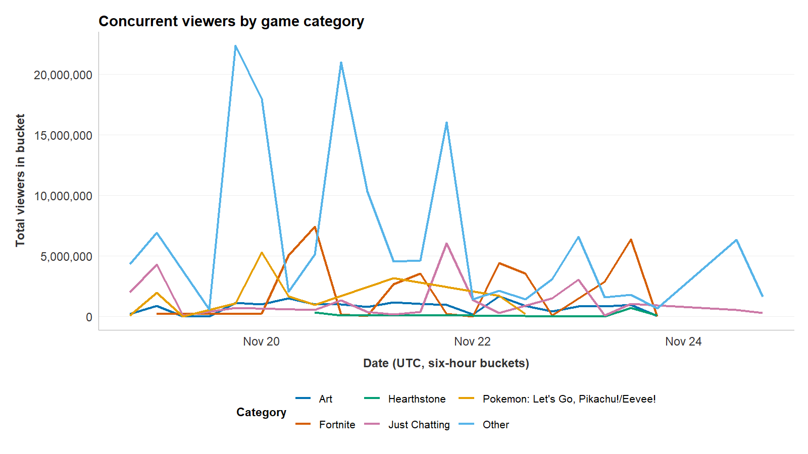
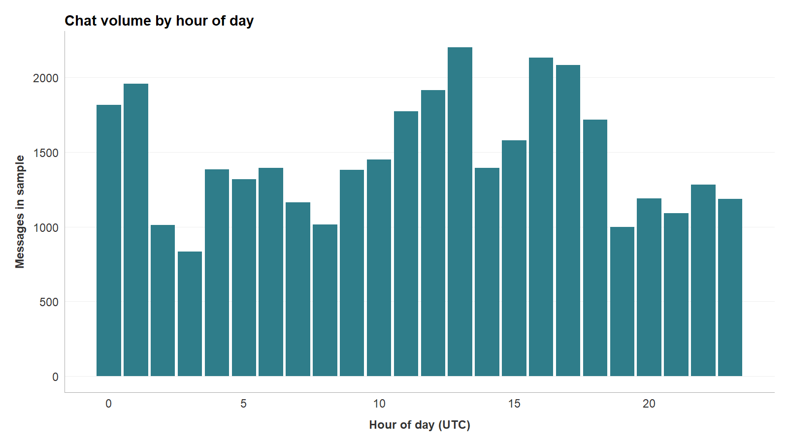
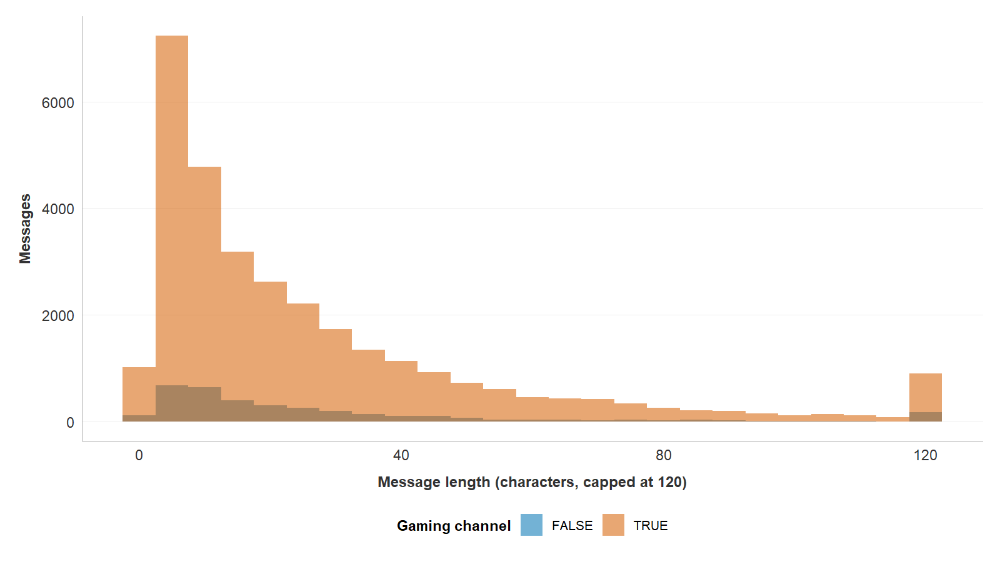

## Today's Agenda

- The Twitch job, part 2: the Describing Data worksheet
- The grammar of graphics: every plot is built from the same three parts
- Three chart types: a line chart, a bar chart, and a histogram
- Effect sizes, and the design choices a figure must disclose
- Figures other people can actually read

## What We Build Today

[Working session]{.eyebrow}

- Three figures and one table of descriptive statistics, built on the example data
    - A line chart for change over time, a bar chart for counts, a histogram for shape
    - Each chart type fits a different kind of question
- The same figures, built on your own data, go into your Results and onto your poster
- Plus the rule that turns a picture into a claim: report the effect size

Expect every first version to look wrong. The fix is usually one line.

## The Twitch Job, Part 2

- The Describing Data worksheet is part 2 of the Twitch job
    - It loads `data/twitch_analysis.RDS`, with your thirty codes inside
- Frequency tables, mean, median, and sd, a cross-tabulation, and three figures
- Part 5: the diagnostics behind each figure
- Your interpretation and your alt text are never filled in for you

[MC 501 worksheet](https://aura-lab.siue.edu/v2v-hub/starters/12-describing-data-mc501.qmd) · [Describing Data risks guide](https://aura-lab.siue.edu/v2v-hub/resources/risks/describing-data.html)

- Click the link: your browser saves `12-describing-data-mc501.qmd` in your Downloads folder
- Move it into your workspace's top folder, next to README.md: [Put a Worksheet in Your Workspace](https://aura-lab.siue.edu/v2v-hub/guides/mc501/14-put-a-worksheet-in-your-workspace.html)

## Load the Saved Table

Three lines start every Describing session: two packages, then the table Data Wrangling saved.

```r
library(tidyverse)
library(v2v)
analysis <- read_rds("data/twitch_analysis.RDS")
```

- `library()` switches a package on for this session
- `read_rds()` reads the saved file and names the table `analysis`
- If R says `cannot open the connection`, the file is not in your `data` folder

## Load the Table: Output

```{.term .tall code-line-numbers="false" step="01-setup"}
> library(tidyverse)
── Attaching core tidyverse packages ──────────────── tidyverse 2.0.0 ──
✔ dplyr     1.1.4     ✔ readr     2.1.6
✔ forcats   1.0.1     ✔ stringr   1.6.0
✔ ggplot2   4.0.1     ✔ tibble    3.3.0
✔ lubridate 1.9.4     ✔ tidyr     1.3.1
✔ purrr     1.2.0
── Conflicts ────────────────────────────────── tidyverse_conflicts() ──
✖ dplyr::filter() masks stats::filter()
✖ dplyr::lag()    masks stats::lag()
ℹ Use the conflicted package (<http://conflicted.r-lib.org/>) to force all conflicts to become errors
> library(v2v)
v2v 0.3.9 loaded.
  setup()  checks that R, Quarto and Git are ready
  ?v2v     lists what this package gives you
> analysis <- read_rds("data/twitch_analysis.RDS")
```

- The two `masks` lines are normal, not errors
- `read_rds()` prints nothing: the table went into `analysis` quietly

## A First Look at the Table

```r
glimpse(analysis)
```

- `glimpse()` prints one line per column: its name, its type, and its first few values
- Use it every time you load a table, before you draw anything

## A First Look: Output

```{.term .tall code-line-numbers="false" step="02-glimpse"}
> glimpse(analysis)
Rows: 35,267
Columns: 16
$ id             <dbl> 89, 551, 1033, 2094, 2803, 10406, 16104, 22571,…
$ channel        <chr> "sodapoppin", "xqcow", "forsen", "sodapoppin", …
$ sender         <chr> "madzee", "prometheanow", "spectre155", "itsjer…
$ message        <chr> "???????????????????????", "TriEasy Clap TriEas…
$ date           <dbl> 1.542578e+12, 1.542578e+12, 1.542578e+12, 1.542…
$ ts             <dttm> 2018-11-18 21:55:27, 2018-11-18 21:55:35, 2018…
$ message_length <int> 23, 441, 8, 12, 206, 37, 6, 7, 4, 7, 3, 4, 12, …
$ snapshot_ts    <dttm> NA, NA, NA, NA, NA, 2018-11-18 21:56:40, 2018-…
$ game           <chr> NA, NA, NA, NA, NA, "Artifact", "Marble It Up!"…
$ viewers        <int> NA, NA, NA, NA, NA, 15300, 28076, 4703, 19239, …
$ main_game      <chr> "Hand Simulator", "Just Chatting", "The Elder S…
$ is_gaming      <lgl> TRUE, FALSE, TRUE, TRUE, FALSE, TRUE, TRUE, TRU…
$ channel_type   <fct> gaming, non-gaming, gaming, gaming, non-gaming,…
$ median_viewers <dbl> 22944, 16176, 10163, 22944, 16176, 10163, 22944…
$ viewer_band    <fct> large, medium, medium, large, medium, medium, l…
$ reaction_only  <fct> NA, NA, NA, NA, NA, NA, NA, NA, NA, NA, NA, NA,…
```

- 35,267 rows, one per chat message, and 16 columns
- `reaction_only` is `NA` except on your thirty coded messages

## A Table Too Long to Read

- The analysis table is complete, but too long to read
    - Nobody scrolls through 35,267 rows and learns anything
    - The numbers are present, but the pattern is not visible
- A figure turns a long column of numbers into a shape you can see

Visualization is not decoration applied afterwards. It is part of the analysis.

## The Grammar of Graphics

Three parts do most of the work (Wilkinson, 2005; Wickham, 2016):

```r
ggplot(data, aes(x = ..., y = ...)) +
  geom_line()
```

- **Data:** the table being shown
- **Aesthetic mappings:** which column goes to which visual property, such as the x axis or the color
- **Geometry:** the kind of mark used to draw the data, such as a line or a bar

Swap `geom_line()` for `geom_col()` and the same data is drawn as bars.

## Figure 1, a Line Chart for Change Over Time

- **The question:** how did viewership move across the week, and how was it split across games?
- Time goes on the x axis and a rising and falling value on the y axis, so this is a line chart
    - A line implies a sequence, and real distance between the points
    - A line is right for time and wrong for unordered categories
- The data needs shaping before it can be drawn

## Shaping the Data

```r
viewers_over_time <- twitch_viewers_over_time()
viewers_over_time
```

- The course package ships this table already shaped for a line chart
- Typing the table's name on its own line prints it

## The Viewers Table: Output

```{.term .tall code-line-numbers="false" step="03-viewers-print"}
> viewers_over_time <- twitch_viewers_over_time()
> viewers_over_time
# A tibble: 97 × 3
   six_hour            category                           total_viewers
   <dttm>              <fct>                                      <int>
 1 2018-11-18 18:00:00 Art                                       238217
 2 2018-11-18 18:00:00 Just Chatting                            2034123
 3 2018-11-18 18:00:00 Pokemon: Let's Go, Pikachu!/Eevee!         99909
 4 2018-11-18 18:00:00 Other                                    4333423
 5 2018-11-19 00:00:00 Art                                       870710
 6 2018-11-19 00:00:00 Fortnite                                  258780
 7 2018-11-19 00:00:00 Just Chatting                            4312125
 8 2018-11-19 00:00:00 Pokemon: Let's Go, Pikachu!/Eevee!       1991196
 9 2018-11-19 00:00:00 Other                                    6933016
10 2018-11-19 06:00:00 Art                                        12444
# ℹ 87 more rows
```

- Three columns: the six-hour window, the category, and the viewers added up inside it
- R prints the first ten rows and says how many more there are

## Count the Categories

```r
viewers_over_time %>%
  count(category)
```

- `count()` makes one row per category and counts the rows in each

## Count the Categories: Output

```{.term code-line-numbers="false" step="04-viewers-count"}
> viewers_over_time %>%
+   count(category)
# A tibble: 6 × 2
  category                               n
  <fct>                              <int>
1 Art                                   21
2 Fortnite                              17
3 Hearthstone                            9
4 Just Chatting                         18
5 Pokemon: Let's Go, Pikachu!/Eevee!    10
6 Other                                 22
```

- Six categories, so six rows; `n` is how many six-hour windows each one has

## Shaping the Data (cont.)

- The course package ships this table ready to draw
- The stream snapshots are grouped into six-hour windows
- Everything past the top five games is lumped into "Other," and the viewers inside each window are added up
- Three judgment calls made for you: `?twitch_viewers_over_time` says how, and the package source holds the pipeline

## Drawing the Line Chart

```r
ggplot(viewers_over_time,
       aes(x = six_hour, y = total_viewers,
           color = category)) +
  geom_line(linewidth = 0.9) +
  scale_y_continuous(labels = scales::label_comma()) +
  labs(title = "Concurrent viewers by game category",
       x = "Date (UTC, six-hour buckets)",
       y = "Total viewers in bucket",
       color = "Category") +
  v2v::scale_color_v2v() +
  v2v::theme_v2v()
```

`label_comma()` writes 20,000,000 instead of 2.0e+07, and `theme_v2v()` applies
publication-ready fonts, spacing, and gridlines in one call.

## Drawing the Line Chart: Output

{.run-figure fig-alt="A line chart of total viewers per six-hour window from November 18 to 25, 2018, one line per category. The Other line towers over the rest, peaking above 22 million; Art, Fortnite, Hearthstone, Just Chatting, and Pokemon stay mostly under 7.5 million."}

- In VS Code the chart opens in its own Plot tab, beside your code

## What Dominates the Chart, and Why

- The towering line is "Other", the catch-all for everything beyond the top five games
    - As a finding: viewership really is spread across a long tail of games
    - As a caution: lumping fifty categories into one guarantees that result
- There is a plain design cost too
    - The five named lines are pressed into the bottom of the panel

A dominant series crowds out the rest. Noticing that is reading the chart honestly.

## Figure 2, a Bar Chart for Counts

- **The question:** at which hours of the day are channels busiest?
- Hour of day is 24 separate categories, not a continuous sweep
- What is measured is a simple count of messages in each hour
- Counts across categories call for a bar chart
    - One bar per category, the height is the count, the bars sit side by side

## Count Messages per Hour

```r
chat_by_hour <- analysis %>%
  mutate(hour = hour(ts)) %>%
  count(hour, name = "messages")
chat_by_hour
```

- `hour()` pulls the hour, 0 to 23, out of each message's time stamp
- `count()` then counts the messages in each hour and names the count `messages`

## Messages per Hour: Output

```{.term code-line-numbers="false" step="06-hour-table"}
> chat_by_hour <- analysis %>%
+   mutate(hour = hour(ts)) %>%
+   count(hour, name = "messages")
> chat_by_hour
# A tibble: 24 × 2
    hour messages
   <int>    <int>
 1     0     1816
 2     1     1959
 3     2     1013
 4     3      833
 5     4     1384
 6     5     1317
 7     6     1393
 8     7     1165
 9     8     1016
10     9     1381
# ℹ 14 more rows
```

- One row per hour; R shows the first ten and says 14 more are there

## Find the Busiest Hour

```r
chat_by_hour %>%
  arrange(desc(messages))
```

- `arrange()` sorts the rows; `desc()` puts the biggest count first
- Sorting is how you find the peak before you draw it

## Find the Busiest Hour: Output

```{.term code-line-numbers="false" step="07-hour-sorted"}
> chat_by_hour %>%
+   arrange(desc(messages))
# A tibble: 24 × 2
    hour messages
   <int>    <int>
 1    13     2201
 2    16     2132
 3    17     2084
 4     1     1959
 5    12     1915
 6     0     1816
 7    11     1775
 8    18     1717
 9    15     1578
10    10     1449
# ℹ 14 more rows
```

- The busiest hour is 13:00 UTC, with 2,201 messages

## The Code for the Bar Chart

```r
ggplot(chat_by_hour, aes(x = hour, y = messages)) +
  geom_col(fill = "#2f7d8a") +
  labs(title = "Chat volume by hour of day",
       x = "Hour of day (UTC)",
       y = "Messages in sample") +
  v2v::theme_v2v()
```

`geom_col()` draws a bar whose height is a value you already computed.

## The Bar Chart: Output

{.run-figure fig-alt="A bar chart titled Chat volume by hour of day: messages in the sample for each hour, 0 to 23 UTC. The tallest bar is 13:00 at about 2,200 messages, with high bars again at 16:00 and 17:00; the shortest is 03:00 at about 830."}

## Chat Volume by Hour of Day

- The example chat is busiest through UTC midday, peaking at 13:00 with 2,201 messages
- It is quietest in the small hours, bottoming out at 03:00 with 833 messages
- That is a swing of well over two to one
- The 2018 audience was mostly in the Americas and Europe, which explains the pattern

The chart shows all twenty-four hourly counts at once.

## Effect Sizes, and Their Standing

> "Effect sizes are the most important outcome of empirical studies."
>
> Lakens (2013, p. 1)

- Every figure that shows a comparison must report its effect size
- A taller bar is a visual impression, not a claim
- The effect size states the magnitude of a difference in a unit that does not depend on the scale

## Exercise: The Most Important Outcome {.discuss}

[Lakens (2013)]{.eyebrow}

> "Effect sizes are the most important outcome of empirical studies."
>
> Lakens (2013, p. 1)

- Lakens says effect sizes are the most important outcome. Name the reader for whom that is true, and say why
- Articles in your field usually report *p* before the effect size. Give one reason that habit persists
- Describe one thing that would change in your field if journals required the effect size first

## Figure 3, a Histogram for Shape

::: {.define}
**Histogram:** a bar chart of a number variable, where each bar counts the values in one range. Example: one bar counts the messages 0 to 5 characters long.
:::

- **The central question of the example study:** how long is a chat message, and does the answer depend on the kind of channel?
- The answer is not a total and not a trend. It is a distribution
    - Where the values cluster, and where they thin out
- Two histograms overlaid let the two shapes be compared directly

## The Table Behind the Histogram

```r
msglen <- analysis %>%
  filter(!is.na(is_gaming)) %>%
  mutate(length_shown = pmin(message_length, 120))
msglen %>%
  count(is_gaming)
```

- `filter()` drops the messages from channels with no gaming label
- `pmin()` keeps each length, but shows anything over 120 as 120
- `count(is_gaming)` checks how many messages each group has left

## The Table Behind It: Output

```{.term code-line-numbers="false" step="09-msglen"}
> msglen <- analysis %>%
+   filter(!is.na(is_gaming)) %>%
+   mutate(length_shown = pmin(message_length, 120))
> msglen %>%
+   count(is_gaming)
# A tibble: 2 × 2
  is_gaming     n
  <lgl>     <int>
1 FALSE      3457
2 TRUE      31309
```

- `FALSE` is non-gaming: 3,457 messages, about one in ten
- `TRUE` is gaming: 31,309 messages

## Check the Cap

```r
msglen %>%
  summarize(
    longest = max(message_length, na.rm = TRUE),
    longest_shown = max(length_shown, na.rm = TRUE)
  )
```

- `max()` finds the biggest value; `na.rm = TRUE` skips the empty messages
- One line compares the real longest message with the longest one the chart will show

## Check the Cap: Output

```{.term code-line-numbers="false" step="10-cap-check"}
> msglen %>%
+   summarize(
+     longest = max(message_length, na.rm = TRUE),
+     longest_shown = max(length_shown, na.rm = TRUE)
+   )
# A tibble: 1 × 2
  longest longest_shown
    <int>         <dbl>
1     501           120
```

- The longest message is 501 characters; the chart draws it at 120

## The Code for the Histogram

```r
ggplot(msglen,
       aes(x = length_shown, fill = is_gaming)) +
  geom_histogram(binwidth = 5, position = "identity",
                 alpha = 0.55) +
  labs(x = "Message length (characters, capped at 120)",
       y = "Messages",
       fill = "Gaming channel") +
  v2v::scale_fill_v2v() +
  v2v::theme_v2v()
```

- `binwidth = 5` makes each bar five characters wide; `alpha` lets the overlap show through

## The Histogram: Output

{.run-figure fig-alt="Two overlaid histograms of message length in characters, capped at 120, for gaming (TRUE) and non-gaming (FALSE) channels. Both pile up under 20 characters and thin out to the right, with a small spike in the last bar at 120. The non-gaming bars are so short they barely show."}

## The Warning Under the Chart

The terminal also prints this under the histogram code:

```{.term code-line-numbers="false" step="11-plot-hist"}
> ggplot(msglen,
+        aes(x = length_shown, fill = is_gaming)) +
+   geom_histogram(binwidth = 5, position = "identity",
+                  alpha = 0.55) +
+   labs(x = "Message length (characters, capped at 120)",
+        y = "Messages",
+        fill = "Gaming channel") +
+   v2v::scale_fill_v2v() +
+   v2v::theme_v2v()
Warning message:
Removed 4 rows containing non-finite outside the scale range
(`stat_bin()`).
```

- A **warning** is not an error: the chart still drew
- The 4 rows are the empty messages, which have no length to draw

## Counts Hide the Smaller Group

- Non-gaming is one message in ten, so by count it barely shows
- The R Companion's **Histogram comparing two groups** draws each group as shares instead, so the shapes compare

## Two Choices You Must Disclose

- `binwidth = 5` makes each bar cover five characters
    - A wider bin smooths the shape and a narrower bin roughens it
    - The bin width is a judgment, so you report it
- `pmin(message_length, 120)` caps the display at 120 characters
    - The longest message is 501 characters, so the last bar is a pile-up of everything longer
    - Capping keeps the bulk of the data legible

An unannounced cap is a quiet distortion. The axis label states the cap.

## What the Shape Shows

::: {.define}
**Skew:** a lopsided shape. Right-skewed means most values are small and a few are very large, like message length here.
:::

- Both groups share one shape: heavily right-skewed
    - A tall stack of very short messages on the left
    - A long thin tail of longer messages to the right
- Most Twitch chat messages are brief: a word or an emote

The skew is the most important thing the histogram reveals, and no summary number can show it.

## What Descriptive Statistics Are

::: {.define}
**Descriptive statistics:** numbers that summarize a set of data, such as how many cases there are, where the middle sits, and how spread out the values are. Example: n, mean, median, and sd of message length for each group.
:::

## The Descriptive Statistics

- The R Companion (the **AURA Lab R Companion** icon on VS Code's left edge) writes a grouped summary
- Press **Ctrl+Shift+P** (**Cmd+Shift+P** on a Mac) to open the Command Palette, type **AURA: Write R code**, and press **Enter**
- Under **R3 Describe**, **Summary by group** writes n, mean, median, and sd for each `channel_type`
- To summarize another column, change the column names in the block it writes

## The Descriptive Statistics (cont.)

```r
msglen %>%
  group_by(is_gaming) %>%
  summarize(
    n      = sum(!is.na(message_length)),
    mean   = mean(message_length, na.rm = TRUE),
    median = median(message_length, na.rm = TRUE),
    sd     = sd(message_length, na.rm = TRUE),
    .groups = "drop"
  )
```

- `group_by(is_gaming)` splits the table into the two groups; `summarize()` makes one row per group
- `na.rm = TRUE` leaves the four empty messages out of each number

## The Descriptive Statistics: Output

```{.term code-line-numbers="false" step="12-summary"}
> msglen %>%
+   group_by(is_gaming) %>%
+   summarize(
+     n      = sum(!is.na(message_length)),
+     mean   = mean(message_length, na.rm = TRUE),
+     median = median(message_length, na.rm = TRUE),
+     sd     = sd(message_length, na.rm = TRUE),
+     .groups = "drop"
+   )
# A tibble: 2 × 5
  is_gaming     n  mean median    sd
  <lgl>     <int> <dbl>  <int> <dbl>
1 FALSE      3457  33.7     16  60.7
2 TRUE      31305  28.5     17  38.5
```

## The Descriptive Statistics (cont.)

- **AURA: Write R code**, then **R3 Describe**, then **Line chart over time** writes Figure 1
- **Histogram comparing two groups** writes Figure 3
- Its **Bar chart** draws the top ten games, not Figure 2
- After **Run it**, the saved chart opens in its own VS Code tab

## The Numbers

::: {.define}
**Mean:** the average, the total divided by the count. **Median:** the middle value once the values are sorted. Example: the mean message is 29.0 characters long, the median 17.
:::

- **Non-gaming:** n 3,457, mean 33.7, median 16, sd 60.7
- **Gaming:** n 31,305, mean 28.5, median 17, sd 38.5
    - 31,305, not 31,309: the four empty messages have no length to count

Read the **means** and non-gaming chat is longer. Read the **medians**, 16 against 17, and
the two groups are all but identical, pointing the other way.

## When the Mean and the Median Disagree

::: {.define}
**Standard deviation (sd):** how far values typically sit from the mean. Example: non-gaming chat's sd of 60.7 says its lengths are more spread out than gaming chat's 38.5.
:::

- The mean is sensitive to a long tail; the median is not
    - A few very long messages lift the average
    - The middle value is untouched by them
- Non-gaming chat has the heavier tail, and its larger standard deviation records that
- The gap in means is the work of the tail, not of the typical message

Report the mean alone and you misreport what a typical message looks like.

## Which Effect Size to Report

::: {.define}
**Effect size:** how big a difference or a relationship is, on a scale that does not grow with the sample. Example: Cramer's *V* of 0.15 for viewer band by channel type.
:::

- **A difference between two group means:** **Cohen's *d*** with a 95% confidence interval
- **A cross-tabulation of two categorical variables:** **Cramer's *V***
- **A correlation between two numeric variables:** ***r*** and its confidence interval
- `effectsize::cohens_d()` and `effectsize::cramers_v()` print each one with its 95% confidence interval

Put the effect size in the caption or in a companion table, never in a footnote.

## Cohen's *d* for Message Length

```r
effectsize::cohens_d(message_length ~ is_gaming,
                     data = msglen)
```

- `message_length ~ is_gaming` reads "message length, compared across gaming status"
- `effectsize::` calls the function from the effectsize package without loading the whole package
- Copy the *d* and its interval into your caption by hand

## Cohen's *d*: Output

```{.term code-line-numbers="false" step="13-cohens-d"}
> effectsize::cohens_d(message_length ~ is_gaming,
+                      data = msglen)
Cohen's d |       95% CI
------------------------
0.13      | [0.09, 0.16]

- Estimated using pooled SD.Warning message:
Missing values detected. NAs dropped.
```

- Non-gaming messages run 0.13 standard deviations longer, with a 95% interval of 0.09 to 0.16
- The warning is the four empty messages again, dropped before the calculation

## Three Terms From That List

::: {.define}
**Confidence interval:** a range around an estimate, built by a method that captures the true value in a stated share of repeated samples, such as 95 in 100. Example: *d* with its 95% interval shows how far the true gap could plausibly sit from the measured one.
:::

::: {.define}
**Categorical variable:** a variable whose values are categories rather than measured amounts. Example: channel type, gaming or non-gaming.
:::

::: {.define}
**Cross-tabulation:** a table that counts how often each combination of two categorical variables occurs. Example: viewer band by channel type.
:::

## Figures Other People Can Read

- Roughly one in twelve men has a color-vision deficiency
    - Choose a colorblind-safe palette, such as `scale_color_v2v()`
    - Do not let color carry the message alone
    - Vary the line type, or split the groups into panels
- Alt text is what a screen-reader user gets instead of the figure
    - With no alt text, the figure is simply missing for that reader

## Figures Other People Can Read (cont.)

- Alt text states the chart type, the axes, and the takeaway
- In a Quarto file it goes on a line at the top of the chunk: `#| fig-alt: "A histogram of message length..."`
- The R Companion's chart code also leaves an `alt =` line marked YOUR TURN inside `labs()`
- Write the same sentence in both places

## Checkpoint

You should now have:

- The worksheet's three figures (Tasks 4.1 to 4.3), each saved in `figures/` and drawn with `theme_v2v()`
- A `#| fig-alt:` sentence for each figure, with no YOUR TURN left
- The table of n, mean, median, and sd
- One disclosure sentence per figure: the cap, the categories kept, or the bin width
- One interpretation of two to three sentences per figure

## Commit Your Pre-Registration

- Your Methods must cite a **dated pre-registration file** in your project repository, by its path and commit
- Revise your Research Proposal first if it needs it, then commit it to your project repository as that file
- **Commit it by Monday, November 16, 11:59 PM**, before you analyze your own data
- Every change after that commit is a departure you disclose in Methods
- Step by step: [Commit Your Pre-Registration](#TODO-prereg-guide)

<!-- TODO(#mc451501-improve): replace #TODO-prereg-guide with the pre-registration commit guide URL when its worker ships it (owner q-0014 = b, 2026-11-05). -->

## Your Own Study, Starting Now

- **By Monday, December 7, 11:59 PM:** push your full coded dataset and a re-code of a subsample to your project repository
- The re-code happens at least 48 hours after your first pass, with your first codes hidden
- So finish the first coding pass on your full corpus by **Thursday, December 3**
- The reliability figure in your Methods comes from this re-code, not from the pilot
- This week's own-study starter: [Your Own Study, Week 12](#TODO-own-study-w12)

<!-- TODO(#mc451501-improve): replace #TODO-own-study-w12 with the W12 own-study starter URL when its worker ships it (owner q-0013 = b, 2026-11-05). -->

## How Big Is the Re-Code?

The subsample is **at least 50 units or 20 percent of your corpus, whichever is larger**. It leaves out your immersion items. It may include or leave out your pilot items; say which in your Methods.

| Your corpus | 20 percent | Re-code |
|---|---|---|
| 200 units | 40 | 50 |
| 250 units | 50 | 50 |
| 400 units | 80 | 80 |

## Before Week 13

- **Due Monday, November 16, 11:59 PM:** [Data Wrangling in R](https://aura-lab.siue.edu/v2v-hub/mc501-assignments.html#data-wrangling-in-r), 50 points
- **By Monday, November 16, 11:59 PM:** commit your pre-registration file to your project repository
- **Due Monday, November 16, 11:59 PM:** [Week 12 reading journal](https://aura-lab.siue.edu/v2v-hub/mc501-assignments.html#weekly-reading-journal), 450 to 500 words
- **Due Monday, November 23, 11:59 PM:** [Describing Data in R](https://aura-lab.siue.edu/v2v-hub/mc501-assignments.html#describing-data-in-r), 100 points
    - The worksheet: tables, figures, diagnostics, alt text, and the disclosed choices
    - Check it against the [Describing Data risks guide](https://aura-lab.siue.edu/v2v-hub/resources/risks/describing-data.html)

## Before Week 13 (cont.)

- Click by click: [Describe the Data: Tables and Charts](https://aura-lab.siue.edu/v2v-hub/guides/mc501/09-describing-tables-and-charts.html) and its [walkthrough video](https://siue.yuja.com/V/Video?v=17490672&a=193714265)
- Finish the first coding pass on your own full corpus by Thursday, December 3; the re-code and push are due Monday, December 7, 11:59 PM
- Read [Chapter 13, Making the Call](https://aura-lab.siue.edu/v2v/chapters/chapter13.html)
    - The assigned article: **Lakens et al. (2018)**, "Justify your alpha"

The histogram left a precise question: is the gap between the groups real or chance? Week 13 answers it.

## Questions, Comments, or Concerns? {.titlecard}
