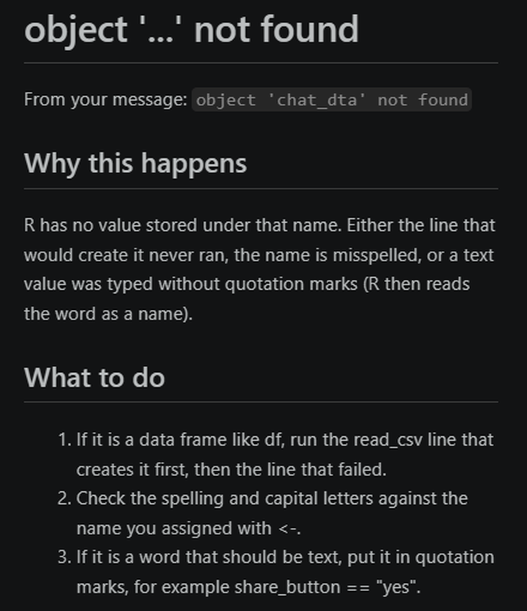

# Explain an R Error

Get a plain-English reading of an R error message and the steps that usually fix it.

## Steps

1. In the R terminal, select the error message with the mouse, starting at `Error`.
2. Copy it with **Ctrl+C** (**Cmd+C** on a Mac).
3. Open the Command Palette: **View**, then **Command Palette...** (or **Ctrl+Shift+P**; **Cmd+Shift+P** on a Mac).
4. Type `AURA: Explain an R error` and press **Enter**. The copied message is already in the box.
5. Press **Enter** again.
6. Read **Why this happens**, then work through the numbered steps under **What to do**.
7. Close the explanation with **Ctrl+W**.

## What you should see

{fig-alt="An R Companion panel titled object not found. It quotes the message object chat_dta not found, then explains why this happens and lists what to do."}

## If it does not work

If the message is not in the list, the extension offers **Copy a question for your AI tool**. Paste that question into your AI tool and record the exchange in your AI Use Log.
