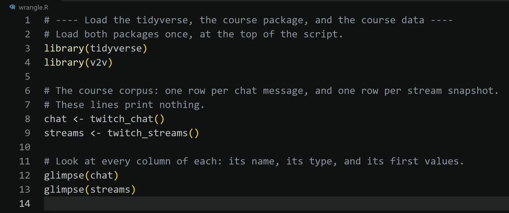

# Load the Course Data with Write R Code

Write the commented code that loads the tidyverse, the course package, and the Twitch data, then run it.

Prefer to watch first? The walkthrough video [Wrangling and the reliability grid](https://siue.yuja.com/V/Video?v=17490319&a=95173025) shows these steps.

## Steps

1. Open the file you are working in. For the Data Wrangling assignment that is `11-wrangling-data.qmd` in the top folder of your workspace ([Put a Worksheet in Your Workspace](14-put-a-worksheet-in-your-workspace.md) shows how to get it there): click it in the Explorer on the left. Put the cursor on an empty line near the top. (With no file open, the code goes to `steps.R` in your course folder.)
2. Open the Command Palette: **View**, then **Command Palette...** (or **Ctrl+Shift+P**; **Cmd+Shift+P** on a Mac).
3. Type `AURA: Open an R terminal` and press **Enter**. Wait for the R prompt `>` at the bottom.
4. Open the Command Palette again, type `AURA: Write R code`, and press **Enter**.
5. Under **R2 Data**, select **Load the course Twitch corpus**.
6. A message at the bottom right asks **Run it now?**. Select **Run it** before it disappears.

## What you should see

{fig-alt="VS Code editor showing a script named wrangle.R with a commented block the R Companion inserted: library(tidyverse), library(v2v), chat <- twitch_chat(), streams <- twitch_streams(), glimpse(chat), and glimpse(streams)."}

The terminal lists the columns of `chat` (35,267 rows) and `streams` (32,276 rows). Scroll up in the terminal if the counts have already passed.

## If it does not work

If pressing **Ctrl+Enter** (**Cmd+Enter** on a Mac) opens a box titled **Choose where to run the selected code**, press **Esc**. Do not pick **New R Interactive window** or **Create R terminal**: both start a new R that has none of your tables. Instead, click the **AURA Lab R Companion** icon on VS Code's left edge and select **Run my steps from the top**. It runs your file from the first line, in the same R as **Run it**.

If the terminal says `there is no package called 'v2v'`, run **AURA: Check my setup**, select **Install what is missing**, then run the block again with **Ctrl+Enter** (**Cmd+Enter** on a Mac).
