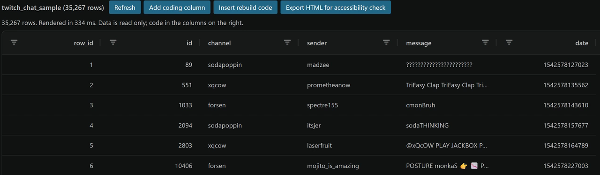
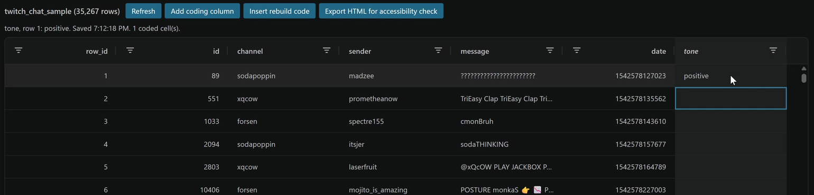

# Read and Code Data in the Data Viewer

Read your sampled messages as a grid and enter codes in coding columns, without changing the original file.

Prefer to watch first? The walkthrough video [The data viewer and coding sheet](https://siue.yuja.com/V/Video?v=17489997&a=123495612) shows these steps.

## Steps

1. Open the Command Palette: **View**, then **Command Palette...** (or **Ctrl+Shift+P**; **Cmd+Shift+P** on a Mac).
2. Type `AURA: Open the data viewer` and press **Enter**.
3. Select **Pick a CSV file**, choose your sampled CSV, then **Open in the data viewer**.
4. Select a column header to sort by it. Select it again to reverse the order.
5. Select **Add coding column**. Type the variable name from your codebook, for example `tone`.
6. Choose **Allowed values (a dropdown)**, then type your codebook values separated by commas, for example `positive, neutral, negative`.
7. Click the first cell in the new column, type the first letters of a code, and press **Enter**. The cursor moves down one row.
8. When you have coded, select **Insert rebuild code**. It writes the R that joins your codes back onto the data.

## What you should see

{fig-alt="The R Companion data viewer showing the Twitch chat sample as a grid of 35,267 rows, with columns for channel, sender, message, and date."}

{fig-alt="The data viewer with buttons Refresh, Add coding column, Insert rebuild code, and Export HTML for accessibility check. A new column named tone on the right holds the code positive in row 1, and the line above the grid reads: tone, row 1: positive. Saved."}

Your codes save by themselves to `data/derived/`, one row per coded cell. The original CSV never changes.

## If it does not work

If you typed a wrong code, press **Ctrl+Z** (**Cmd+Z** on a Mac) to undo it, or select the cell and press **Delete** to clear it.
