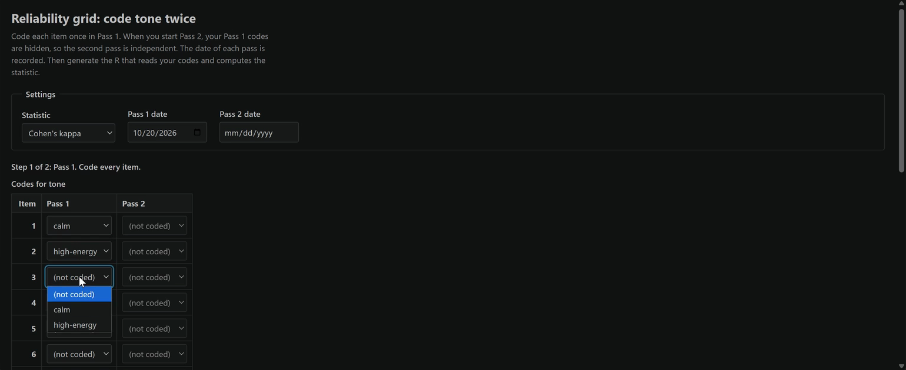
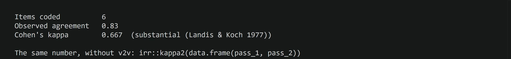

# Check Reliability with the Reliability Grid

Code the same items twice and compute Cohen's kappa or Krippendorff's alpha for your pilot.

Prefer to watch first? The walkthrough video [Wrangling and the reliability grid](https://siue.yuja.com/V/Video?v=17490319&a=95173025) shows these steps.

## Steps

1. Open the Command Palette: **View**, then **Command Palette...** (or **Ctrl+Shift+P**; **Cmd+Shift+P** on a Mac).
2. Type `AURA: Reliability grid` and press **Enter**. A panel titled **Reliability grid** opens.
3. Under **Settings**, pick the **Statistic**: Cohen's kappa or Krippendorff's alpha.
4. Code every item in the **Pass 1** column.
5. Scroll down and select **Start Pass 2 (hide Pass 1)**. Your Pass 1 codes disappear.
6. Code every item again in the **Pass 2** column.
7. Select **Save codes and generate R**, then **Run it**.

## What you should see

{fig-alt="The Reliability grid panel titled Reliability grid: code tone twice. Settings show the statistic Cohen's kappa and a Pass 1 date. The line Step 1 of 2: Pass 1. Code every item. sits above a table with Item, Pass 1, and Pass 2 columns, and a drop-down open on item 3 offering not coded, calm, and high-energy."}

{fig-alt="R terminal output: Items coded 6, Observed agreement 0.83, Cohen's kappa 0.667 (substantial (Landis & Koch 1977)), and the line The same number, without v2v: irr::kappa2(data.frame(pass_1, pass_2))."}

The terminal prints the items coded, the observed agreement, and the statistic, then the same number from `irr` as a check.

## If it does not work

If the buttons are out of sight, scroll down inside the panel. They sit below the last row.
