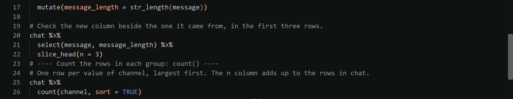

# Wrangle the Data with Write R Code

Clean the dates, add a column, join each message to its stream and its channel label, join your codes onto the messages, and save the analysis file.

Prefer to watch first? The walkthrough video [Wrangle the Data with Write R Code](https://siue.yuja.com/V/Video?v=17649365&a=210065970) shows these steps.

## Steps

1. Load the course data first (guide 04).
2. Open the Command Palette: **View**, then **Command Palette...** (or **Ctrl+Shift+P**; **Cmd+Shift+P** on a Mac). Type `AURA: Write R code` and press **Enter**.
3. Under **R2 Data**, select **Turn the date column into a time (clean_dates)**. When the message at the bottom right asks **Run it now?**, select **Run it**.
4. Run **AURA: Write R code** again and select **Add a column (mutate)**, then **Run it**. Do this before the join, so every matched message keeps its length.
5. Select **Match each message to its stream (join_chat_streams)**, then **Run it**.
6. Select **Label each channel by its top category**, then **Run it**. Then select **Join the channel labels onto the messages**, then **Run it**.
7. Select **Count rows per group (count)**. A list titled **Which table?** opens: press **Enter** to keep **chat**. Then select **Use the course default columns**, then **Run it**.
8. Read your coding sheet into a table named `codes` that keeps only the key and your code. On a new line under the last block, type these two lines, select both, and press **Ctrl+Enter** (**Cmd+Enter** on a Mac):

    ```r
    codes <- read_csv("data/coding-form.csv") %>%
      select(id, reaction_only)
    ```

9. Run **AURA: Write R code** and select **Join two tables by a shared column**. Answer its three questions:
    - **The table you keep every row of:** select **chat_streams**.
    - **The table you take columns from:** select **codes**.
    - **The column both tables share:** type `id` and press **Enter**.

    Then select **Keep every row of chat_streams** (the usual choice), then **Run it**. The block names the result `chat_streams_codes`.
10. On a new line under that block, type `analysis <- chat_streams_codes` and press **Ctrl+Enter** (**Cmd+Enter** on a Mac). This names the finished table `analysis`, the name the save step and the next worksheets read.
11. Select **Save a table as an RDS file**. A box asks for the file name: leave `data/twitch_analysis.RDS` and press **Enter**. Then **Run it**.
12. Below each block, write your own comment saying why you chose that step.

## What you should see

{fig-alt="Code the R Companion wrote into wrangle.R: a mutate() that adds message_length, a check that selects message and message_length for three rows, and a block headed Count the rows in each group: count() that counts chat by channel, largest first."}

Each block arrives with a heading comment. The terminal prints a table after each **Run it**.

The join's two checks print `[1] 35267`, then `[1] 35237`. The first is the row count: the join kept every message and added none. The second counts the messages with no match in `codes`: every message except your thirty. Only your thirty coded messages carry a value in `reaction_only`; every other message is `NA` there, and that is correct.

The save step ends with `[1] 35267`: the file holds every message. `twitch_analysis.RDS` appears in the `data` folder in the Explorer.

## If it does not work

If pressing **Ctrl+Enter** (**Cmd+Enter** on a Mac) opens a box titled **Choose where to run the selected code**, press **Esc**. Do not pick **New R Interactive window** or **Create R terminal**: both start a new R that has none of your tables. Instead, click the **AURA Lab R Companion** icon on VS Code's left edge and select **Run my steps from the top**. It runs your file from the first line, in the same R as **Run it**.

If a step's list offers no table, run the block that creates that table first. The menu offers only tables made above the cursor.

If the join's first check prints a number bigger than `35267`, an `id` appears twice in your coding sheet. If the second prints more than `35237`, some `id` values in your sheet no longer match a message: check that the `id` column was not changed when you saved the sheet.

If R says `cannot open file 'data/...': No such file or directory`, your workspace has no `data` folder yet. Click in the R terminal, type `dir.create("data")`, press **Enter**, and run the block again.
