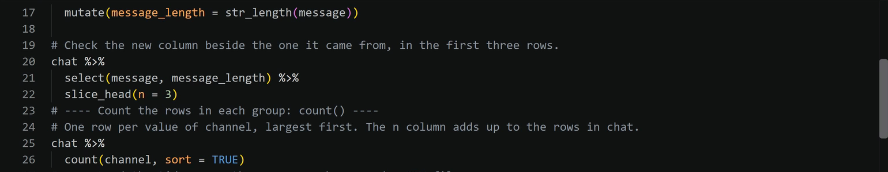

# Wrangle the Data with Write R Code

Clean the dates, join each message to its stream, add and count columns, and save the analysis file.

Prefer to watch first? The walkthrough video [Wrangling and the reliability grid](https://siue.yuja.com/V/Video?v=17490319&a=95173025) shows these steps.

## Steps

1. Load the course data first (guide 04).
2. Open the Command Palette: **View**, then **Command Palette...** (or **Ctrl+Shift+P**; **Cmd+Shift+P** on a Mac). Type `AURA: Write R code` and press **Enter**.
3. Under **R2 Data**, select **Turn the date column into a time (clean_dates)**, then **Run it**.
4. Run **AURA: Write R code** again and select **Match each message to its stream (join_chat_streams)**, then **Run it**.
5. Select **Add a column (mutate)**, then **Run it**.
6. Select **Count rows per group (count)**, choose **Use the course default columns**, then **Run it**.
7. When the table is ready, select **Save a table as an RDS file**, then **Run it**.
8. Below each block, write your own comment saying why you chose that step.

## What you should see

{fig-alt="Code the R Companion wrote into wrangle.R: a mutate() that adds message_length, a check that selects message and message_length for three rows, and a block headed Count the rows in each group: count() that counts chat by channel, largest first."}

Each block arrives with a heading comment. The terminal prints a table after each **Run it**.

## If it does not work

If a step's list offers no table, run the block that creates that table first. The menu offers only tables made above the cursor.
