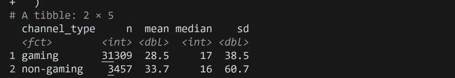
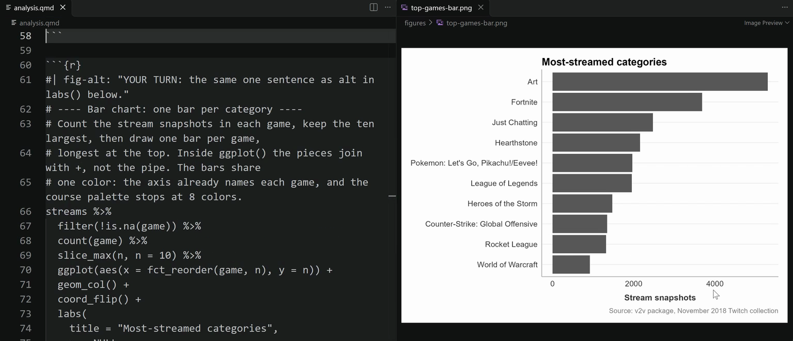

# Describe the Data: Tables and Charts

Make frequency tables, group summaries, and charts, each with alt text you write.

Prefer to watch first? The walkthrough video [Describing data](https://siue.yuja.com/V/Video?v=17490672&a=193714265) shows these steps.

## Steps

1. In your Quarto document, load your saved analysis: **AURA: Write R code**, then **Load your saved analysis (RDS)**, then **Run it**.
2. Run **AURA: Write R code** and, under **R3 Describe**, select **Frequency table**, then **Use the course default columns**, then **Run it**.
3. Select **Summary by group**, then **Run it**.
4. Select **Bar chart**. Before running it, replace both lines marked `YOUR TURN` with one sentence that says what the chart shows: the `#| fig-alt:` line and the `alt =` line inside `labs()`.
5. Select **Run it**. The chart opens in its own tab and is saved in your `figures` folder.
6. Repeat for **Histogram**, **Boxplot**, **Line chart over time**, or **Histogram comparing two groups**, as your project needs.

## What you should see

{fig-alt="R terminal output of Summary by group: a table with one row each for gaming (n 31309, mean 28.5, median 17, sd 38.5) and non-gaming (n 3457, mean 33.7, median 16, sd 60.7)."}

{fig-alt="VS Code split in two. On the left, analysis.qmd holds a chunk that starts with a fig-alt line marked YOUR TURN and a bar chart block. On the right, top-games-bar.png is open in its own tab: a bar chart titled Most-streamed categories, with Art the longest bar."}

## If it does not work

If a chart does not appear, check that every `+` sits at the end of a line, not at the start of the next one.
