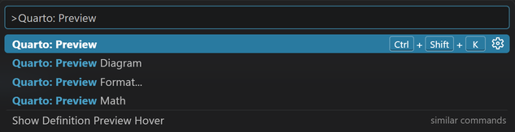
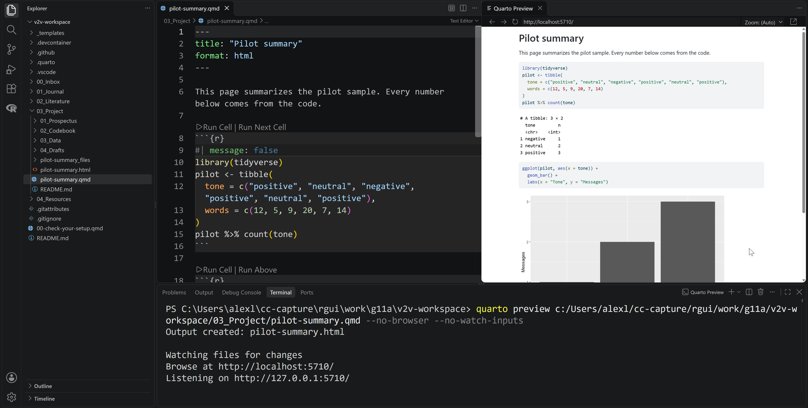
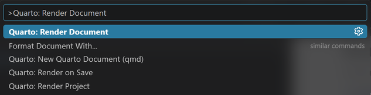
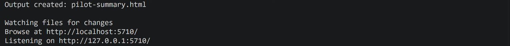

# Render a Quarto Document

Turn your `.qmd` file into a finished page in which every number and chart comes from your code.

## Steps

1. Open your `.qmd` file in the editor.
2. Save it with **Ctrl+S** (**Cmd+S** on a Mac).
3. Open the Command Palette: **View**, then **Command Palette...** (or **Ctrl+Shift+P**; **Cmd+Shift+P** on a Mac).
4. Type `Quarto: Preview` and press **Enter**, or press **Ctrl+Shift+K** (**Cmd+Shift+K** on a Mac).

    {fig-alt="The Command Palette with Quarto: Preview typed. The first line, Quarto: Preview, is highlighted and shows its shortcut Ctrl+Shift+K."}

5. Wait for the Terminal panel to finish. The rendered page opens in a panel beside your file.

    {fig-alt="VS Code with pilot-summary.qmd open on the left and a Quarto Preview panel on the right showing the rendered page: the title Pilot summary, the code, a table counting messages by tone, and a bar chart. The Terminal panel below shows the render finishing."}

6. After each change, save the file again. The preview updates.
7. To build the final file without the preview, run **Quarto: Render Document** from the Command Palette.

    {fig-alt="The Command Palette with Quarto: Render Document typed and highlighted as the first line."}

## What you should see

{fig-alt="The Terminal panel after a preview. It reads Output created: pilot-summary.html, then Watching files for changes and the local address the preview uses."}

The Terminal panel ends with `Output created:` followed by the file name, and the rendered page shows your text, tables, and charts.

## If it does not work

If the render stops at a chunk, the Terminal names the chunk and the line. Run that chunk on its own to see the R error, then use guide 03.
