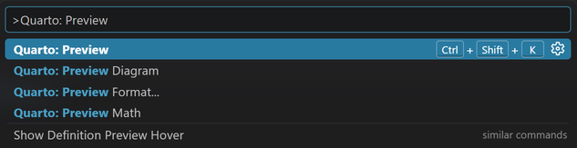
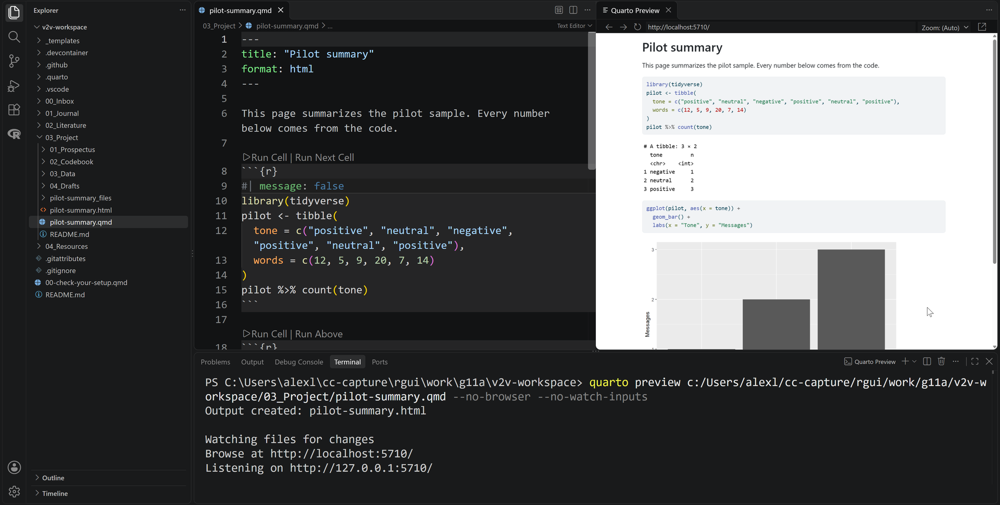
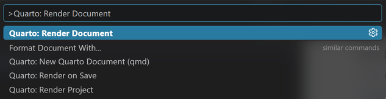
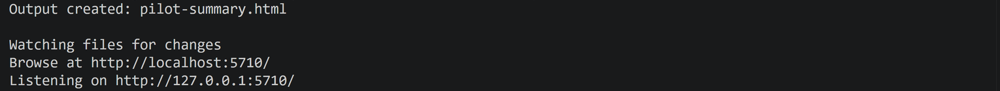

# Render a Quarto Document

Turn your `.qmd` file into a finished page in which every number and chart comes from your code.

Prefer to watch first? The walkthrough video [Render a Quarto Document](https://siue.yuja.com/V/Video?v=17649358&a=85867670) shows these steps.

## Steps

1. Open your `.qmd` file in the editor.
2. Save it: in the menu bar at the top, select **File**, then **Save**.
3. Open the Command Palette: **View**, then **Command Palette...** (or **Ctrl+Shift+P**; **Cmd+Shift+P** on a Mac).
4. Type `Quarto: Preview` and press **Enter** (**Return** on a Mac). (Keyboard: **Ctrl+Shift+K**, or **Cmd+Shift+K** on a Mac.)

    {fig-alt="The Command Palette with Quarto: Preview typed. The first line, Quarto: Preview, is highlighted and shows its shortcut Ctrl+Shift+K."}

5. Wait for the Terminal panel to finish. The rendered page opens in a panel beside your file.

    {fig-alt="VS Code with pilot-summary.qmd open on the left and a Quarto Preview panel on the right showing the rendered page: the title Pilot summary, the code, a table counting messages by tone, and a bar chart. The Terminal panel below shows the render finishing."}

6. After each change, save the file again, then run **Quarto: Preview** again from the Command Palette, as in steps 3 and 4. Saving alone does not refresh the preview.
7. To build the final file, first close the **Quarto Preview** tab. Then run **Quarto: Render Document** from the Command Palette. If a list of formats opens, select **Render HTML**.

    {fig-alt="The Command Palette with Quarto: Render Document typed and highlighted as the first line."}

## What you should see

{fig-alt="The Terminal panel after a preview. It reads Output created: pilot-summary.html, then Watching files for changes and the local address the preview uses."}

The Terminal panel ends with `Output created:` followed by the file name, and the rendered page shows your text, tables, and charts.

## If it does not work

If the render stops at a chunk, the Terminal names the chunk and the line. Run that chunk on its own to see the R error, then use guide 03.

**The render stops with `does not exist in current working directory`.** Your worksheet may be inside one of the folders in your course workspace, the folder you have open in VS Code. It has to be outside all of them. These steps check, and move it if needed.

1. Look at the Explorer, the list of files and folders on the left side of VS Code. (If you do not see the word **EXPLORER** at the top of it, select **View** in the menu bar, then **Explorer**. The menu bar is at the top of the VS Code window on Windows, and at the top of the screen on a Mac.) Under the word **EXPLORER** at the top of this list, a line in capital letters shows the name of your course workspace. Do not click that line. Below it, each folder has a small arrow in front of its name. The arrow points right, like `>`, when the folder is closed, and points down, like `v`, when it is open. Click the name of every folder whose arrow points down, so that every arrow points right. Every folder is now closed, and the list is short.
2. Look for your worksheet's name in the short list. It is the same name as on the tab above the page you are typing in. If you see it there, the worksheet is already in the right place, and this entry does not apply: email your instructor a picture of the whole VS Code window, with the list on the left and the red message at the bottom both showing (a photo taken with your phone is fine). If you do not see it, it is inside one of the closed folders: go on to step 3.
3. Open the folders one at a time, starting from the top of the short list. Click a folder's name once to open it, and read the names that show below it. If your worksheet's name is not there, click the folder's name again to close it, and try the next folder the same way. A folder inside a folder opens the same way: try those before you close the outer one. Stop when you see your worksheet's name. If you have tried every folder and have not seen it, email your instructor a picture of the whole VS Code window.
4. Drag the worksheet's name onto the empty space below the last line of the list and let go. If a box asks whether to move it, select **Move**. You should see the worksheet's name leave the folder it was in.
5. Close every folder again, as in step 1. You should now see the worksheet's name in the short list, and a line reading `data`. If either one is missing, email your instructor a picture of the whole VS Code window.
6. Click the worksheet's name once, so that it is the page in front of you, then render again with steps 3 and 4 under the heading **Steps** at the top of this guide. **It worked if** a line that begins `Output created:` prints near the bottom of the Terminal panel, the panel along the bottom of VS Code. If the red message prints again, email your instructor a picture of the whole VS Code window, with the red message showing.

Why moving it works: when you render, R begins in the folder that holds the worksheet, so `data/` in your lines leads to a folder named `data` inside that folder, and there is none. Once the worksheet is outside every folder, it sits next to `data`, and `data/` leads to the right place. When you highlight lines and run them with a right-click, R begins in your course workspace wherever the worksheet is, so the same lines can work that way and still stop a render.

If you press **Run Cell** (the ▷ at the top right of a code cell) and your code lands in a terminal named **powershell** (**zsh** on a Mac) instead of **R (AURA)**, it did not run in R. Select **R (AURA)** in the list of terminals at the right of the Terminal panel, then press **Run Cell** again. (Keyboard: click inside the cell and press **Ctrl+Shift+Enter**, or **Cmd+Shift+Enter** on a Mac; it switches to **R (AURA)** before it runs the cell.)

## Submit your work as one ZIP file

You turn in an R assignment as one ZIP file: your whole course workspace, the folder you have open in VS Code, packed into a single file. Before you start, render the worksheet, and save the AI-use log in the same place as `README.md`, so that both are inside the workspace.

**On Windows**

1. In the Explorer on the left side of VS Code, right-click `README.md` and select **Reveal in File Explorer**. A File Explorer window opens with `README.md` highlighted.
2. Click the up arrow (↑) to the left of the address bar at the top of that window. You should see your workspace's name in the list of folders.
3. Right-click your workspace's name and select **Compress to ZIP file**. (On an older Windows, select **Send to**, then **Compressed (zipped) folder**.) You should see a new file with the same name, ending in `.zip`.
4. In Blackboard, open the assignment, attach that `.zip` file, and submit.

**On a Mac**

1. In the Explorer on the left side of VS Code, Control-click `README.md` and select **Reveal in Finder**. A Finder window opens with `README.md` highlighted.
2. In the menu bar at the top of the screen, select **Go**, then **Enclosing Folder**. You should see your workspace's name in the list of folders.
3. Control-click your workspace's name and select **Compress**. You should see a new file with the same name, ending in `.zip`.
4. In Blackboard, open the assignment, attach that `.zip` file, and submit.
