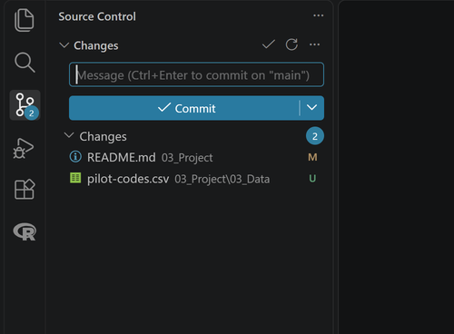
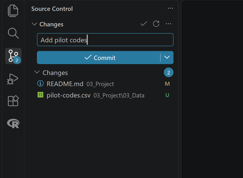
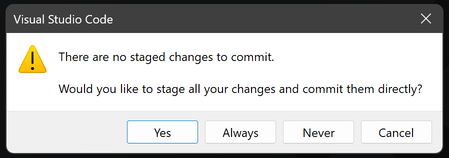
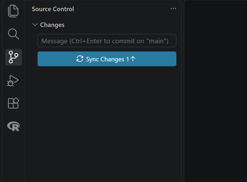
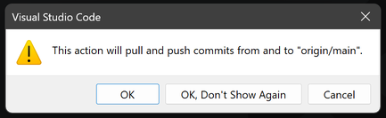
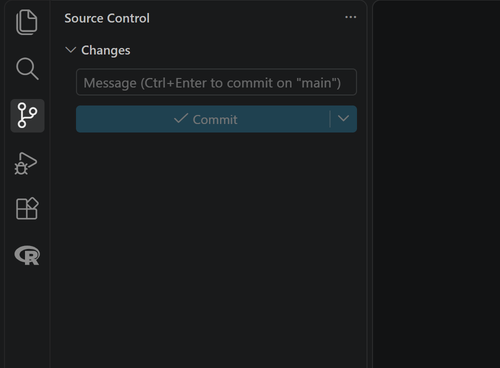

# Commit and Push with Git

Save a snapshot of your work and send it to your repository on GitHub.

## Steps

1. Select the **Source Control** icon in the Activity Bar on the left, or press **Ctrl+Shift+G**.
2. Under **Changes**, read the list of files you changed.

    {fig-alt="The Source Control view. Under Changes are two files: README.md in 03_Project, marked M for modified, and pilot-codes.csv in 03_Project/03_Data, marked U for new. Above them are an empty Message box and the blue Commit button."}

3. Type a short message in the **Message** box that says what you did, for example `Add pilot codes`.

    {fig-alt="The Source Control view with Add pilot codes typed in the Message box, above the Commit button."}

4. Select **Commit**. If VS Code asks whether to stage all your changes, select **Yes**.

    {fig-alt="A VS Code message: There are no staged changes to commit. Would you like to stage all your changes and commit them directly? The buttons are Yes, Always, Never, and Cancel."}

5. Select **Sync Changes** to push the commit to GitHub. If VS Code says the action will pull and push commits, select **OK**.

    {fig-alt="The Source Control view after the commit. The Changes list is empty and the blue button now reads Sync Changes with 1 and an up arrow. The Graph below shows Add pilot codes as an outgoing change."}

    {fig-alt="A VS Code message: This action will pull and push commits from and to origin/main. The buttons are OK, OK, Don't Show Again, and Cancel."}

6. Open your repository on GitHub and check that the new commit is listed.

## What you should see

{fig-alt="The Source Control view after the push. The Message box is empty, the Sync Changes button is gone, and the Graph shows Add pilot codes on both main and the GitHub copy."}

The **Changes** list empties after you commit, and **Sync Changes** goes away once the push finishes.

## If it does not work

If Git asks who you are, run these two lines in the terminal with your own name and email, then commit again:

```
git config --global user.name "Your Name"
git config --global user.email "you@example.com"
```
