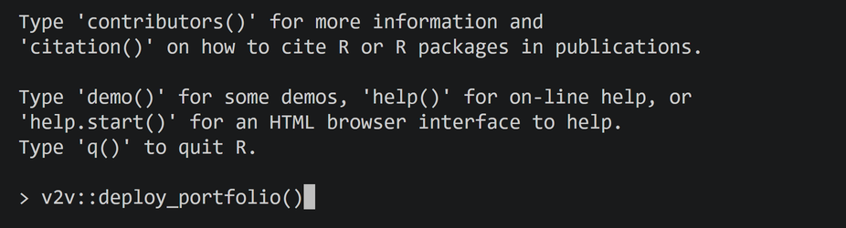
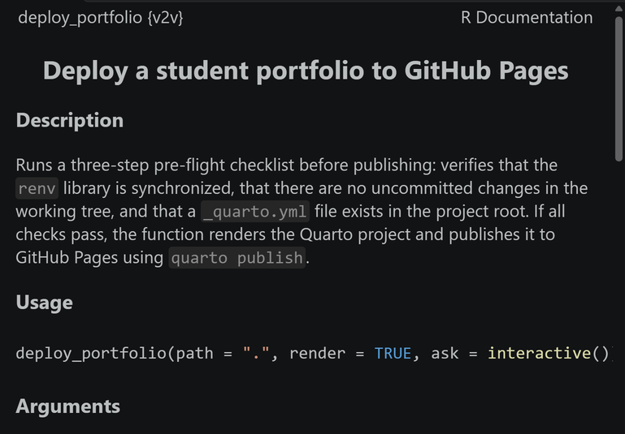

# Publish Your Site

Render your project and put it live on GitHub Pages, after three checks that catch the common failures.

## Steps

1. Commit and push every change first (guide 12).
2. Open your project folder itself in VS Code: select **File**, then **Open Folder**, and choose the folder `v2v::new_portfolio()` made for your study (the one that holds `_quarto.yml`), not the workspace around it.
3. Open an R terminal: run **AURA: Open an R terminal** from the Command Palette.
4. Type this line in the R terminal and press **Enter**:

    ```r
    v2v::deploy_portfolio()
    ```

    {fig-alt="The R terminal in VS Code with v2v::deploy_portfolio() typed after the prompt, ready to run."}

5. Read the **Pre-flight checks**. Each line starts with a check mark when it passes.
6. When it asks **Publish to GitHub Pages? [y/N]**, type `y` and press **Enter**. Any other answer stops without publishing.
7. When it finishes, it prints that the portfolio is live on GitHub Pages. Open that address in a browser.

To read what the command does before you run it, put your cursor on `deploy_portfolio` in a script and run **R: Open help for selection** from the Command Palette. The help page opens beside your script.

{fig-alt="The R Help page for deploy_portfolio in the v2v package, titled Deploy a student portfolio to GitHub Pages. The Description says it checks that the renv library is in sync, that there are no uncommitted changes, and that a _quarto.yml file exists, then renders and publishes the project. Usage reads deploy_portfolio(path = &quot;.&quot;, render = TRUE, ask = interactive())."}

## What you should see

```
── Pre-flight checks ──
ℹ No renv.lock found - skipping renv check
✔ no uncommitted changes
✔ _quarto.yml valid
──────────────────────
✔ Rendering 9 pages
Publish to GitHub Pages? [y/N] y
✔ Publishing to GitHub Pages
ℹ Published to https://your-username.github.io/your-repository/
✔ Portfolio live on GitHub Pages.
```

The first line is normal: the course scaffold has no `renv.lock` file, so the renv check is skipped. A project with one shows **renv library in sync** there instead. The **Published to** line gives your site's address.

## If it does not work

If a check fails, fix that one thing and run the command again. **_quarto.yml** failing means VS Code has the wrong folder open: go back to step 2. **no uncommitted changes** failing means you have work to commit and push (guide 12).
