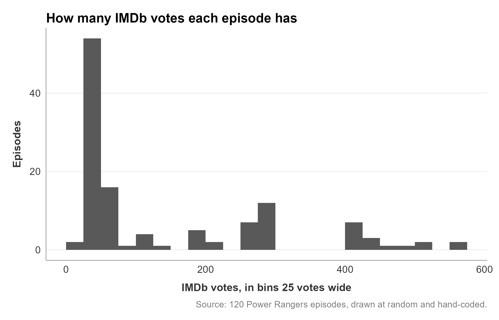
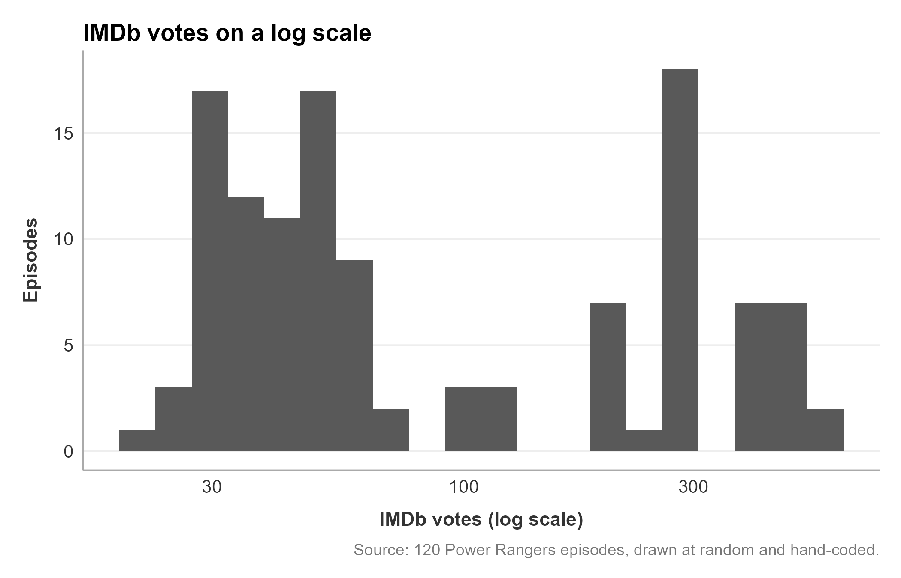
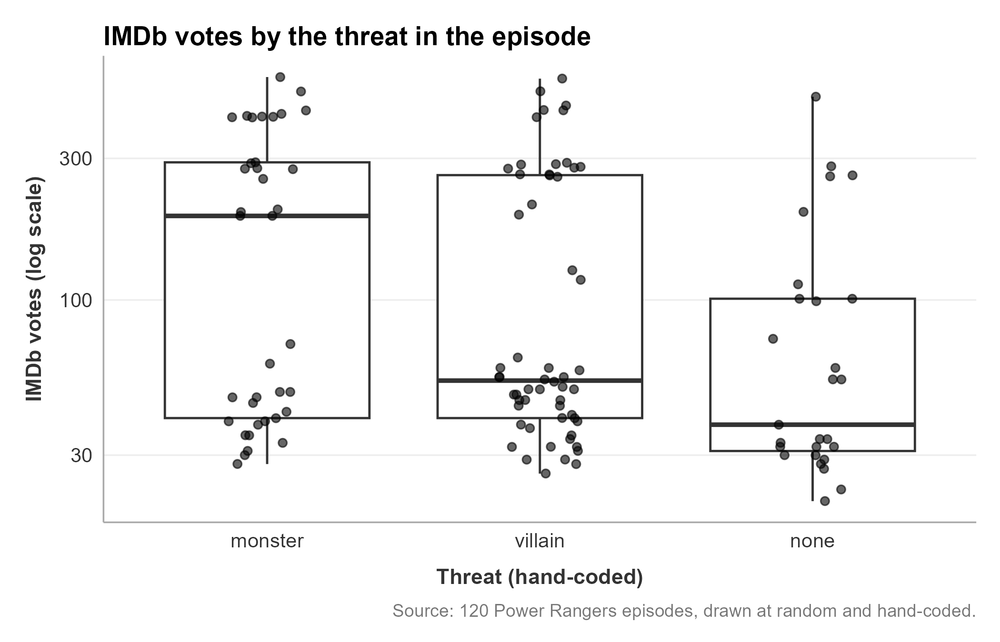

# Describe a Coded Category Against Counts and Source Measures

Some studies code a category for each item, then compare it with numbers that came with the item: views, likes, shares, votes, streams, or followers. Those numbers behave differently from a rating. A few items have far more than the rest, and often the number belongs to the item's **source** (the account, channel, outlet, artist, or season it came from) more than to the item. This guide shows how to see both before you test anything. You type every line of R yourself and see what each one prints.

Start with [guide 09](09-describing-tables-and-charts.md), *Describe Your Own Data*, which covers counts, percents, crosstabs, and the three basic charts. This guide adds what changes when your numbers are counts or come from your sources. [Guide 17](17-choose-your-test-and-write-it-in-apa.md) picks up from here and turns what you find into test choices.

## The example data

The example continues the study from [guide 08](08-wrangling.md), *Wrangle Your Own Data*: 120 Power Rangers episodes, drawn at random and hand-coded for `threat` (`monster`, `villain`, or `none`). Each episode also has a count, `total_votes`, the number of IMDb users who rated it. The season table adds a number that belongs to the season, not the episode: the season's own IMDb rating.

- [episodes_analysis.RDS](../../resources/examples/own-study-walkthrough/episodes_analysis.RDS): the analysis file [guide 08](08-wrangling.md) saved.
- [power_rangers_seasons.csv](../../resources/examples/own-study-walkthrough/power_rangers_seasons.csv): the table about the sources, one row per season.
- [describe-counts.R](../../resources/examples/own-study-walkthrough/describe-counts.R): the finished script, so you can compare yours with it at any step.

Your study has the same parts under other names. Your items might be posts, videos, articles, or messages; your count might be views or likes; your sources might be accounts, channels, songs, or outlets.

## Words used here

- **Count:** a number that tallies something, such as views or votes. It cannot go below 0, and it usually has no upper limit.
- **Skewed:** most values are small and a few are very large, so the chart has a long tail on one side.
- **Log scale:** an axis where equal steps multiply instead of add, so 10, 100, and 1,000 sit equally far apart. It lets a chart show small and very large counts at once.
- **Source:** where an item came from: the account, channel, outlet, artist, song, or season.
- **Source measure:** a number that belongs to the source, so every item from that source has the same value, such as a channel's follower count or a song's monthly streams.

## Before you start

**It worked if** the Explorer, the file list on VS Code's left, shows `episodes_analysis.RDS` and `power_rangers_seasons.csv` (or your own files) indented under `data`. To get the example files, click each link above; your browser saves it to your **Downloads** folder. Then drag it from Downloads onto the `data` folder in the Explorer, as [guide 08](08-wrangling.md) shows.

### How to run lines in this guide

Every step asks you to type lines into your script and run them:

1. Type the lines exactly as shown, one per line.
2. Select them: click just before the first letter of the first line, hold the mouse button (or press on the trackpad), and drag to the end of the last line. The lines turn highlighted.
3. Right-click the highlighted lines (on a Mac, Control-click or click with two fingers) and select **Run the selected lines in R**. (Keyboard: **Ctrl+Enter**, or **Cmd+Enter** on a Mac.)

What R prints appears in the **Terminal** panel along the bottom of VS Code. Scroll up inside it with your mouse wheel or trackpad to see output that has scrolled away. To run your whole file from the top instead, click the **AURA Lab R Companion** icon on VS Code's left edge and select **Run my steps from the top**.

## Step 1: Open a script and load the packages and your data

1. In the Explorer, right-click (on a Mac, Control-click or click with two fingers) the empty space below the file list and select **New File...**. Type `describe-counts.R` and press **Enter**.
2. Open an R terminal: click **View** in the menu bar at the top of the window (on a Mac, at the top of the screen), then **Command Palette...**. Type `AURA: Open an R terminal` and click it in the list. Wait for the `>` prompt in the Terminal panel.

Type these lines and run them:

```r
library(tidyverse)
library(janitor)
library(v2v)
options(scipen = 10)
```

```
> library(tidyverse)
── Attaching core tidyverse packages ──────────────────────── tidyverse 2.0.0 ──
✔ dplyr     1.1.4     ✔ readr     2.1.6
✔ forcats   1.0.1     ✔ stringr   1.6.0
✔ ggplot2   4.0.1     ✔ tibble    3.3.0
✔ lubridate 1.9.4     ✔ tidyr     1.3.1
✔ purrr     1.2.0     
── Conflicts ────────────────────────────────────────── tidyverse_conflicts() ──
✖ dplyr::filter() masks stats::filter()
✖ dplyr::lag()    masks stats::lag()
ℹ Use the conflicted package (<http://conflicted.r-lib.org/>) to force all conflicts to become errors

> library(janitor)

Attaching package: 'janitor'

The following objects are masked from 'package:stats':

    chisq.test, fisher.test


> library(v2v)
v2v 0.3.9 loaded.
  setup()  checks that R, Quarto and Git are ready
  ?v2v     lists what this package gives you

Attaching package: 'v2v'

The following object is masked from 'package:janitor':

    crosstab


> options(scipen = 10)
```

**Check:** the `v2v` line says 0.3.9 or newer. The `Conflicts` and `masked` lines are notes, not errors.

Now load your analysis file and make a folder for the charts:

```r
episodes <- read_rds("data/episodes_analysis.RDS")
dir.create("figures", showWarnings = FALSE)
```

```
> episodes <- read_rds("data/episodes_analysis.RDS")

> dir.create("figures", showWarnings = FALSE)
```

**Check:** both lines print nothing, and a `figures` folder appears in the Explorer.

## Step 2: Count your coded category

Start with the category you coded, as in [guide 09, Step 2](09-describing-tables-and-charts.md#step-2-count-each-category-frequency-tables):

```r
episodes %>%
  count(threat) %>%
  mutate(percent = round(100 * n / sum(n), 1))
```

```
> episodes %>%
+   count(threat) %>%
+   mutate(percent = round(100 * n / sum(n), 1))
# A tibble: 3 × 3
  threat      n percent
  <fct>   <int>   <dbl>
1 monster    37    30.8
2 villain    56    46.7
3 none       27    22.5
```

**Check:** the counts add up to your number of items (37 + 56 + 27 = 120). A group with very few items (under about 5) gives shaky averages in every later step, so note it now.

## Step 3: Is your count skewed? Compare the mean and the median

The mean adds every value and divides; the median is the middle value. With a count, a few very large values pull the mean up while the median stays put, so the gap between them is your first sign of skew ([summarize() on the dplyr cheat sheet](../../resources/cheat-sheets/dplyr.html)):

```r
episodes %>%
  summarize(
    n = n(),
    mean = mean(total_votes),
    median = median(total_votes),
    sd = sd(total_votes),
    max = max(total_votes)
  )
```

```
> episodes %>%
+   summarize(
+     n = n(),
+     mean = mean(total_votes),
+     median = median(total_votes),
+     sd = sd(total_votes),
+     max = max(total_votes)
+   )
# A tibble: 1 × 5
      n  mean median    sd   max
  <int> <dbl>  <dbl> <dbl> <dbl>
1   120  146.     54  151.   564
```

**Check:** the mean (146) is almost three times the median (54), and the standard deviation (151) is larger than the mean. Both say the votes are skewed. When you describe a skewed count in your write-up, the median is the better "typical" number; give the mean too, so a reader sees the gap.

Now the same numbers for each category:

```r
episodes %>%
  group_by(threat) %>%
  summarize(
    n = n(),
    mean = mean(total_votes),
    median = median(total_votes),
    sd = sd(total_votes)
  )
```

```
> episodes %>%
+   group_by(threat) %>%
+   summarize(
+     n = n(),
+     mean = mean(total_votes),
+     median = median(total_votes),
+     sd = sd(total_votes)
+   )
# A tibble: 3 × 5
  threat      n  mean median    sd
  <fct>   <int> <dbl>  <dbl> <dbl>
1 monster    37 195.   192    170.
2 villain    56 139.    53.5  147.
3 none       27  95.0   38    110.
```

**Check:** monster episodes have a much higher median (192) than villain (53.5) or no-threat (38) episodes. Before you read that as "monster episodes draw more votes," Step 6 checks where the votes come from.

## Step 4: See the shape, then use a log scale

A histogram on the ordinary scale shows the skew:

```r
fig_votes_hist <- episodes %>%
  ggplot(aes(x = total_votes)) +
  geom_histogram(binwidth = 25, boundary = 0) +
  labs(
    title = "How many IMDb votes each episode has",
    x = "IMDb votes, in bins 25 votes wide",
    y = "Episodes",
    caption = "Source: 120 Power Rangers episodes, drawn at random and hand-coded.",
    alt = "Most episodes have under 75 votes; a second group sits near 250 to 300, and a few pass 500."
  ) +
  theme_v2v()

fig_votes_hist
ggsave("figures/votes-histogram.png", fig_votes_hist,
       width = 7, height = 4.5, dpi = 300)
```

```
> fig_votes_hist <- episodes %>%
+   ggplot(aes(x = total_votes)) +
+   geom_histogram(binwidth = 25, boundary = 0) +
+   labs(
+     title = "How many IMDb votes each episode has",
+     x = "IMDb votes, in bins 25 votes wide",
+     y = "Episodes",
+     caption = "Source: 120 Power Rangers episodes, drawn at random and hand-coded.",
+     alt = "Most episodes have under 75 votes; a second group sits near 250 to 300, and a few pass 500."
+   ) +
+   theme_v2v()

> fig_votes_hist

> ggsave("figures/votes-histogram.png", fig_votes_hist,
+        width = 7, height = 4.5, dpi = 300)
```

{fig-alt="Most episodes have under 75 votes; a second group sits near 250 to 300, and a few pass 500."}

**Check:** a tall bar at the left and a long, thin tail to the right. That shape is skew. The chart appears in the **R Plot** tab, and `votes-histogram.png` appears in `figures`.

`scale_x_log10()` puts the same counts on a log scale, where 30, 100, and 300 sit about equally far apart, because each is about three times the one before ([scale_x_log10() on the ggplot2 cheat sheet](../../resources/cheat-sheets/ggplot2.html)). Small and large counts both get room:

```r
fig_votes_log <- episodes %>%
  ggplot(aes(x = total_votes)) +
  geom_histogram(bins = 20) +
  scale_x_log10() +
  labs(
    title = "IMDb votes on a log scale",
    x = "IMDb votes (log scale)",
    y = "Episodes",
    caption = "Source: 120 Power Rangers episodes, drawn at random and hand-coded.",
    alt = "On a log scale the votes split into two groups: 78 episodes with 21 to 126 votes, 42 with 192 to 564."
  ) +
  theme_v2v()

fig_votes_log
ggsave("figures/votes-log-histogram.png", fig_votes_log,
       width = 7, height = 4.5, dpi = 300)
```

```
> fig_votes_log <- episodes %>%
+   ggplot(aes(x = total_votes)) +
+   geom_histogram(bins = 20) +
+   scale_x_log10() +
+   labs(
+     title = "IMDb votes on a log scale",
+     x = "IMDb votes (log scale)",
+     y = "Episodes",
+     caption = "Source: 120 Power Rangers episodes, drawn at random and hand-coded.",
+     alt = "On a log scale the votes split into two groups: 78 episodes with 21 to 126 votes, 42 with 192 to 564."
+   ) +
+   theme_v2v()

> fig_votes_log

> ggsave("figures/votes-log-histogram.png", fig_votes_log,
+        width = 7, height = 4.5, dpi = 300)
```

{fig-alt="On a log scale the votes split into two groups: 78 episodes with 21 to 126 votes, 42 with 192 to 564."}

**Check:** the log scale shows something the first chart hid: two separate groups of episodes: 78 with 21 to 126 votes and 42 with 192 to 564, and none in between. Two groups like that usually mean two kinds of source. Step 6 finds them. Say in your caption that the axis is a log scale, because a reader will otherwise read the bars as evenly spaced numbers.

## Step 5: Compare the count across your categories

A boxplot for each category, every item drawn as a dot, on the same log scale ([geom_boxplot() on the ggplot2 cheat sheet](../../resources/cheat-sheets/ggplot2.html)):

```r
fig_votes_threat <- episodes %>%
  ggplot(aes(x = threat, y = total_votes)) +
  geom_boxplot(outlier.shape = NA) +
  geom_jitter(width = 0.15, alpha = 0.6) +
  scale_y_log10() +
  labs(
    title = "IMDb votes by the threat in the episode",
    x = "Threat (hand-coded)",
    y = "IMDb votes (log scale)",
    caption = "Source: 120 Power Rangers episodes, drawn at random and hand-coded.",
    alt = "Votes by threat: monster has the highest median, near 190; every group has dots in both vote groups."
  ) +
  theme_v2v()

fig_votes_threat
ggsave("figures/votes-by-threat.png", fig_votes_threat,
       width = 7, height = 4.5, dpi = 300)
```

```
> fig_votes_threat <- episodes %>%
+   ggplot(aes(x = threat, y = total_votes)) +
+   geom_boxplot(outlier.shape = NA) +
+   geom_jitter(width = 0.15, alpha = 0.6) +
+   scale_y_log10() +
+   labs(
+     title = "IMDb votes by the threat in the episode",
+     x = "Threat (hand-coded)",
+     y = "IMDb votes (log scale)",
+     caption = "Source: 120 Power Rangers episodes, drawn at random and hand-coded.",
+     alt = "Votes by threat: monster has the highest median, near 190; every group has dots in both vote groups."
+   ) +
+   theme_v2v()

> fig_votes_threat

> ggsave("figures/votes-by-threat.png", fig_votes_threat,
+        width = 7, height = 4.5, dpi = 300)
```

{fig-alt="Votes by threat: monster has the highest median, near 190; every group has dots in both vote groups."}

**Check:** the thick lines match the medians from Step 3 (192, 53.5, and 38). The dots in each box split into the same two groups as the histogram, so the medians depend on how many of each group's episodes come from the high-vote group.

## Step 6: Find out how much the number belongs to the source

Many counts depend on where an item came from: a big account's posts get more views, and a famous song's videos ride on its streams. Count your items per source, and look at the count for each source. `n_distinct()` counts how many different values a column has ([n_distinct() on the dplyr cheat sheet](../../resources/cheat-sheets/dplyr.html)):

```r
episodes %>%
  group_by(season_num) %>%
  summarize(
    episodes = n(),
    median_votes = median(total_votes)
  ) %>%
  print(n = 25)
```

```
> episodes %>%
+   group_by(season_num) %>%
+   summarize(
+     episodes = n(),
+     median_votes = median(total_votes)
+   ) %>%
+   print(n = 25)
# A tibble: 25 × 3
   season_num episodes median_votes
        <dbl>    <int>        <dbl>
 1          1        7        504  
 2          2        8        416  
 3          3        2        418. 
 4          4        8        282. 
 5          5        4        262. 
 6          6        7        265  
 7          7        7        198  
 8          8        6        100  
 9          9        5         54  
10         10        5         44  
11         11        6         48.5
12         12        2         57  
13         13        4         52.5
14         14        7         48  
15         15        1         26  
16         16        8         34.5
17         17        3         46  
18         18        2         49.5
19         20        5         38  
20         21        1         39  
21         23        5         32  
22         24        6         31  
23         25        2         25.5
24         26        2         29.5
25         27        7         31  
```

**Check:** every season from 1 to 7 has a median above 190 votes, and every season from 9 on is under 60. The two groups in the histogram are early seasons and later seasons, not two kinds of episode. So the monster episodes' high median in Step 3 may come from monsters being more common in the early seasons. A test that compares votes across threat would mix the two. Name this in your write-up, and see [guide 17](17-choose-your-test-and-write-it-in-apa.md) for the choices it leaves you.

### A number that belongs only to the source

Some numbers are not about the item at all. The season's IMDb rating is one number per season, joined onto every episode in it. Read the season table and join that number on, as in [guide 08](08-wrangling.md):

```r
seasons <- read_csv("data/power_rangers_seasons.csv") %>%
  clean_names() %>%
  select(season_title, season_rating = imdb_rating)
```

```
> seasons <- read_csv("data/power_rangers_seasons.csv") %>%
+   clean_names() %>%
+   select(season_title, season_rating = imdb_rating)
Rows: 28 Columns: 7
── Column specification ────────────────────────────────────────────────────────
Delimiter: ","
chr  (3): season_title, air_date_last_ep, producer
dbl  (3): season_num, number_of_episodes, IMDB_rating
date (1): air_date_first_ep

ℹ Use `spec()` to retrieve the full column specification for this data.
ℹ Specify the column types or set `show_col_types = FALSE` to quiet this message.
```

```r
episodes <- episodes %>%
  left_join(seasons, by = join_by(season_title))
```

```
> episodes <- episodes %>%
+   left_join(seasons, by = join_by(season_title))
```

**Check:** the first block prints the column types the file was read with, and the join prints nothing. `select()` keeps two columns and renames `imdb_rating` to `season_rating`, so it cannot be mixed up with the episode's own rating.

Now count how many different values that number really has:

```r
episodes %>%
  summarize(
    episodes = n(),
    seasons = n_distinct(season_title),
    season_ratings = n_distinct(season_rating)
  )
```

```
> episodes %>%
+   summarize(
+     episodes = n(),
+     seasons = n_distinct(season_title),
+     season_ratings = n_distinct(season_rating)
+   )
# A tibble: 1 × 3
  episodes seasons season_ratings
     <int>   <int>          <int>
1      120      25             13
```

**Check:** 120 episodes, but only 25 seasons and 13 different season ratings. Any test of `season_rating` against your coded category rests on 25 sources, not 120 independent items. Seasons with more episodes in your sample count more times:

```r
episodes %>%
  count(season_title, season_rating, sort = TRUE)
```

```
> episodes %>%
+   count(season_title, season_rating, sort = TRUE)
# A tibble: 25 × 3
   season_title              season_rating     n
   <chr>                             <dbl> <int>
 1 Jungle Fury                         6.6     8
 2 Mighty Morphin (Season 2)           6.5     8
 3 Zeo                                 6.6     8
 4 Beast Morphers (Season 2)           6.8     7
 5 In Space                            7.3     7
 6 Lost Galaxy                         6.9     7
 7 Mighty Morphin (Season 1)           6.5     7
 8 Mystic Force                        6.7     7
 9 Lightspeed Rescue                   6.5     6
10 Ninja Steel                         6       6
# ℹ 15 more rows
```

**Check:** the top seasons have 7 or 8 episodes each, and some have 1. Describe a source measure once per source, with `distinct()`, which keeps each source once ([distinct() on the dplyr cheat sheet](../../resources/cheat-sheets/dplyr.html)):

```r
episodes %>%
  distinct(season_title, season_rating) %>%
  summarize(
    seasons = n(),
    mean = mean(season_rating),
    median = median(season_rating)
  )
```

```
> episodes %>%
+   distinct(season_title, season_rating) %>%
+   summarize(
+     seasons = n(),
+     mean = mean(season_rating),
+     median = median(season_rating)
+   )
# A tibble: 1 × 3
  seasons  mean median
    <int> <dbl>  <dbl>
1      25  6.39    6.5
```

**Check:** 25 seasons, mean 6.39, median 6.5. These are the numbers to report for a source measure: one per source, so a season with 8 episodes in your sample does not count 8 times.

## What goes in your write-up

- Your category's counts and percents (Step 2).
- For each count: n, median, and mean, and a sentence saying it is skewed if the mean sits well above the median (Step 3).
- Your charts, each with alt text you wrote after looking at it, and a caption that says when an axis is a log scale (Steps 4 and 5).
- How many sources your items come from, and any count or measure that belongs to the source rather than the item (Step 6). This is a limit a reader needs to know before your tests.

## If it does not work

If running a line opens a box titled **Choose where to run the selected code**, press **Esc**. Do not pick **New R Interactive window** or **Create R terminal**: both start a new R that has none of your tables. Instead, click the **AURA Lab R Companion** icon on VS Code's left edge and select **Run my steps from the top**.

**`Transformation introduced infinite values in continuous x-axis`** (or `y-axis`), and some items are missing from a log-scale chart. At least one count is 0, and a log scale cannot show 0. Say in your caption how many items have 0, and chart the rest, or add 1 to every count first: `mutate(total_votes_plus1 = total_votes + 1)`, then chart the new column and say so in the caption.

**`could not find function "n_distinct"`** (or `read_rds`, `%>%`, or any other function). The `library()` lines have not run in this R session. Select them, run them, and run your line again.

**`object 'season_rating' not found`.** The join in Step 6 has not run, or your source table names the column differently. Run `names(seasons)` and use the name it prints.

**A count reads as text, such as `<chr>` in `glimpse()`.** The column has a comma, a word like `1.2K`, or a blank written as text. Go back to [guide 08](08-wrangling.md) and fix it in the wrangling script, so every later step reads a number.
