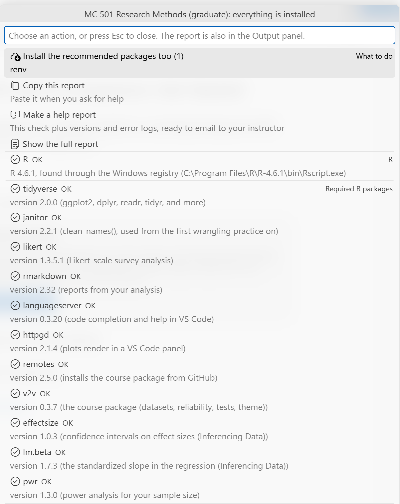

# Check Your Setup

Confirm that R, VS Code, and every package this course needs are ready, and install anything missing.

Prefer to watch first? The walkthrough video [Setup](https://siue.yuja.com/V/Video?v=17489654&a=114591092) shows these steps.

## Steps

0. Install AURA Lab R Companion from the Extensions view ([Marketplace listing](https://marketplace.visualstudio.com/items?itemName=aura-lab-siue.r-companion)).
1. Open VS Code.
2. Open the Command Palette: **View**, then **Command Palette...** (or **Ctrl+Shift+P**; **Cmd+Shift+P** on a Mac).
3. Type `AURA: Pick my course` and press **Enter**. Select **MC 501 Research Methods (graduate)**.
4. Open the Command Palette again, type `AURA: Check my setup`, and press **Enter**.
5. If the first line of the list reads **Install what is missing**, select it. The Output panel at the bottom shows R installing the packages.
6. When it finishes, the list opens again with **SETUP OK** at the top.

## What you should see

{fig-alt="The R Companion's Output panel after Check my setup. Two lines read: RESULT: everything this course needs is installed. SETUP OK: R and the course packages are working."}

The Output panel reads **RESULT: everything this course needs is installed** and **SETUP OK: R and the course packages are working.**

## If it does not work

::: {.callout-important}
## When VS Code asks to install "sess", click Install

The first time R opens in VS Code, a notice appears in the bottom-right corner: **vscode-R needs bundled sess to attach the session watcher.** Click **Install bundled sess** and wait about a minute. You must say yes: if you click **Not now** or **Don't ask again**, R will not connect to VS Code, and the bottom bar keeps saying **R: (not attached)**.

**Missed it?** Click the bell icon in the bottom-right corner of VS Code to find the notice again. If it is not there and you have the AURA Lab R Companion, run **AURA: Fix R (not attached)** from the Command Palette: it closes your R terminals, installs sess and the packages it needs, and opens a new R terminal. Without the Companion, close VS Code, open R itself (from the Start menu on Windows, or Applications on a Mac), and run these three lines one at a time:

```r
install.packages(c("processx", "later", "jsonlite", "rstudioapi"), repos = "https://cloud.r-project.org")
p <- tail(Sys.glob(file.path(Sys.getenv(if (.Platform$OS.type == "windows") "USERPROFILE" else "HOME"), ".vscode", "extensions", "reditorsupport.r-3*", "dist", "resources", "sess")), 1)
install.packages(p, repos = NULL, type = "source")
```

Then open VS Code again and start R. The bottom bar should show your R version.
:::


If the list says R was not found, close VS Code completely, open it again, and run **AURA: Check my setup** once more. A new VS Code window picks up an R you installed after it opened.
