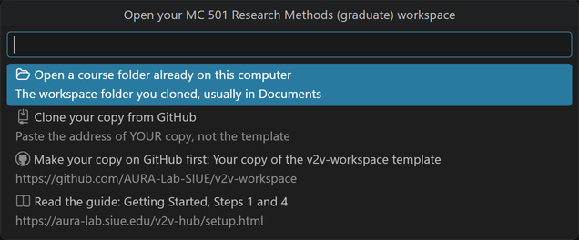
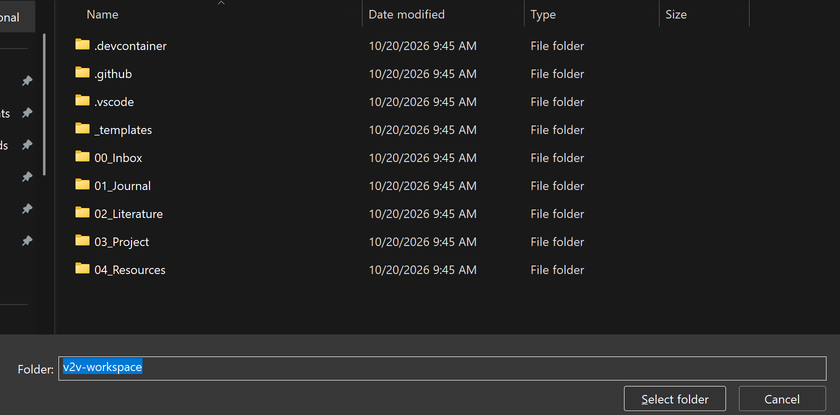
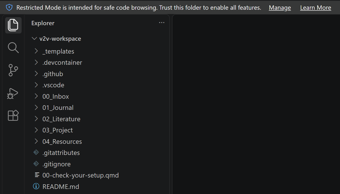
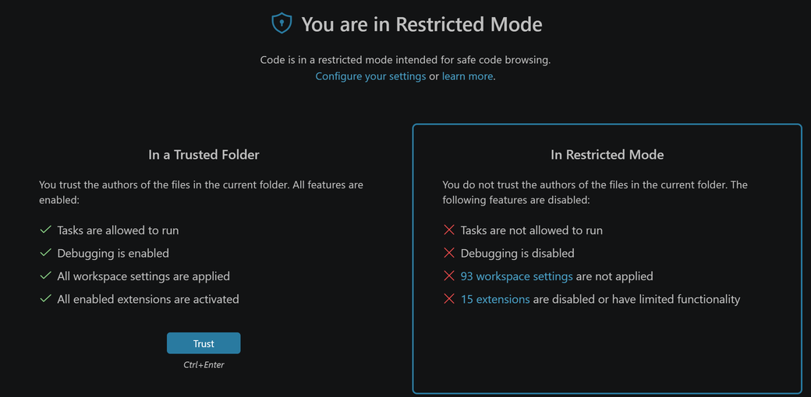

# Open Your Course Workspace

Open your own copy of the course workspace, the folder that holds your journal, codebook, data, and drafts.

## Steps

1. Open the Command Palette: **View**, then **Command Palette...** (or **Ctrl+Shift+P**; **Cmd+Shift+P** on a Mac).
2. Type `AURA: Open my course workspace` and press **Enter**.

    {fig-alt="The list titled Open your MC 501 Research Methods (graduate) workspace, with four choices: Open a course folder already on this computer, Clone your copy from GitHub, Make your copy on GitHub first, and Read the guide."}

3. Pick one line from the list:
    - **Open a course folder already on this computer** if you cloned your copy before. Choose the folder, then **Select folder**.
    - **Clone your copy from GitHub** if this computer does not have it yet. Paste your repository URL and choose where to keep it.
    - **Make your copy on GitHub first** if you have no copy yet. It opens the template page, where you select **Use this template**.

    {fig-alt="The Open Folder window inside the workspace folder, listing 00_Inbox, 01_Journal, 02_Literature, 03_Project, and 04_Resources. The Folder box reads v2v-workspace, beside the Select folder button."}

4. If a bar at the top says **Restricted Mode**, select **Manage**, then **Trust**. R does not run in a folder you have not trusted.

    {fig-alt="The bar across the top of VS Code reads: Restricted Mode is intended for safe code browsing. Trust this folder to enable all features. It ends with the links Manage and Learn More."}

    {fig-alt="The Workspace Trust page that Manage opens. Under In a Trusted Folder is the blue Trust button; beside it, In Restricted Mode lists the features that stay off."}

## What you should see

The Explorer on the left lists your workspace folders: `00_Inbox`, `01_Journal`, `02_Literature`, `03_Project`, and `04_Resources`.

## If it does not work

If the Explorer shows a different folder, use **File**, then **Open Recent**, and pick your workspace from the list.
