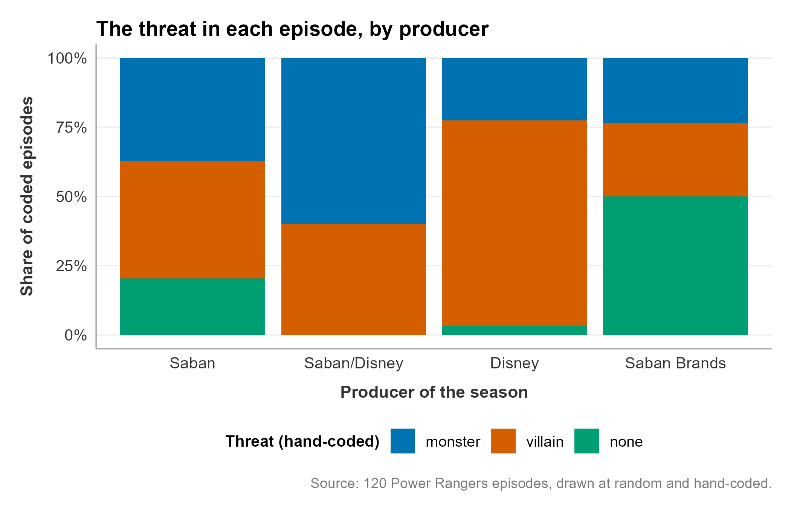
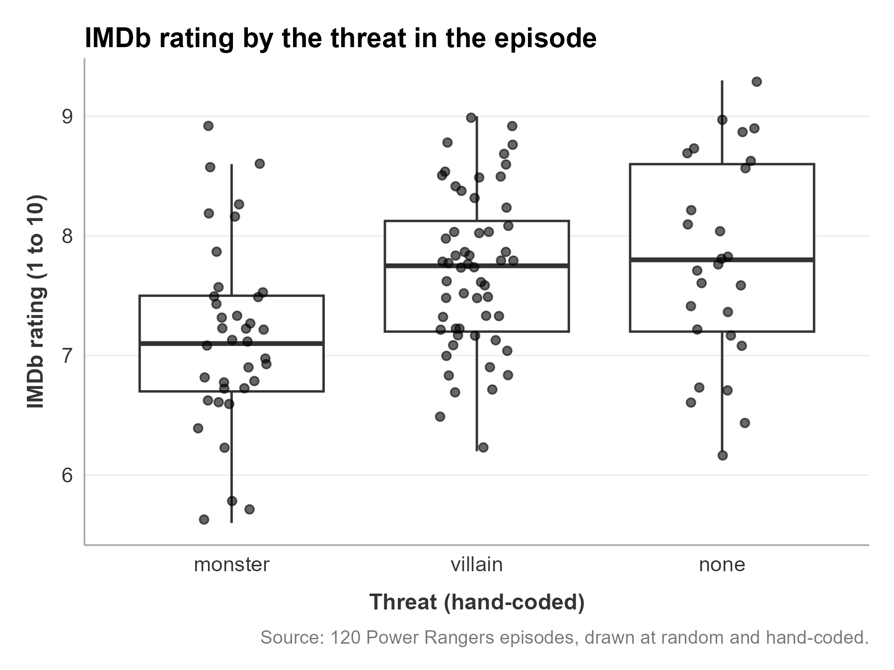
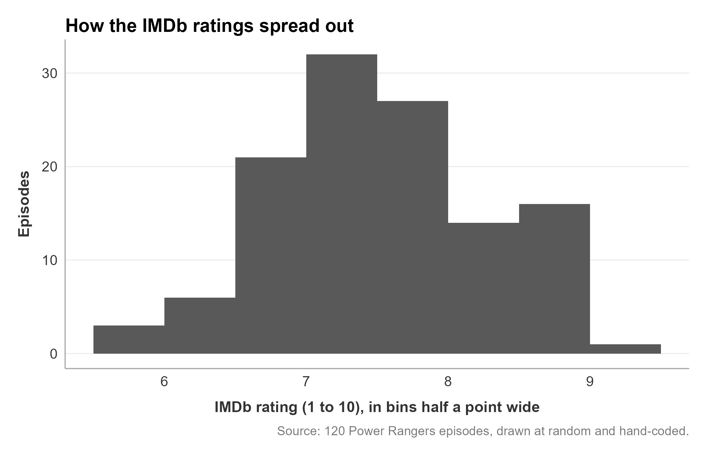

# Describe Your Own Data: Tables, Numbers, and Charts

Load the analysis file you saved after wrangling, count your categories, find the middle and the spread of your number columns, cross two categories, and draw three charts with alt text you write. You type every line of R yourself and see what each one prints.

Prefer to watch first? The walkthrough video [Describe Your Own Data](https://siue.yuja.com/V/Video?v=17679641&a=131613932) shows these steps.

**How this guide and the Describing Data worksheet fit together.** The graded worksheet (`12-describing-data-mc501.qmd`) does this job on the course's Twitch data. Your White Paper does it again on your own data. This guide walks your own-data version, one step at a time, and after each step a box names the worksheet task that does the same thing on Twitch, the R Companion menu for it, and what the worksheet says you should see. Use the guide beside the worksheet, or come back to it when you start on your own study.

## The example data

The example continues the study from [guide 08](08-wrangling.md), *Wrangle Your Own Data*: 120 Power Rangers episodes, drawn at random and hand-coded for `threat` (`monster`, `villain`, or `none`) and `focus` (`team`, `one_ranger`, or `other`), joined to a table about each season that adds `producer`. Each episode also has its IMDb rating, `imdb_rating`, a number from 1 to 10.

- [episodes_analysis.RDS](../../resources/examples/own-study-walkthrough/episodes_analysis.RDS): the analysis file [guide 08](08-wrangling.md) saved in its last step. If you worked through [guide 08](08-wrangling.md), you already have it in your `data` folder. If not, download it and drag it into `data`.
- [describe.R](../../resources/examples/own-study-walkthrough/describe.R): the finished script, so you can compare yours with it at any step.

**No folder named `data`?** Look at the Explorer, the list of files and folders on the left side of VS Code. If no line in that list reads `data`, make the folder before you go on: [guide 08, Before you start](08-wrangling.md#before-you-start-put-both-files-in-your-data-folder) has the steps.

Your analysis file is the same shape: one row per item you coded, your code columns stored as factors, and the columns you joined on from your sources table.

## Words used here

- **Frequency table:** how many rows fall in each category, often with each count as a percent of all the rows.
- **Mean:** the average. Add up the values and divide by how many there are. A few very large or very small values pull it toward them.
- **Median:** the middle value once the values are sorted. Half the rows are below it, half above.
- **Standard deviation (sd):** how far values typically sit from the mean. A bigger sd means the values are more spread out.
- **Cross-tabulation (crosstab):** a table that counts every combination of two categories, such as producer by threat.
- **Share:** a part of a whole, written as a decimal. 0.25 is 25 percent.
- **Alt text:** one sentence that says what a chart shows, for a reader who cannot see it. A screen reader reads it aloud.
- **Outlier:** a value far from the rest of its group.

## Before you start: check that the analysis file is in your data folder

**It worked if** the Explorer shows `episodes_analysis.RDS` (or your own `.RDS` file) indented under `data`, beside your CSV files.

## Step 1: Open a script, load the packages, and load your analysis file

1. In the Explorer, right-click (on a Mac, Control-click or click with two fingers) the empty space below the file list and select **New File...**. Type `describe.R` and press **Enter**.
2. Open an R terminal: **View**, then **Command Palette...** (or **Ctrl+Shift+P**; **Cmd+Shift+P** on a Mac), type `AURA: Open an R terminal`, and press **Enter**. Wait for the `>` prompt.

Type these lines into `describe.R`, select them, then right-click them (on a Mac, Control-click or click with two fingers) and select **Run the selected lines in R** (keyboard: **Ctrl+Enter**, or **Cmd+Enter** on a Mac):

```r
library(tidyverse)
library(v2v)
options(scipen = 10)
```

```
> library(tidyverse)
── Attaching core tidyverse packages ────────────────────────────────── tidyverse 2.0.0 ──
✔ dplyr     1.1.4     ✔ readr     2.1.6
✔ forcats   1.0.1     ✔ stringr   1.6.0
✔ ggplot2   4.0.1     ✔ tibble    3.3.0
✔ lubridate 1.9.4     ✔ tidyr     1.3.1
✔ purrr     1.2.0     
── Conflicts ──────────────────────────────────────────────────── tidyverse_conflicts() ──
✖ dplyr::filter() masks stats::filter()
✖ dplyr::lag()    masks stats::lag()
ℹ Use the conflicted package (<http://conflicted.r-lib.org/>) to force all conflicts to become errors

> library(v2v)
v2v 0.3.9 loaded.
  setup()  checks that R, Quarto and Git are ready
  ?v2v     lists what this package gives you

> options(scipen = 10)
```

**Check:** the `v2v` line says `0.3.9` or newer. `options(scipen = 10)` prints nothing; it makes R write long numbers in full instead of in forms like `1e+05`.

Now load your analysis file under a name you choose. The example calls it `episodes`. `read_rds()` reads the file exactly as you saved it, factor order included ([read_rds() on the readr cheat sheet](../../resources/cheat-sheets/readr.html#read_rds-read-an-.rds-back-in)). The second line makes a `figures` folder for the charts in Step 5:

```r
episodes <- read_rds("data/episodes_analysis.RDS")
dir.create("figures", showWarnings = FALSE)
```

```
> episodes <- read_rds("data/episodes_analysis.RDS")

> dir.create("figures", showWarnings = FALSE)
```

**Check:** both lines print nothing. `episodes` appears in the Workspace panel (**AURA: Show what is loaded in R (Workspace panel)**) with 120 rows, and a `figures` folder appears in the Explorer. If you see `cannot open the connection`, the file name in the quotes does not match the one under `data`: check the spelling and the capital letters.

**The R Companion shortcut, once you have typed it yourself:** **AURA: Write R code**, then under **R2 Data**, **Load your saved analysis (RDS)**.

**In the worksheet (Twitch):** the Setup chunk runs these same lines on `data/twitch_analysis.RDS`, named `analysis`, then counts `reaction_only`. **What you should see** there: your two coded groups adding to `30`, and `NA` with `35237`.

## Step 2: Count each category: frequency tables

`count()` lists each value of a column once, with how many rows have it ([count() on the dplyr cheat sheet](../../resources/cheat-sheets/dplyr.html#count-how-many-rows-in-each-group)):

```r
episodes %>%
  count(threat)
```

```
> episodes %>%
+   count(threat)
# A tibble: 3 × 2
  threat      n
  <fct>   <int>
1 monster    37
2 villain    56
3 none       27
```

A count is easier to read as a percent. `mutate()` adds a column: each count divided by the total, times 100, rounded to one decimal place ([mutate() on the dplyr cheat sheet](../../resources/cheat-sheets/dplyr.html#mutate-add-or-change-a-column)):

```r
episodes %>%
  count(threat) %>%
  mutate(percent = round(100 * n / sum(n), 1))
```

```
> episodes %>%
+   count(threat) %>%
+   mutate(percent = round(100 * n / sum(n), 1))
# A tibble: 3 × 3
  threat      n percent
  <fct>   <int>   <dbl>
1 monster    37    30.8
2 villain    56    46.7
3 none       27    22.5
```

**Check:** the counts add up to your number of rows (37 + 56 + 27 = 120), and the percents add up to about 100. The rows come out in your factor order from [guide 08](08-wrangling.md) (`monster`, `villain`, `none`), not in alphabetical order.

Do the same for every category column. Here, `focus` and `producer`:

```r
episodes %>%
  count(focus) %>%
  mutate(percent = round(100 * n / sum(n), 1))
```

```
> episodes %>%
+   count(focus) %>%
+   mutate(percent = round(100 * n / sum(n), 1))
# A tibble: 4 × 3
  focus          n percent
  <fct>      <int>   <dbl>
1 team          54    45  
2 one_ranger    52    43.3
3 other         13    10.8
4 <NA>           1     0.8
```

```r
episodes %>%
  count(producer) %>%
  mutate(percent = round(100 * n / sum(n), 1))
```

```
> episodes %>%
+   count(producer) %>%
+   mutate(percent = round(100 * n / sum(n), 1))
# A tibble: 4 × 3
  producer         n percent
  <fct>        <int>   <dbl>
1 Saban           54    45  
2 Saban/Disney     5     4.2
3 Disney          31    25.8
4 Saban Brands    30    25  
```

**Check:** `focus` has an `<NA>` row with 1 episode: the blank cell [guide 08](08-wrangling.md) found and left blank. Keep it in the table and say so in your write-up. In `producer`, `Saban/Disney` has only 5 episodes. A group that small gives shaky percents and averages, so watch it in every later step.

**The R Companion shortcut:** **AURA: Write R code**, under **R3 Describe**, **Frequency table**, then **Choose the table and the columns**. It asks which table, then which column. It writes the same two lines with `count(threat, sort = TRUE)`, which lists the biggest group first instead of in your factor order. Its comment line says "Count each channel type" whatever column you pick, so change the comment to match your column.

**In the worksheet (Twitch):** Tasks 1.1, 1.2, and 1.3. **What you should see** for Task 1.1: `gaming` `31309` (88.8%), `non-gaming` `3457` (9.8%), and `NA` `501` (1.4%). Task 1.3 adds a `filter(!is.na(...))` line first, because only thirty messages have your code.

## Step 3: The three numbers: n, the middle, and the spread

For a number column, report how many values there are (`n`), the mean and the median (two ways to say where the middle is), and the standard deviation (how spread out the values are). `summarize()` turns the whole table into one row of numbers ([mean, median, sd, IQR inside summarize() on the stats cheat sheet](../../resources/cheat-sheets/stats.html#mean-median-sd-iqr-inside-summarize)). `na.rm = TRUE` tells each function to skip missing values instead of returning `NA`:

```r
episodes %>%
  summarize(
    n      = sum(!is.na(imdb_rating)),
    mean   = mean(imdb_rating, na.rm = TRUE),
    median = median(imdb_rating, na.rm = TRUE),
    sd     = sd(imdb_rating, na.rm = TRUE)
  )
```

```
> episodes %>%
+   summarize(
+     n      = sum(!is.na(imdb_rating)),
+     mean   = mean(imdb_rating, na.rm = TRUE),
+     median = median(imdb_rating, na.rm = TRUE),
+     sd     = sd(imdb_rating, na.rm = TRUE)
+   )
# A tibble: 1 × 4
      n  mean median    sd
  <int> <dbl>  <dbl> <dbl>
1   120  7.56    7.5 0.784
```

**Check:** `n` is 120, so no rating is missing. The mean (7.56) and the median (7.5) are close. When they are close, the values are spread about evenly on both sides of the middle. When the mean sits well above the median, a few very large values are pulling it up, as message length does in the Twitch worksheet.

Now the same numbers for each group. `group_by()` makes `summarize()` work one group at a time ([group_by() plus summarize() on the dplyr cheat sheet](../../resources/cheat-sheets/dplyr.html#group_by-plus-summarize-one-row-per-group)):

```r
episodes %>%
  group_by(threat) %>%
  summarize(
    n      = n(),
    mean   = mean(imdb_rating),
    median = median(imdb_rating),
    sd     = sd(imdb_rating)
  )
```

```
> episodes %>%
+   group_by(threat) %>%
+   summarize(
+     n      = n(),
+     mean   = mean(imdb_rating),
+     median = median(imdb_rating),
+     sd     = sd(imdb_rating)
+   )
# A tibble: 3 × 5
  threat      n  mean median    sd
  <fct>   <int> <dbl>  <dbl> <dbl>
1 monster    37  7.16   7.1  0.776
2 villain    56  7.71   7.75 0.657
3 none       27  7.79   7.8  0.861
```

For `focus`, drop the one blank row first, so it does not become a group of its own:

```r
episodes %>%
  filter(!is.na(focus)) %>%
  group_by(focus) %>%
  summarize(
    n      = n(),
    mean   = mean(imdb_rating),
    median = median(imdb_rating),
    sd     = sd(imdb_rating)
  )
```

```
> episodes %>%
+   filter(!is.na(focus)) %>%
+   group_by(focus) %>%
+   summarize(
+     n      = n(),
+     mean   = mean(imdb_rating),
+     median = median(imdb_rating),
+     sd     = sd(imdb_rating)
+   )
# A tibble: 3 × 5
  focus          n  mean median    sd
  <fct>      <int> <dbl>  <dbl> <dbl>
1 team          54  7.54    7.5 0.848
2 one_ranger    52  7.57    7.5 0.697
3 other         13  7.68    7.6 0.877
```

**Check:** the `n` column adds up to your rows (119 for `focus`, after the blank one is dropped). Monster episodes average about half a point lower (7.16) than villain (7.71) or no-threat episodes (7.79). The three `focus` groups sit within 0.15 of each other. A description can say how big a gap is; whether it is bigger than chance is a test, in [guide 10](10-tests-and-check-my-test-choice.md).

**The R Companion shortcut:** under **R3 Describe**, **Summary by group**, then **Choose the table and the columns**. It asks for the column to group by, then the number column, and writes the same lines with a `filter(!is.na(...))` line and `na.rm = TRUE` added.

**In the worksheet (Twitch):** Tasks 2.1 and 2.2. **What you should see** for Task 2.1: `n` `35263`, `mean` `29.0`, `median` `17`, `sd` `41.2`. There the mean is far above the median, the opposite of the ratings here.

## Step 4: Cross two categories: the crosstab

`count()` with two columns counts every combination, one row each. `pivot_wider()` turns those rows into a grid: one row per producer, one column per threat, with the counts in the cells ([pivot_wider() on the dplyr cheat sheet](../../resources/cheat-sheets/dplyr.html#pivot_wider-spread-one-column-into-many)). `values_fill = 0` writes a `0` where a combination never occurs:

```r
episodes %>%
  count(producer, threat) %>%
  pivot_wider(names_from = threat, values_from = n, values_fill = 0)
```

```
> episodes %>%
+   count(producer, threat) %>%
+   pivot_wider(names_from = threat, values_from = n, values_fill = 0)
# A tibble: 4 × 4
  producer     monster villain  none
  <fct>          <int>   <int> <int>
1 Saban             20      23    11
2 Saban/Disney       3       2     0
3 Disney             7      23     1
4 Saban Brands       7       8    15
```

The same counts as shares of each producer. `group_by(producer)` makes `sum(n)` add up within each producer instead of across the whole table, so each producer's shares add up to 1:

```r
episodes %>%
  count(producer, threat) %>%
  group_by(producer) %>%
  mutate(share = round(n / sum(n), 3))
```

```
> episodes %>%
+   count(producer, threat) %>%
+   group_by(producer) %>%
+   mutate(share = round(n / sum(n), 3))
# A tibble: 11 × 4
# Groups:   producer [4]
   producer     threat      n share
   <fct>        <fct>   <int> <dbl>
 1 Saban        monster    20 0.37 
 2 Saban        villain    23 0.426
 3 Saban        none       11 0.204
 4 Saban/Disney monster     3 0.6  
 5 Saban/Disney villain     2 0.4  
 6 Disney       monster     7 0.226
 7 Disney       villain    23 0.742
 8 Disney       none        1 0.032
 9 Saban Brands monster     7 0.233
10 Saban Brands villain     8 0.267
11 Saban Brands none       15 0.5  
```

**Check:** the grid's cells add up to your rows (120). The shares table has 11 rows, not 12: `Saban/Disney` has no `none` row, because `count()` prints only the combinations it finds. The grid shows that missing combination as `0`. Read across a producer's rows: villain episodes are 0.742 of Disney's episodes, and no-threat episodes are 0.5 of Saban Brands'.

**The R Companion shortcut:** under **R3 Describe**, **Crosstab with proportions**, then **Choose the table and the two columns**. It writes both tables, with a `filter()` line that drops rows missing either column.

**In the worksheet (Twitch):** Tasks 3.1 and 3.2, viewer band by channel type. **What you should see** in Task 3.2: non-gaming is `0.088` of the small band and `0.2` of the medium band, and the large band has no non-gaming row at all.

## Step 5: Draw three charts, each with alt text you write

Each chart is built with `ggplot()`, saved under a name with `<-`, shown, and saved to your `figures` folder with `ggsave()` ([labs()](../../resources/cheat-sheets/ggplot2.html#labs-the-words-around-the-chart) and [ggsave()](../../resources/cheat-sheets/ggplot2.html#ggsave-save-a-chart-to-a-file) on the ggplot2 cheat sheet). Inside `ggplot()`, the pieces join with `+` at the **end** of each line, not the pipe.

Every chart's `labs()` has an `alt =` line: one sentence, in your own words, that says what the chart shows for a reader who cannot see it. Write it after you look at the chart, and name what a reader would notice first.

### Chart 1: the shares of one category within another

This is the crosstab from Step 4 as a chart. `fill = threat` colors each bar by threat, and `position = "fill"` stretches every bar to 100 percent, so producers with few episodes and producers with many can be compared ([geom_bar() on the ggplot2 cheat sheet](../../resources/cheat-sheets/ggplot2.html#geom_bar-a-bar-that-counts-the-rows-for-you)):

```r
fig_threat_producer <- episodes %>%
  ggplot(aes(x = producer, fill = threat)) +
  geom_bar(position = "fill") +
  scale_y_continuous(labels = scales::percent_format()) +
  scale_fill_v2v() +
  labs(
    title = "The threat in each episode, by producer",
    x = "Producer of the season",
    y = "Share of coded episodes",
    fill = "Threat (hand-coded)",
    caption = "Source: 120 Power Rangers episodes, drawn at random and hand-coded.",
    alt = "Filled bars by producer: Disney mostly villain, Saban Brands half no threat."
  ) +
  theme_v2v()

fig_threat_producer

ggsave("figures/threat-by-producer.png", fig_threat_producer,
       width = 7, height = 4.5, dpi = 300)
```

{fig-alt="Filled bars by producer: Disney mostly villain, Saban Brands half no threat."}

**Check:** four bars of the same height, colored in your factor order, and `threat-by-producer.png` in `figures`. A bar stretched to 100 percent hides how many episodes it holds: the `Saban/Disney` bar is 5 episodes. Say so in the sentence that discloses your choices.

**The R Companion:** its **Bar chart** counts one column at a time, so type this chart yourself, as the worksheet does.

### Chart 2: a number column compared across groups

A boxplot shows each group's middle half (the box), its median (the thick line), and how far the rest reaches (the whiskers). `geom_jitter()` adds every episode as a dot, spread a little sideways so the dots do not sit on top of each other. `outlier.shape = NA` stops the boxplot drawing its own outlier dots, because the jitter already draws every episode ([geom_boxplot() on the ggplot2 cheat sheet](../../resources/cheat-sheets/ggplot2.html#geom_boxplot-spread-and-middle-across-groups)):

```r
fig_rating_threat <- episodes %>%
  ggplot(aes(x = threat, y = imdb_rating)) +
  geom_boxplot(outlier.shape = NA) +
  geom_jitter(width = 0.15, alpha = 0.6) +
  labs(
    title = "IMDb rating by the threat in the episode",
    x = "Threat (hand-coded)",
    y = "IMDb rating (1 to 10)",
    caption = "Source: 120 Power Rangers episodes, drawn at random and hand-coded.",
    alt = "Rating by threat: monster episodes lowest, villain and no threat near 7.8."
  ) +
  theme_v2v()

fig_rating_threat

ggsave("figures/rating-by-threat.png", fig_rating_threat,
       width = 6, height = 4.5, dpi = 300)
```

{fig-alt="Rating by threat: monster episodes lowest, villain and no threat near 7.8."}

**Check:** the thick lines match the medians from Step 3 (7.1, 7.75, and 7.8). One monster dot sits above the end of its whisker, near 9: an outlier, found by name in the MC 501 diagnostics below.

**The R Companion shortcut:** under **R3 Describe**, **Boxplot**, then **Choose the table and the columns**. It asks for the number column, then the column to group by, and writes a plain boxplot with `YOUR TURN` lines in `labs()` for the title, the axis labels, and the alt text. Add the `geom_jitter()` line yourself if you want every item shown.

### Chart 3: how one number column spreads out

A histogram splits a number column into bins and draws one bar per bin, as tall as the number of values in it. `binwidth = 0.5` makes each bin half a point wide, and `boundary = 0` starts the bins on whole and half numbers (7 to 7.5, 7.5 to 8), which are easier to read ([geom_histogram() on the ggplot2 cheat sheet](../../resources/cheat-sheets/ggplot2.html#geom_histogram-the-shape-of-one-number)):

```r
fig_rating_hist <- episodes %>%
  ggplot(aes(x = imdb_rating)) +
  geom_histogram(binwidth = 0.5, boundary = 0) +
  labs(
    title = "How the IMDb ratings spread out",
    x = "IMDb rating (1 to 10), in bins half a point wide",
    y = "Episodes",
    caption = "Source: 120 Power Rangers episodes, drawn at random and hand-coded.",
    alt = "Ratings run from 5.5 to 9.5, most between 6.5 and 8, peaking at 7 to 7.5."
  ) +
  theme_v2v()

fig_rating_hist

ggsave("figures/rating-histogram.png", fig_rating_hist,
       width = 7, height = 4.5, dpi = 300)
```

{fig-alt="Ratings run from 5.5 to 9.5, most between 6.5 and 8, peaking at 7 to 7.5."}

**Check:** the bars add up to your rows (120). The bin width is a choice you made, so name it in your disclosure sentence: wider bins smooth the shape, narrower ones show more bumps.

**The R Companion shortcut:** under **R3 Describe**, **Histogram**, then **Choose the table and the columns**. It writes `geom_histogram(bins = 30)`, thirty bins whatever the range. Change it to a `binwidth` that suits your column.

**In the worksheet (Twitch):** Part 4, Tasks 4.1 (a filled bar chart like Chart 1), 4.2 (a boxplot with jitter like Chart 2), and 4.3 (a chart of your own choice, such as a histogram). There the alt text goes on each chunk's `#| fig-alt:` line, the Quarto way to attach it. In your own `.qmd`, put the same sentence on that line. After each chart, the worksheet asks for one sentence disclosing a choice you made and two to three sentences of interpretation.

## MC 501: the diagnostics behind each chart

A chart is a claim. The diagnostic says whether you are allowed to make it: the shape of the variable, whether the test the chart leads to can be trusted on this data, and where the outliers are, with the check shown.

### The counts a chi-square will expect

A chi-square test ([guide 10](10-tests-and-check-my-test-choice.md)) compares the counts in your crosstab with the counts it would expect if the two categories were unrelated. Its p-value can be trusted only when every expected count is at least 5. `xtabs()` builds the grid of counts from a formula naming the two columns ([xtabs() on the stats cheat sheet](../../resources/cheat-sheets/stats.html#xtabs-a-cross-tabulation)), `chisq.test()` runs the test on it ([chisq.test()](../../resources/cheat-sheets/stats.html#chisq.test-is-the-pairing-more-than-chance)), and `$expected` pulls out only the expected counts. Read those here; [guide 10](10-tests-and-check-my-test-choice.md) reads the test itself.

```r
expected <- chisq.test(xtabs(~ producer + threat, data = episodes))$expected

round(expected, 1)
```

```
> expected <- chisq.test(xtabs(~ producer + threat, data = episodes))$expected
Warning in chisq.test(xtabs(~producer + threat, data = episodes)) :
  Chi-squared approximation may be incorrect

> round(expected, 1)
              threat
producer       monster villain none
  Saban           16.6    25.2 12.2
  Saban/Disney     1.5     2.3  1.1
  Disney           9.6    14.5  7.0
  Saban Brands     9.2    14.0  6.8
```

**Check:** the warning `Chi-squared approximation may be incorrect` is R saying that some expected counts are below 5. Find them: all three `Saban/Disney` cells (1.5, 2.3, and 1.1). Every other cell is 6.8 or more. So the chi-square in [guide 10](10-tests-and-check-my-test-choice.md) leaves out the 5 `Saban/Disney` episodes, and the write-up says so and why.

### Spread and outliers behind the boxplot

A boxplot draws a point on its own for a value more than 1.5 times the box's height (the interquartile range, or IQR) beyond the box. The second block finds those items within each group by name: `quantile(..., 0.75)` is the top of the box and `IQR()` is its height ([quantile() on the stats cheat sheet](../../resources/cheat-sheets/stats.html#quantile-the-cut-points-of-a-distribution)).

```r
episodes %>%
  group_by(threat) %>%
  summarize(n = n(), sd = sd(imdb_rating), iqr = IQR(imdb_rating))
```

```
> episodes %>%
+   group_by(threat) %>%
+   summarize(n = n(), sd = sd(imdb_rating), iqr = IQR(imdb_rating))
# A tibble: 3 × 4
  threat      n    sd   iqr
  <fct>   <int> <dbl> <dbl>
1 monster    37 0.776 0.8  
2 villain    56 0.657 0.925
3 none       27 0.861 1.4  
```

```r
episodes %>%
  group_by(threat) %>%
  filter(imdb_rating > quantile(imdb_rating, 0.75) + 1.5 * IQR(imdb_rating)) %>%
  select(threat, imdb_rating, episode_title)
```

```
> episodes %>%
+   group_by(threat) %>%
+   filter(imdb_rating > quantile(imdb_rating, 0.75) + 1.5 * IQR(imdb_rating)) %>%
+   select(threat, imdb_rating, episode_title)
# A tibble: 1 × 3
# Groups:   threat [1]
  threat  imdb_rating episode_title  
  <fct>         <dbl> <chr>          
1 monster         8.9 Always a Chance
```

**Check:** one episode lies beyond its group's upper whisker: *Always a Chance*, a monster episode rated 8.9, the dot near 9 in Chart 2. Open your coding sheet and re-read that item's synopsis: is `monster` the right code? If it is, keep the episode and report it as an outlier. An outlier is a finding to report, not a row to delete. The ANOVA in [guide 10](10-tests-and-check-my-test-choice.md) compares ratings across `threat` and assumes the groups spread about the same. Here the sd runs from 0.657 to 0.861, the largest about 1.3 times the smallest, which is close.

### Shape across the producers

The same shape check works for any grouping. Compare the mean with the median within each group: a mean far from its median means a lopsided group, pulled by a few very high or very low values. Here the groups are the producers.

```r
episodes %>%
  group_by(producer) %>%
  summarize(n      = n(),
            mean   = mean(imdb_rating),
            median = median(imdb_rating),
            sd     = sd(imdb_rating))
```

```
> episodes %>%
+   group_by(producer) %>%
+   summarize(n      = n(),
+             mean   = mean(imdb_rating),
+             median = median(imdb_rating),
+             sd     = sd(imdb_rating))
# A tibble: 4 × 5
  producer         n  mean median    sd
  <fct>        <int> <dbl>  <dbl> <dbl>
1 Saban           54  7.51    7.6 0.878
2 Saban/Disney     5  7.38    7.5 0.804
3 Disney          31  7.54    7.5 0.537
4 Saban Brands    30  7.7     7.5 0.832
```

**Check:** in every producer the mean and the median sit within 0.2 of each other, so no group is badly lopsided. Disney's ratings are the tightest (sd 0.537). `Saban/Disney` has only 5 episodes, too few for its numbers to say much.

**In the worksheet (Twitch):** Part 5, Tasks 5.1, 5.2, and 5.3. **What you should see:** six expected counts, the smallest `198.9`; with the instructor's codes, sd `27.9` and `23.5` and four messages beyond their upper whiskers; and a medium-band sd of `53.9`, far larger than the other two bands. The worksheet then asks for a diagnostics note for each figure: its shape, the assumption it bears on, and its outliers.

## If it does not work

If running a line opens a box titled **Choose where to run the selected code**, press **Esc**. Do not pick **New R Interactive window** or **Create R terminal**: both start a new R that has none of your tables. Instead, click the **AURA Lab R Companion** icon on VS Code's left edge and select **Run my steps from the top**. It runs your file from the first line, in the same R as **Run it**.

**`cannot open the connection` on `read_rds()`.** The file name in the quotes does not match a file in `data`. Look under `data` in the Explorer and copy the name exactly, capital letters included.

**`object 'episodes' not found`.** The line that loads your analysis file has not run in this R session. Select it, right-click it (on a Mac, Control-click or click with two fingers) and select **Run the selected lines in R** again, then do the same for the line that failed.

**`could not find function "read_rds"`** (or `glimpse`, `pull`, `%>%`, or any other function). R prints:

```
Error in read_rds("data/episodes_analysis.RDS") : 
  could not find function "read_rds"
```

R does not know that function yet, because the `library()` lines at the top of your file have not run in this R session. That happens after R restarts, or when you run a line from the middle of your file first. Select the `library()` lines, right-click them (on a Mac, Control-click or click with two fingers), select **Run the selected lines in R**, and run your line again the same way. `read_csv()`, `read_rds()`, `glimpse()`, `pull()`, and `%>%` come from `library(tidyverse)`; `theme_v2v()` and `scale_fill_v2v()` come from `library(v2v)`. If the `library()` lines have run, check the spelling: R reads `Read_csv` and `read_csv` as two different names.

**A chart does not appear, or R prints a `+` and waits.** Check that every `+` sits at the end of a line, not at the start of the next one, and that every `(` has its `)`. Press **Esc** in the terminal to stop the waiting, fix the line, and run the chart again.

**The rows of a table come out in alphabetical order.** The column is text, not a factor. Go back to [guide 08](08-wrangling.md), Step 7, set the factor order, and save the analysis file again.
