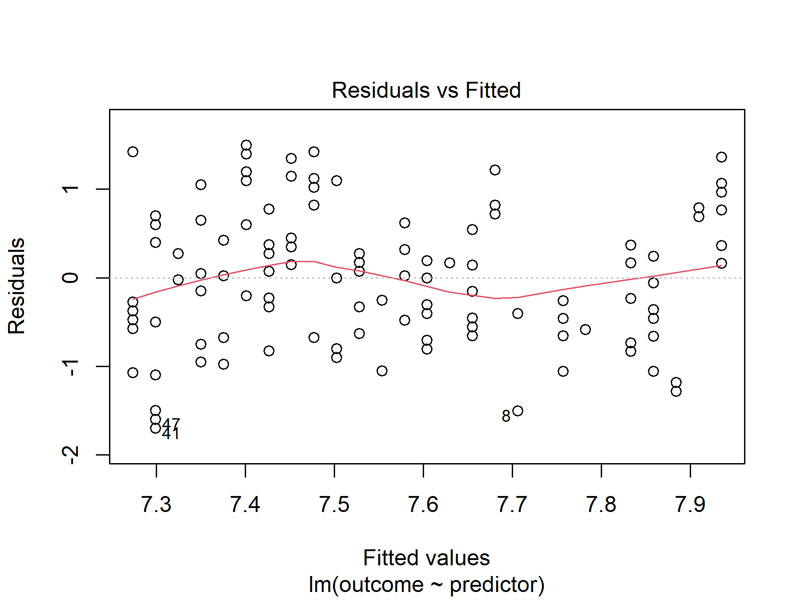
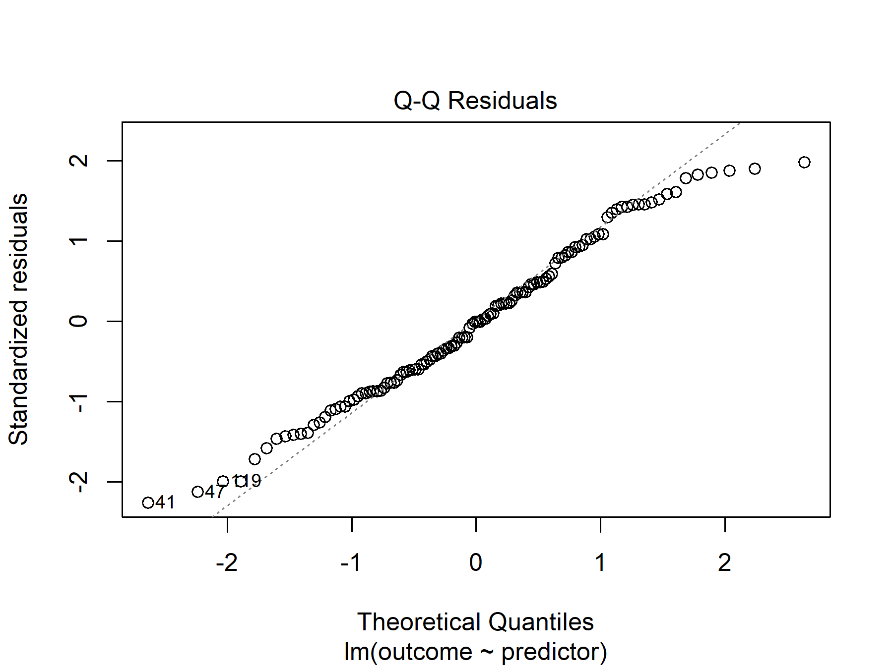

# Test Your Own Hypotheses: Check Your Test Choice, Run Four Tests, Check Your Numbers

Check that each test you chose fits your variables, name your variables once in a settings block, run the four tests with their effect sizes, and check the numbers in your sentences. You type every line of R yourself and see what each one prints.

Prefer to watch first? The walkthrough video [Test Your Own Hypotheses](https://siue.yuja.com/V/Video?v=17679880&a=165443560) shows these steps.

**How this guide and the Inferencing Data worksheet fit together.** The graded worksheet (`13-inferencing-data-mc501.qmd`) does this job on the course's Twitch data. Your White Paper does it again on your own data. This guide walks your own-data version, one step at a time, and after each step a box names the worksheet task that does the same thing on Twitch, the R Companion menu for it, and what the worksheet says you should see. Use the guide beside the worksheet, or come back to it when you start on your own study.

## The example data and its four questions

The example continues the study from [guide 08](08-wrangling.md), *Wrangle Your Own Data*, and [guide 09](09-describing-tables-and-charts.md), *Describe Your Own Data*: 120 Power Rangers episodes, hand-coded for `threat` (`monster`, `villain`, or `none`) and `focus` (`team`, `one_ranger`, or `other`), with each episode's IMDb rating (`imdb_rating`), its season's number (`season_num`), and its season's producer (`producer`).

- [episodes_analysis.RDS](../../resources/examples/own-study-walkthrough/episodes_analysis.RDS): the analysis file [guide 08](08-wrangling.md) saved. If it is not already in your `data` folder, download it and drag it into `data`.
- [test.R](../../resources/examples/own-study-walkthrough/test.R): the finished script, so you can compare yours with it at any step.

**No `data` folder?** The course workspace does not come with one. If the Explorer shows no folder named `data` beside `README.md`, make it first, as in [guide 08, Before you start](08-wrangling.md#before-you-start-put-both-files-in-your-data-folder).

The example's four questions were written down before any test was run, the way the worksheet's Part 0 asks you to write yours:

1. Does the threat an episode has go with the company that produced it? (two categories)
2. Are episodes about one Ranger rated differently from episodes about the whole team? (a number across two groups)
3. Does an episode's rating differ by the threat it has? (a number across three groups)
4. Are later seasons rated higher than earlier ones? (a number predicted from a number)

## Words used here

- **p-value:** how surprising a result this size would be if there were really no difference or link at all. A p-value below .05 is the usual line for calling a result statistically significant.
- **Effect size:** how big the difference or link is, in a unit you can compare across studies. A tiny difference can be significant in a big sample, so you report both.
- **df (degrees of freedom):** a number the test reports with its statistic, mostly set by how many rows and groups it used. It goes in your APA sentence.
- **Settings block:** the one block of code that names your columns for the tests, so every test below runs unchanged on your own data.
- **Null result:** a test that finds no difference or link it can tell apart from chance. It is a finding to report, not a failure.

## Step 1: Check that each test fits your variables

Before you run a test, check that it suits the kind of variables you have. The R Companion checks your choice without choosing for you.

1. Open the Command Palette: **View**, then **Command Palette...** (or **Ctrl+Shift+P**; **Cmd+Shift+P** on a Mac). Type `AURA: Check my test choice` and press **Enter**.
2. The first box reads *Your outcome, the variable you are explaining or comparing, is*. Pick **a number** or **a category**.
3. The second reads *You compare it across, or predict it from,*. Pick **a category with two groups**, **a category with three or more groups**, or **a number**.
4. The third reads *Which test did you choose?* Pick the test you wrote down.

A message appears at the bottom right of VS Code. For the example's second question (a rating, compared across two focus groups, with a Welch t-test) it says:

> Fits. A Welch t-test compares the mean of a number between two groups, without assuming the groups spread out equally. You have a number compared across a category with two groups.

Had the t-test been chosen for the third question, where `threat` has three groups, the message would say what is missing without naming the answer:

> Does not fit. A t-test needs a number for the outcome and a category with exactly two groups. You have a number compared across a category with three or more groups.

**Check:** run it once for each of your four tests, and fix any that do not fit before you go on. The example's four are a chi-square test, a Welch t-test, a one-way ANOVA, and a linear regression, and all four fit.

## Step 2: Name your variables once, in a settings block

1. In the Explorer, right-click (on a Mac, Control-click or click with two fingers) the empty space below the file list and select **New File...**. Type `test.R` and press **Enter**.
2. Open an R terminal: in the Command Palette, run `AURA: Open an R terminal`, and wait for the `>` prompt.

Every test below uses six short names instead of your column names: `outcome` (a number), `group2` (a category with two groups), `group3` (a category with three or more), `predictor` (a number), and `cat_a` and `cat_b` (two categories). Only this block knows your column names. `transmute()` builds a new table with only the columns you name ([transmute() on the dplyr cheat sheet](../../resources/cheat-sheets/dplyr.html#transmute-keep-only-the-columns-you-build)), and `factor(..., levels = ...)` keeps only the groups you list, in that order ([factor() on the dplyr cheat sheet](../../resources/cheat-sheets/dplyr.html#factor-store-a-category-in-the-order-you-choose)).

Type these lines, select them, then right-click them (on a Mac, Control-click or click with two fingers) and select **Run the selected lines in R** (keyboard: **Ctrl+Enter**, or **Cmd+Enter** on a Mac):

```r
library(tidyverse)
library(v2v)
library(effectsize)
options(scipen = 10)
```

```
> library(tidyverse)
── Attaching core tidyverse packages ────────────────────────────────── tidyverse 2.0.0 ──
✔ dplyr     1.1.4     ✔ readr     2.1.6
✔ forcats   1.0.1     ✔ stringr   1.6.0
✔ ggplot2   4.0.1     ✔ tibble    3.3.0
✔ lubridate 1.9.4     ✔ tidyr     1.3.1
✔ purrr     1.2.0     
── Conflicts ──────────────────────────────────────────────────── tidyverse_conflicts() ──
✖ dplyr::filter() masks stats::filter()
✖ dplyr::lag()    masks stats::lag()
ℹ Use the conflicted package (<http://conflicted.r-lib.org/>) to force all conflicts to become errors

> library(v2v)
v2v 0.3.9 loaded.
  setup()  checks that R, Quarto and Git are ready
  ?v2v     lists what this package gives you

> library(effectsize)
Warning: package ‘effectsize’ was built under R version 4.5.3

> options(scipen = 10)
```

```r
analysis <- read_rds("data/episodes_analysis.RDS") %>%
  transmute(
    outcome   = imdb_rating,
    group2    = factor(focus, levels = c("team", "one_ranger")),
    group3    = threat,
    predictor = season_num,
    cat_a     = threat,
    cat_b     = factor(producer, levels = c("Saban", "Disney", "Saban Brands"))
  )
```

```r
glimpse(analysis)
```

```
> analysis <- read_rds("data/episodes_analysis.RDS") %>%
+   transmute(
+     outcome   = imdb_rating,
+     group2    = factor(focus, levels = c("team", "one_ranger")),
+     group3    = threat,
+     predictor = season_num,
+     cat_a     = threat,
+     cat_b     = factor(producer, levels = c("Saban", "Disney", "Saban Brands"))
+   )

> glimpse(analysis)
Rows: 120
Columns: 6
$ outcome   <dbl> 7.8, 8.6, 7.2, 8.5, 6.7, 7.0, 7.8, 6.2, 8.9, 8.8, 7.1, 7.2, 8.6, 6.4, …
$ group2    <fct> team, team, one_ranger, team, one_ranger, one_ranger, team, team, team…
$ group3    <fct> villain, villain, villain, villain, villain, villain, villain, none, n…
$ predictor <dbl> 15, 9, 16, 9, 10, 16, 7, 18, 9, 8, 16, 4, 26, 4, 8, 2, 24, 16, 11, 11,…
$ cat_a     <fct> villain, villain, villain, villain, villain, villain, villain, none, n…
$ cat_b     <fct> Disney, Saban, Disney, Saban, NA, Disney, Saban, Saban Brands, Saban, …
```

Two lines make a choice, and each choice goes in your write-up:

- **`group2`** must have exactly two groups, but `focus` has three. Listing `team` and `one_ranger` in `levels` keeps those two, and the 13 `other` episodes become `NA`, so the t-test leaves them out.
- **`cat_b`** lists three of the four producers. [Guide 09](09-describing-tables-and-charts.md)'s MC 501 diagnostics found that the 5 `Saban/Disney` episodes give expected counts below 5, too few for a chi-square. Leaving that producer out of `levels` turns those 5 rows into `NA`, so the chi-square leaves them out. The `NA` you can see in `cat_b` above is one of them.

**Check:** `Rows: 120` and six columns. `outcome` and `predictor` are `<dbl>` (numbers); the other four are `<fct>` (categories).

**The R Companion shortcut, once you have typed it yourself:** **AURA: Write R code**, under **R4 Test**, **Settings block (name the test variables)**, then **Choose my own variables**. It asks for your saved RDS file and then one column for each name. It writes every category as plain `factor(column)`, with all its groups, so add the `levels = c(...)` part yourself wherever you keep only some groups, as above.

**In the worksheet (Twitch):** Part 1, the settings block, with `group2` set to your hand-coded variable. **What you should see** there: `Rows: 35,267` and six columns.

## Step 3: Test 1, the chi-square test (two categories)

`xtabs()` builds the grid of counts for the two categories ([xtabs() on the stats cheat sheet](../../resources/cheat-sheets/stats.html#xtabs-a-cross-tabulation)), and `sum()` gives N, the number of rows the test used. `chisq.test()` runs the test ([chisq.test()](../../resources/cheat-sheets/stats.html#chisq.test-is-the-pairing-more-than-chance)). `cramers_v()` gives Cramér's V, the effect size for two categories, from 0 (no link) to 1 ([cramers_v()](../../resources/cheat-sheets/stats.html#cramers_v-how-strong-is-the-association)).

```r
counts <- xtabs(~ cat_a + cat_b, data = analysis)

counts

sum(counts)
```

```
> counts <- xtabs(~ cat_a + cat_b, data = analysis)

> counts
         cat_b
cat_a     Saban Disney Saban Brands
  monster    20      7            7
  villain    23     23            8
  none       11      1           15

> sum(counts)
[1] 115
```

```r
chi <- chisq.test(counts)

chi

cramers_v(counts, adjust = FALSE)
```

```
> chi <- chisq.test(counts)

> chi

	Pearson's Chi-squared test

data:  counts
X-squared = 24.298, df = 4, p-value = 0.00006961

> cramers_v(counts, adjust = FALSE)
Cramer's V |       95% CI
-------------------------
0.33       | [0.19, 1.00]

- One-sided CIs: upper bound fixed at [1.00].
```

**Check:** N is `115`, the 120 episodes minus the 5 left out in Step 2. `X-squared = 24.298`, `df = 4`, and `p-value = 0.00006961`, far below .05: threat and producer go together. V is `0.33`. Look back at the grid to see how: most of Disney's episodes have a villain, and Saban Brands has the most episodes with no threat.

**The R Companion shortcut:** under **R4 Test**, **Chi-square test with Cramer's V**. It writes these lines for `cat_a` and `cat_b`.

**In the worksheet (Twitch):** Task 2.1. **What you should see:** `34766`; then `X-squared = 822.66`, `df = 2`, `p-value < 2.2e-16`; then `Cramer's V` `0.15`.

## Step 4: Test 2, the Welch t-test (a number across two groups)

First, how many rows the test uses and each group's mean and sd, which your APA sentence needs. The second block counts only rows with both an outcome and a group, as the test does:

```r
analysis %>%
  filter(!is.na(group2)) %>%
  count(group2)

analysis %>%
  filter(!is.na(outcome), !is.na(group2)) %>%
  group_by(group2) %>%
  summarize(n = n(), mean = mean(outcome), sd = sd(outcome))
```

```
> analysis %>%
+   filter(!is.na(group2)) %>%
+   count(group2)
# A tibble: 2 × 2
  group2         n
  <fct>      <int>
1 team          54
2 one_ranger    52

> analysis %>%
+   filter(!is.na(outcome), !is.na(group2)) %>%
+   group_by(group2) %>%
+   summarize(n = n(), mean = mean(outcome), sd = sd(outcome))
# A tibble: 2 × 4
  group2         n  mean    sd
  <fct>      <int> <dbl> <dbl>
1 team          54  7.54 0.848
2 one_ranger    52  7.57 0.697
```

`t.test()` with a formula (a number `~` a two-group category) runs Welch's t-test, R's default, which does not assume the two groups spread out equally ([t.test() on the stats cheat sheet](../../resources/cheat-sheets/stats.html#t.test-compare-two-group-means)). `cohens_d()` gives the gap between the two means in standard deviations ([cohens_d()](../../resources/cheat-sheets/stats.html#cohens_d-how-big-is-the-gap)):

```r
t.test(outcome ~ group2, data = analysis)

cohens_d(outcome ~ group2, data = analysis)
```

```
> t.test(outcome ~ group2, data = analysis)

	Welch Two Sample t-test

data:  outcome by group2
t = -0.20064, df = 101.51, p-value = 0.8414
alternative hypothesis: true difference in means between group team and group one_ranger is not equal to 0
95 percent confidence interval:
 -0.3287703  0.2683715
sample estimates:
      mean in group team mean in group one_ranger 
                7.535185                 7.565385 

> cohens_d(outcome ~ group2, data = analysis)
Cohen's d |        95% CI
-------------------------
-0.04     | [-0.42, 0.34]

- Estimated using pooled SD.
```

**Check:** the groups add up to 106 (54 team, 52 one-Ranger; the 13 `other` episodes and the one blank are out). The two means differ by 0.03 of a point: `p-value = 0.8414` and `Cohen's d` `-0.04`, far below 0.2, the usual line for a small effect. This is a null result: the example finds no difference in rating between team and one-Ranger episodes. The minus sign says the first group in `levels`, `team`, averaged a little lower.

**The R Companion shortcut:** under **R4 Test**, **Welch t-test with Cohen's d**. It writes the second table and both test lines.

**In the worksheet (Twitch):** Tasks 3.1 and 3.2, on your hand-coded variable. **What you should see,** with the instructor's codes: `t = 1.4499`, `df = 27.701`, `p-value = 0.1583`; then `Cohen's d` `0.52`.

## Step 5: Test 3, the one-way ANOVA (a number across three or more groups)

The first table gives each group's n, mean, and sd for the report. `aov()` fits the ANOVA, `summary()` prints F, both df, and p, and `eta_squared()` gives the share of the variation in the outcome that the groups account for, from 0 to 1 ([aov() on the stats cheat sheet](../../resources/cheat-sheets/stats.html#aov-with-summary-one-way-anova); [eta_squared()](../../resources/cheat-sheets/stats.html#eta_squared-and-omega_squared-share-of-variation-explained)).

```r
analysis %>%
  filter(!is.na(outcome), !is.na(group3)) %>%
  group_by(group3) %>%
  summarize(n = n(), mean = mean(outcome), sd = sd(outcome))
```

```
> analysis %>%
+   filter(!is.na(outcome), !is.na(group3)) %>%
+   group_by(group3) %>%
+   summarize(n = n(), mean = mean(outcome), sd = sd(outcome))
# A tibble: 3 × 4
  group3      n  mean    sd
  <fct>   <int> <dbl> <dbl>
1 monster    37  7.16 0.776
2 villain    56  7.71 0.657
3 none       27  7.79 0.861
```

```r
fit_anova <- aov(outcome ~ group3, data = analysis)

summary(fit_anova)

eta_squared(fit_anova)
```

```
> fit_anova <- aov(outcome ~ group3, data = analysis)

> summary(fit_anova)
             Df Sum Sq Mean Sq F value   Pr(>F)    
group3        2   8.33   4.164   7.527 0.000841 ***
Residuals   117  64.73   0.553                     
---
Signif. codes:  0 ‘***’ 0.001 ‘**’ 0.01 ‘*’ 0.05 ‘.’ 0.1 ‘ ’ 1

> eta_squared(fit_anova)
For one-way between subjects designs, partial eta squared is equivalent to eta
  squared. Returning eta squared.
# Effect Size for ANOVA

Parameter | Eta2 |       95% CI
-------------------------------
group3    | 0.11 | [0.03, 1.00]

- One-sided CIs: upper bound fixed at [1.00].
```

**Check:** `F value` `7.527` on `2` and `117` df, `Pr(>F)` `0.000841`, below .05: the ratings differ by threat. `Eta2` `0.11` says threat accounts for 11 percent of the variation in rating. The first table shows where: monster episodes average 7.16, against 7.71 and 7.79. The line about partial eta squared is a note, not an error.

**The R Companion shortcut:** under **R4 Test**, **One-way ANOVA with eta squared**.

**In the worksheet (Twitch):** Task 4.1. **What you should see:** `F value` `66.2`, `Df` `2` and `35260`, `Pr(>F)` `<2e-16`; then `Eta2` `3.74e-03`.

## Step 6: Test 4, the linear regression (a number predicted from a number)

`lm()` fits a straight line from the predictor to the outcome, and `summary()` prints the slope (the `Estimate` on the predictor's row), R-squared (the share of the variation the line explains), and the F-test ([lm() on the stats cheat sheet](../../resources/cheat-sheets/stats.html#lm-with-summary-linear-regression)).

```r
fit_lm <- lm(outcome ~ predictor, data = analysis)

summary(fit_lm)
```

```
> fit_lm <- lm(outcome ~ predictor, data = analysis)

> summary(fit_lm)

Call:
lm(formula = outcome ~ predictor, data = analysis)

Residuals:
     Min       1Q   Median       3Q      Max 
-1.69907 -0.57365 -0.00328  0.59967  1.49925 

Coefficients:
            Estimate Std. Error t value Pr(>|t|)    
(Intercept) 7.248230   0.126487  57.304  < 2e-16 ***
predictor   0.025421   0.008717   2.916  0.00424 ** 
---
Signif. codes:  0 ‘***’ 0.001 ‘**’ 0.01 ‘*’ 0.05 ‘.’ 0.1 ‘ ’ 1

Residual standard error: 0.7599 on 118 degrees of freedom
Multiple R-squared:  0.06722,	Adjusted R-squared:  0.05932 
F-statistic: 8.504 on 1 and 118 DF,  p-value: 0.004242
```

**Check:** the slope is `0.025421`: each later season is rated about 0.025 of a point higher, so season 27, the latest in the sample, sits about 0.66 of a point above season 1 (26 times 0.025). `p-value: 0.004242`, below .05. `Multiple R-squared` is `0.06722`: the season explains about 7 percent of the variation in rating. One limit belongs in the write-up: the season number belongs to a season, not an episode, so this rests on the 25 seasons the sample reaches, not 120 independent episodes.

**The R Companion shortcut:** under **R4 Test**, **Linear regression**.

**In the worksheet (Twitch):** Task 5.1. **What you should see:** `Estimate` `0.05360` on the `predictor` row; `Multiple R-squared` `7.603e-05`; `F-statistic` `2.681` on `1` and `35261` DF; `p-value` `0.1016`.

## Step 7: Write each sentence, then check its numbers

Write your APA sentence for each test yourself, from the output above. Then let the R Companion print the same numbers in APA form, and compare them one by one: **AURA: Write R code**, under **R4 Test**, **APA numbers to check your sentence**, pick the test, then **Run it**. The block it writes uses code beyond what these courses ask you to type; you need only the line it prints. For the example's four tests, it prints:

```
chi-square(4, N = 115) = 24.30, p < .001, V = .30, 95% CI [.14, 1.00]
t(101.5) = -0.20, p = .841, d = -0.04, 95% CI [-0.42, 0.34]
F(2, 117) = 7.53, p < .001, eta squared = .114, 95% CI [.03, 1.00], N = 120
b = 0.025, SE = 0.009, t(118) = 2.92, p = .004; R-squared = .067, F(1, 118) = 8.50, p = .004, N = 120
```

**Check:** every number in your sentence matches its line. One number will not match: the chi-square line prints `V = .30`, while Step 3 printed `0.33`. The check line uses the adjusted V; Step 3 and the worksheet use `adjust = FALSE`. Report `0.33`, the one the worksheet asks for.

## MC 501: the checks behind each test

Each test above has an assumption it rests on or a follow-up a reviewer will ask for. These run on the same settings block.

### Chi-square: the expected counts and the cells that drive it

`chi` holds everything the test computed. `$expected` is the grid of counts it expected if the two categories were unrelated (each should be at least 5), and `$stdres` is the standardized residuals: how far each real count sits from its expected count. A cell beyond 2 or -2 drives the result.

```r
round(chi$expected, 1)

round(chi$stdres, 2)
```

```
> round(chi$expected, 1)
         cat_b
cat_a     Saban Disney Saban Brands
  monster  16.0    9.2          8.9
  villain  25.4   14.6         14.1
  none     12.7    7.3          7.0

> round(chi$stdres, 2)
         cat_b
cat_a     Saban Disney Saban Brands
  monster  1.65  -1.00        -0.87
  villain -0.88   3.56        -2.59
  none    -0.74  -3.11         3.99
```

**Check:** the smallest expected count is `7.0`, so the assumption holds once `Saban/Disney` is out. Four cells pass 2 or -2. Disney has more villain episodes than expected (`3.56`) and fewer with no threat (`-3.11`); Saban Brands has more with no threat (`3.99`) and fewer villains (`-2.59`). Name those cells in your write-up.

**In the worksheet (Twitch):** Task 2.2. **What you should see:** the smallest expected count `198.9`, and residuals of `-25.68` and `25.68` in the medium row.

### t-test: what this sample could have detected

A null result means more when you know what the test could have found. `pwr.t2n.test()` takes your two group sizes and solves for the smallest d they detect 80 percent of the time ([pwr.t2n.test() on the stats cheat sheet](../../resources/cheat-sheets/stats.html#pwr.t2n.test-power-for-two-groups-of-set-sizes)). `pwr.t.test()` goes the other way: for the d you observed, how many per group you would need ([pwr.t.test()](../../resources/cheat-sheets/stats.html#pwr.t.test-how-many-you-need-per-group)). Use the size of d, without its minus sign.

```r
pwr::pwr.t2n.test(n1 = 54, n2 = 52,
                  sig.level = .05,
                  power = .80)

pwr::pwr.t.test(d = 0.04,
                sig.level = .05,
                power = .80)
```

```
> pwr::pwr.t2n.test(n1 = 54, n2 = 52,
+                   sig.level = .05,
+                   power = .80)

     t test power calculation 

             n1 = 54
             n2 = 52
              d = 0.5494065
      sig.level = 0.05
          power = 0.8
    alternative = two.sided

> pwr::pwr.t.test(d = 0.04,
+                 sig.level = .05,
+                 power = .80)

     Two-sample t test power calculation 

              n = 9812.036
              d = 0.04
      sig.level = 0.05
          power = 0.8
    alternative = two.sided

NOTE: n is number in *each* group
```

**Check:** with 54 and 52 episodes, the test could detect a `d` of about `0.55`, a medium effect, 80 percent of the time. A gap as small as the one found (`0.04`) would need `9812` episodes in each group. So the write-up can say that a medium or larger difference is unlikely, and that this sample cannot speak to a tiny one.

**The R Companion shortcut:** under **R4 Test**, **Power analysis for your sample size**. It writes the `pwr.t.test()` call, with `d = 0.5` for you to change.

**In the worksheet (Twitch):** Task 3.3. **What you should see,** with 17 and 13: `d = 1.069343`, then `n = 59.03` per group for the d of 0.52.

### ANOVA: without assuming equal spread, and which groups differ

`oneway.test()` is Welch's ANOVA, which does not assume the groups spread out equally ([oneway.test() on the stats cheat sheet](../../resources/cheat-sheets/stats.html#oneway.test-anova-that-does-not-assume-equal-spread)). `omega_squared()` is a less biased version of eta squared; report both. `TukeyHSD()` compares every pair of groups, with p adjusted for making three comparisons ([TukeyHSD()](../../resources/cheat-sheets/stats.html#tukeyhsd-which-groups-differ-from-which)).

```r
oneway.test(outcome ~ group3, data = analysis)

omega_squared(fit_anova)

TukeyHSD(fit_anova)
```

```
> oneway.test(outcome ~ group3, data = analysis)

	One-way analysis of means (not assuming equal variances)

data:  outcome and group3
F = 6.9919, num df = 2.000, denom df = 58.858, p-value = 0.001886

> omega_squared(fit_anova)
For one-way between subjects designs, partial omega squared is equivalent to
  omega squared. Returning omega squared.
# Effect Size for ANOVA

Parameter | Omega2 |       95% CI
---------------------------------
group3    |   0.10 | [0.02, 1.00]

- One-sided CIs: upper bound fixed at [1.00].

> TukeyHSD(fit_anova)
  Tukey multiple comparisons of means
    95% family-wise confidence level

Fit: aov(formula = outcome ~ group3, data = analysis)

$group3
                      diff        lwr       upr     p adj
villain-monster 0.54049228  0.1664160 0.9145686 0.0023893
none-monster    0.62032032  0.1734095 1.0672311 0.0037019
none-villain    0.07982804 -0.3338636 0.4935197 0.8908989
```

**Check:** Welch's `F = 6.9919`, `p-value = 0.001886`, still below .05, so the result does not depend on equal spread. `Omega2` is `0.10`. Tukey shows where the difference is: villain episodes are rated `0.54` higher than monster episodes (`p adj` `0.0023893`) and no-threat episodes `0.62` higher (`0.0037019`), while villain and no-threat episodes do not differ (`0.8908989`).

**In the worksheet (Twitch):** Task 4.2. **What you should see:** Welch's `F = 109.83`; `Omega2` `3.68e-03`; and under Tukey, `large-small` and `large-medium` with `p adj` `0.0000000`, and `medium-small` with `p adj` `0.5497618`.

### Regression: the standardized slope and the residuals

`standardize_parameters()` reports the slope in standard deviations: how many standard deviations the rating moves per standard deviation of the season number ([standardize_parameters() on the stats cheat sheet](../../resources/cheat-sheets/stats.html#standardize_parameters-the-slope-in-standard-units)). Then two of R's diagnostic plots from the fitted model ([plot() on a model](../../resources/cheat-sheets/stats.html#plot-on-a-model-the-regressions-diagnostics)).

```r
standardize_parameters(fit_lm)
```

```
> standardize_parameters(fit_lm)
# Standardization method: refit

Parameter   | Std. Coef. |        95% CI
----------------------------------------
(Intercept) |  -1.75e-17 | [-0.18, 0.18]
predictor   |       0.26 | [ 0.08, 0.44]
```

```r
plot(fit_lm, which = 1)
```

{fig-alt="Residuals plotted against the fitted values of the regression of IMDb rating on season number. The points sit in a vertical stripe at each season's predicted rating, from about 7.3 to 7.9, spread evenly above and below the zero line between about minus 1.7 and 1.5, and the red trend line stays close to zero."}

```r
plot(fit_lm, which = 2)
```

{fig-alt="Normal Q-Q plot of the standardized residuals. The points follow the dotted line through the middle. At both ends, they bend in toward the middle of the plot, most clearly at the right, where the highest points flatten below the line near 2."}

**Check:** `Std. Coef.` `0.26` for `predictor`, with an interval of `0.08` to `0.44` that does not include 0. In the first plot, the points spread about evenly above and below 0 at every season, with no curve, which is what a straight-line model needs. In the second, the points follow the line through the middle and bend in toward the middle at both ends, most clearly at the top: the best- and worst-rated episodes sit a little closer to the rest than a normal shape would put them. Describe that bend in your write-up.

**In the worksheet (Twitch):** Task 5.2. **What you should see:** `Std. Coef.` `8.72e-03` for `predictor`, and two plots: the residuals stack in a stripe at each hour, and the Q-Q points bend sharply upward at the right.

### Significance against size

The worksheet's Part 6 asks for one paragraph, across all four results, that separates statistical significance from practical size. The example's results show the difference: the regression is significant (p = .004) but the season explains only about 7 percent of the variation in rating, while the ANOVA's threat accounts for 11 percent, and the t-test is neither significant nor large.

## If it does not work

If running a line opens a box titled **Choose where to run the selected code**, press **Esc**. Do not pick **New R Interactive window** or **Create R terminal**: both start a new R that has none of your tables. Instead, click the **AURA Lab R Companion** icon on VS Code's left edge and select **Run my steps from the top**. It runs your file from the first line, in the same R as **Run it**.

**`could not find function "%>%"`** (or `read_rds`, `glimpse`, `pull`, or any other function). R prints:

```
Error in read_rds("data/episodes_analysis.RDS") %>% transmute(outcome = imdb_rating) : 
  could not find function "%>%"
```

R does not know that function yet, because the `library()` lines at the top of your file have not run in this R session. That happens after R restarts, or when you run a line from the middle of your file first. Select the `library()` lines, right-click them (on a Mac, Control-click or click with two fingers), select **Run the selected lines in R**, and run your line again the same way. `read_csv()`, `read_rds()`, `glimpse()`, `pull()`, and `%>%` come from `library(tidyverse)`; `theme_v2v()` and `scale_fill_v2v()` come from `library(v2v)`. If the `library()` lines have run, check the spelling: R reads `Read_csv` and `read_csv` as two different names.

**`grouping factor must have exactly 2 levels`.** The `group2` column in your settings block does not have exactly two groups. Run `analysis %>% count(group2)` to see them, list the two you compare in `levels = c(...)`, and run the settings block again.

**`there is no package called 'effectsize'`** (or `'pwr'`). Run **AURA: Check my setup**, then **Install what is missing**, and run your lines again.

**`object 'analysis' not found`.** The settings block has not run in this R session. Select it, right-click it (on a Mac, Control-click or click with two fingers) and select **Run the selected lines in R**, then do the same for the line that failed.

**`Chi-squared approximation may be incorrect`.** At least one expected count is below 5. Find the small group with [guide 09](09-describing-tables-and-charts.md)'s MC 501 diagnostics, then leave it out of `levels` in the settings block, as Step 2 does for `Saban/Disney`, or combine it with another group.
