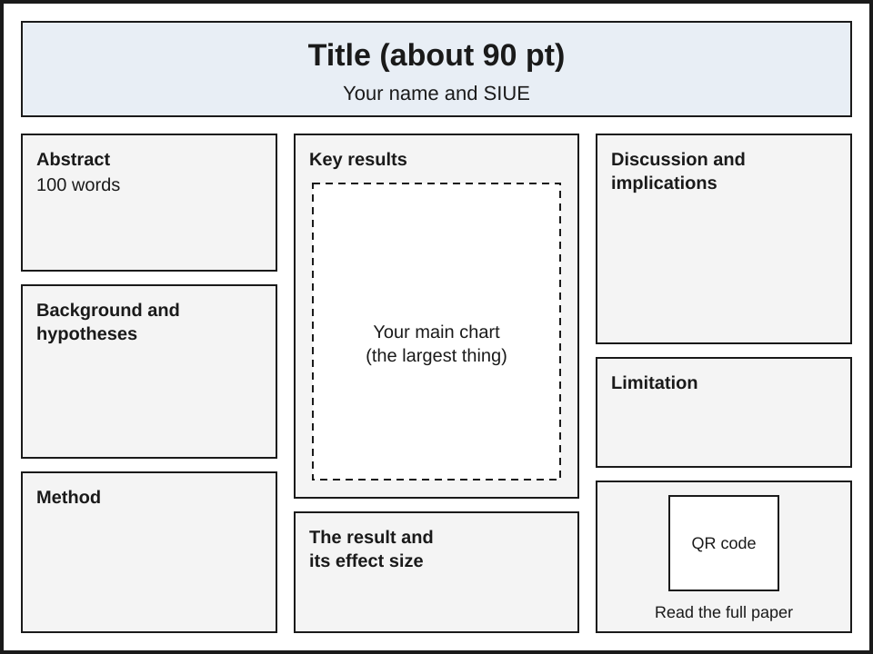

# Build Your Conference Poster

Your poster is one PowerPoint slide, 48 by 36 inches, with a QR code that opens your site, saved as a PDF. "Select" means click once. On a Mac, see [Mac keys](#mac-keys) at the end.

## Before you start

- Your site is live ([guide 13](13-publish-your-site.md)). Open it in your web browser and leave that tab open.
- Your charts are in the `figures` folder of your workspace, the folder whose name is at the top of VS Code's **Explorer** (the file list on the left) ([guide 9](09-describing-tables-and-charts.md)).
- PowerPoint is on your computer. If you cannot find it, ask your instructor before you start.

## Steps

### Part 1: Make the QR code

1. In VS Code, press **Ctrl+Shift+P**, type `AURA: Open an R terminal`, and press **Enter**. A panel opens at the bottom. When its last line shows a `>` sign, R is ready.
2. Click in that panel, type this line, and press **Enter**. Wait for the `>` sign to come back. Red text is fine.

    ```r
    install.packages("qrcode", repos = "https://cloud.r-project.org")
    ```

3. In your browser, click the address bar of your site's tab (the whole address turns blue) and press **Ctrl+C**.
4. In the R panel, type `library(qrcode)` and press **Enter**. The `>` sign comes back with no red text.
5. Type `code <- qr_code("`, press **Ctrl+V** to paste your address, type `")`, and press **Enter**. The `>` sign comes back with no red text.
6. Type each line, press **Enter**, and wait for the `>` sign before the next. After the last line, R prints `null device` and `1`: the file `poster-qr.png` is now in your `figures` folder.

    ```r
    png("figures/poster-qr.png", width = 1200, height = 1200)
    plot(code)
    dev.off()
    ```

7. In the Explorer, click `figures`, then `poster-qr.png`. Point your phone's camera at the QR code on your screen. Your site should open on your phone.

### Part 2: Set up the slide

8. Open PowerPoint and select **Blank Presentation**.
9. Select the **Design** tab, then **Slide Size** (far right), then **Custom Slide Size...**.
10. Type `48` in **Width** and `36` in **Height**, select **Landscape**, then **OK**. If PowerPoint asks, select **Ensure Fit**.
11. Click **Click to add title**, press **Esc**, then **Delete**. Do the same for the subtitle. The slide is blank.

### Part 3: Add your content

12. Lay the poster out like this: a title across the top, then three columns, each about 15 inches wide.

    {fig-alt="A poster layout, wider than it is tall. A title band across the top holds the title and your name and SIUE. Below it are three columns. The left column holds the abstract (100 words), background and hypotheses, and method. The middle column holds key results, with your main chart as the largest thing on the poster, and under it the result and its effect size. The right column holds discussion and implications, the limitation, and the QR code with the line Read the full paper under it."}

    Each block is a short version of a part of your White Paper, 400 to 800 words in all:

    | Block | Take it from your site |
    |---|---|
    | Title, your name, SIUE | the top of the first page |
    | Abstract | the abstract, cut to 100 words |
    | Background and hypotheses | Introduction: two or three sentences, then each hypothesis |
    | Method | Methods: what you studied, how many, how you coded it |
    | Key results | the chart your Results page shows for your main test |
    | The result and its effect size | Results: the sentence that reports your main test, with its numbers |
    | Discussion and implications | Discussion: what the result means, in two or three sentences |
    | Limitation | Discussion: the limitation your paper names |

13. For each block, select **Insert**, then **Text Box**, and drag to draw the box where the layout puts it. Type the block's name, press **Enter**, then add its text. To bring text over from your site, drag across it in the browser, press **Ctrl+C**, click in the box, and press **Ctrl+V**. Keep every box inside the slide; if one runs past the edge, cut words.
14. Set the sizes: drag across the words, click the number box on the **Home** tab (it shows a number such as `18`), type the size, and press **Enter**. Use `90` for the title, `54` for each block's name, and at least `32` for the rest.
15. Add the chart. Select **Insert**, then **Pictures**, then **This Device...**. In the window that opens, do steps 1 and 2 of [Find your workspace folder](#find-your-workspace-folder), select the chart, then **Insert**. Drag a corner until it is the largest thing on the poster.
16. Add the QR code the same way, choosing `poster-qr.png`. With it selected, on the **Picture Format** tab, type `5` in **Width** (far right) and press **Enter**. Add a text box under it: "Read the full paper".

### Part 4: Save and make the PDF

17. Select **File**, then **Save As**, then **Browse**. Follow [Find your workspace folder](#find-your-workspace-folder), name the file `poster`, and select **Save**.
18. Select **File**, then **Export**, then **Create PDF/XPS Document**, then the **Create PDF/XPS** button. Follow [Find your workspace folder](#find-your-workspace-folder), name the file `poster`, and select **Publish**. If the PDF opens, look it over and close it.
19. In the Explorer, `poster.pdf` is now listed with `README.md`. Open it in your browser (press **Ctrl+O** there and [find your workspace folder](#find-your-workspace-folder)), zoom in with **Ctrl** and **+** until the chart fills the screen, and check that its words are crisp. Scan the QR code with your phone; your site opens.

`poster.pdf` goes into the White Paper ZIP file with the paper PDF and your AI-use log ([guide 11](11-render-a-quarto-document.md#submit-your-work-as-one-zip-file)). The [rubric (PDF)](../../resources/rubrics/MC501-rubric-white-paper-and-conference-poster.pdf) grades the poster on its first page, in the line that starts "The poster carries the study at a glance".

## Help and reference

### Find your workspace folder

Use this whenever PowerPoint or your browser opens a window for choosing a file or a place to save.

1. In VS Code's Explorer, right-click `figures` and select **Copy Path** (not **Copy Relative Path**). Nothing changes on screen.
2. In the window, click the **File name** box at the bottom, press **Ctrl+V**, and press **Enter**. The window now shows your charts.
3. To save the poster or open `poster.pdf`, press **Alt+Up arrow** to go up one folder. The name at the top of the window changes to your workspace's name. To save, click the **File name** box, delete what is in it, and type the name. To open, select `poster.pdf`, then **Open**.

### Mac keys

Use **Cmd** where a step says **Ctrl**. Open PowerPoint with **Cmd+Space**. Slide size is **Slide Size**, then **Page Setup...**. Pictures come from **Picture from File...**. Save As has no **Browse**. Export is **File**, then **Export...**, with **File Format** set to **PDF**. In a file window, press **Cmd+Shift+G**, then **Cmd+V**, then **Return** to reach `figures`, and **Cmd+Up arrow** to go up one folder.

### If it does not work

- **`there is no package called 'qrcode'`**: do step 2 again, then step 4.
- **The QR code opens the wrong page**: do steps 3 to 6 again. Right-click the QR code on the slide, select **Change Picture**, then **From a File...**, and choose `poster-qr.png` in `figures`.
- **The chart is blurry in the PDF**: it was pasted in, not inserted. Select it, press **Delete**, and do step 15 again.
