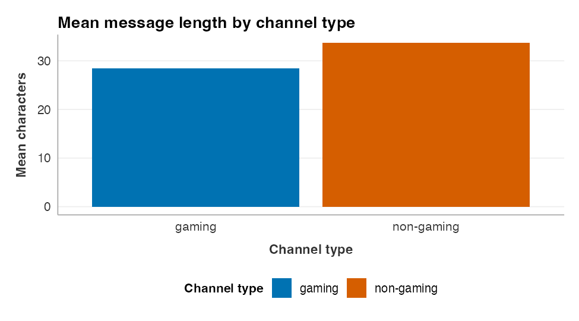
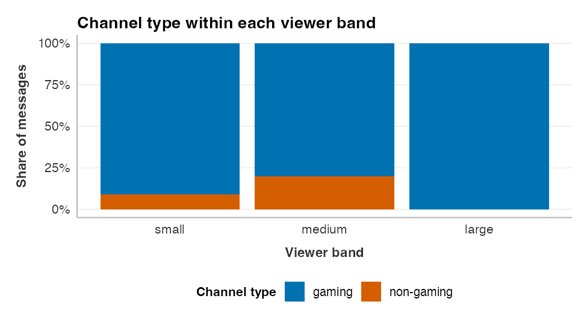
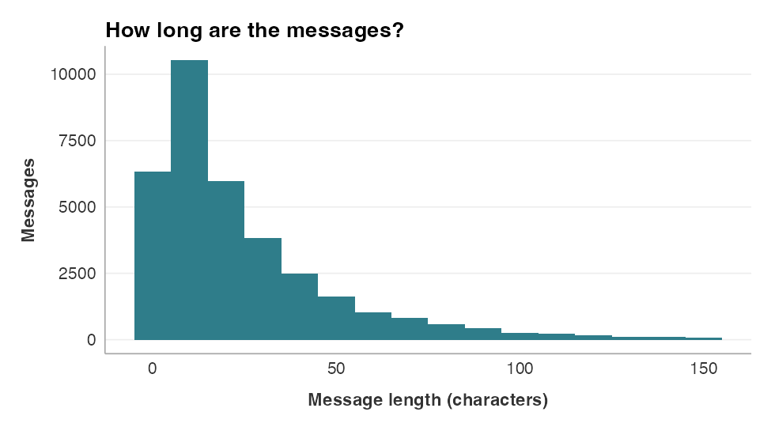
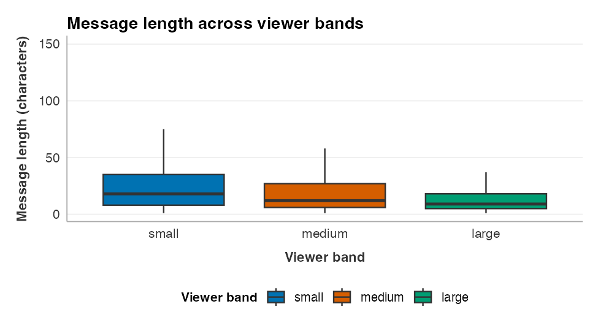
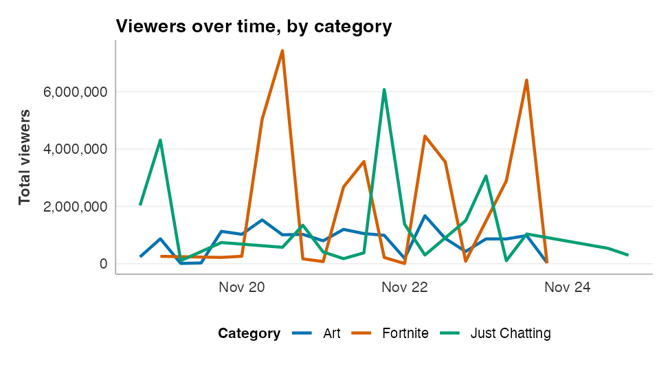
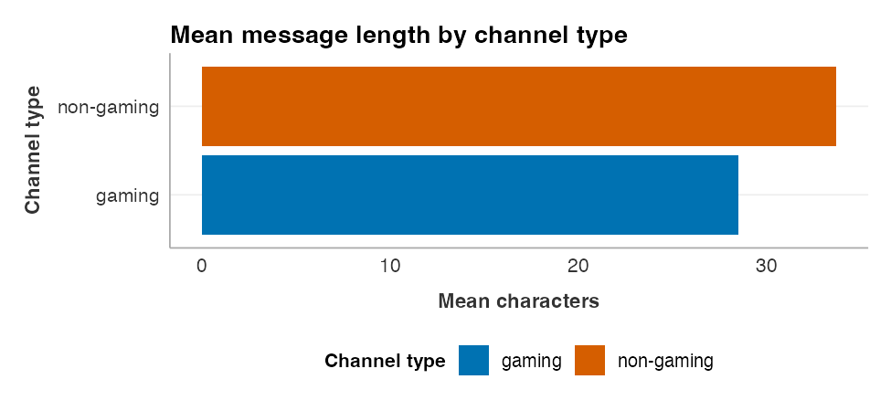

**ggplot2** builds a chart in layers joined by `+`. You start with `ggplot()`, say which columns
map to which part of the picture with `aes()`, add a `geom_` for the kind of mark you want, then
add labels and a look on top. Each entry shows the layer on the course Twitch data and the chart
it draws. **On your data** rewrites the call with plain column names.

Every worksheet starts with these lines, so the examples assume them:

```
library(tidyverse)   # ggplot2 comes with the tidyverse
library(v2v)          # the course theme: theme_v2v() and the palette
```

## How a ggplot is built

Read a ggplot top to bottom as a stack of layers, each joined by `+` at the end of the line:

```
ggplot(data, aes(x = a, y = b)) +   # the data and what maps to x and y
  geom_col() +                       # the kind of mark
  labs(title = "...") +              # the words around it
  theme_v2v()                        # the course look
```

`aes()` (short for aesthetic) is the one to remember: it maps a **column** to a part of the
picture, such as the x position, the y position, or the fill color. A fixed value that is not tied
to a column, such as one color for every bar, goes **outside** `aes()`.

## `geom_col()`: a bar whose height is a number you computed

Draws one bar per group, as tall as a value already in the table. Summarize first, then plot.

```
by_type <- analysis %>%
  filter(!is.na(channel_type)) %>%
  group_by(channel_type) %>%
  summarize(mean_len = mean(message_length, na.rm = TRUE))

ggplot(by_type, aes(x = channel_type, y = mean_len, fill = channel_type)) +
  geom_col() +
  scale_fill_v2v() +
  labs(title = "Mean message length by channel type",
       x = "Channel type", y = "Mean characters", fill = "Channel type") +
  theme_v2v()
```

{fig-alt="Bar chart of mean message length by channel type. The non-gaming bar reaches about 34 characters and the gaming bar about 28."}

**On your data:** `ggplot(summary, aes(x = group, y = value)) + geom_col()`

**If it breaks:** `geom_col()` needs a `y`. If you want R to count the rows for you instead, use
`geom_bar()`, which takes only an `x` (next entry).

## `geom_bar()`: a bar that counts the rows for you

Counts the rows in each group and draws a bar that tall. With `position = "fill"` each bar is
scaled to 100%, so you compare shares, not counts. A percent axis comes from
`scale_y_continuous(labels = scales::percent_format())`.

```
analysis %>%
  filter(!is.na(channel_type)) %>%
  ggplot(aes(x = viewer_band, fill = channel_type)) +
  geom_bar(position = "fill") +
  scale_y_continuous(labels = scales::percent_format()) +
  scale_fill_v2v() +
  labs(title = "Channel type within each viewer band",
       x = "Viewer band", y = "Share of messages", fill = "Channel type") +
  theme_v2v()
```

{fig-alt="Stacked bars showing the share of gaming and non-gaming messages within each viewer band. Non-gaming is about nine percent of small, twenty percent of medium, and none of large."}

**On your data:** `ggplot(your_data, aes(x = group, fill = category)) + geom_bar(position = "fill")`

**If it breaks:** giving `geom_bar()` a `y` as well gives
`Problem while computing stat`. Drop the `y`, or switch to `geom_col()`.

## `geom_histogram()`: the shape of one number

Splits one number into bins and draws a bar for how many rows fall in each. `binwidth` sets the
width of a bin. A fixed `fill` color sits outside `aes()`.

```
analysis %>%
  filter(message_length <= 150) %>%
  ggplot(aes(x = message_length)) +
  geom_histogram(binwidth = 10, fill = "#2f7d8a") +
  labs(title = "How long are the messages?",
       x = "Message length (characters)", y = "Messages") +
  theme_v2v()
```

{fig-alt="Histogram of message length in ten-character bins. The tallest bar is near ten characters at over ten thousand messages, and the count falls off steadily out to 150."}

**On your data:** `ggplot(your_data, aes(x = number_col)) + geom_histogram(binwidth = 5)`

**If it breaks:** the message `stat_bin() using bins = 30` is a reminder, not an error. Set your
own `binwidth` to silence it and control the shape.

## `geom_boxplot()`: spread and middle across groups

Draws a box per group: the line is the median, the box is the middle half of the values, and the
whiskers reach the rest. Good for comparing a number across categories.

```
analysis %>%
  filter(!is.na(viewer_band), message_length <= 150) %>%
  ggplot(aes(x = viewer_band, y = message_length, fill = viewer_band)) +
  geom_boxplot(outlier.shape = NA) +
  scale_fill_v2v() +
  labs(title = "Message length across viewer bands",
       x = "Viewer band", y = "Message length (characters)", fill = "Viewer band") +
  theme_v2v()
```

{fig-alt="Box plots of message length for small, medium, and large viewer bands. The median is near 17 characters in each, and the box shrinks toward the large band."}

**On your data:** `ggplot(your_data, aes(x = group, y = number_col)) + geom_boxplot()`

**If it breaks:** one box covering everything means `x` is a number, not a category. Wrap it with
`factor()` so each value gets its own box.

## `geom_line()`: a value over time

Connects points in order along the x axis, one line per group when a column is mapped to `color`.
Use it for a trend over time.

```
over_time <- twitch_viewers_over_time() %>%
  filter(category %in% c("Fortnite", "Just Chatting", "Art"))

ggplot(over_time, aes(x = six_hour, y = total_viewers, color = category)) +
  geom_line(linewidth = 1) +
  scale_color_v2v() +
  scale_y_continuous(labels = scales::label_comma()) +
  labs(title = "Viewers over time, by category",
       x = NULL, y = "Total viewers", color = "Category") +
  theme_v2v()
```

{fig-alt="Line chart of total viewers over time for Art, Fortnite, and Just Chatting from November 18 to 24, 2018. Fortnite and Just Chatting spike above five million at intervals, while Art stays near one million."}

**On your data:** `ggplot(your_data, aes(x = time_col, y = number_col, color = group)) + geom_line()`

**If it breaks:** a jagged line that doubles back means the rows are out of time order, or that you
mapped `group` to `color` but not every line is separated. Sort by the time column first.

## `labs()`: the words around the chart

Sets the title and the axis and legend names. The legend name is set by the aesthetic it belongs
to, so `fill = "Channel type"` renames the fill legend. Every chart on this sheet uses `labs()`.

```
labs(title = "Mean message length by channel type",
     x = "Channel type", y = "Mean characters", fill = "Channel type")
```

**On your data:** `labs(title = "...", x = "...", y = "...", fill = "...")`

**If it breaks:** a legend still named `channel_type` means you renamed the wrong aesthetic. Rename
the one you mapped the column to: `fill`, `color`, `x`, or `y`.

## `theme_v2v()`, `scale_fill_v2v()`, `scale_color_v2v()`: the course look

From **v2v**. `theme_v2v()` gives every figure one consistent style; `scale_fill_v2v()` colors the
fill with the course palette, and `scale_color_v2v()` does the same for line and point color. Add
them at the end of the chart.

```
... +
  scale_fill_v2v() +   # for bars and boxes (fill)
  scale_color_v2v() + # for lines and points (color)
  theme_v2v()
```

**On your data:** add the same three layers to any chart to match the rest of your report.

**If it breaks:** `could not find function "theme_v2v"` means the v2v package is not loaded. Add
`library(v2v)` at the top.

## `coord_flip()`: turn the chart on its side

Swaps the x and y axes, so bars run left to right. Use it when category names are long and would
overlap along the bottom.

```
ggplot(by_type, aes(x = channel_type, y = mean_len, fill = channel_type)) +
  geom_col() +
  coord_flip() +
  scale_fill_v2v() +
  labs(title = "Mean message length by channel type",
       x = "Channel type", y = "Mean characters", fill = "Channel type") +
  theme_v2v()
```

{fig-alt="The same mean message length bar chart turned on its side, with the gaming and non-gaming bars running left to right."}

**On your data:** add `+ coord_flip()` to any bar chart.

**If it breaks:** nothing to break. After flipping, remember that `x` is now the vertical axis when
you write `labs()`.

## `ggsave()`: save a chart to a file

Writes the last chart, or a chart you name, to an image file. The worksheet saves every figure to
the `figures` folder so it can be dropped into the paper.

```
fig <- ggplot(by_type, aes(x = channel_type, y = mean_len)) + geom_col()
ggsave("figures/mean-length.png", fig, width = 7, height = 4.5, dpi = 300)
```

**On your data:** `ggsave("figures/your-chart.png", your_plot, width = 7, height = 4.5, dpi = 300)`

**If it breaks:** `cannot open file 'figures/...'` means the `figures` folder does not exist. Make
it once with `dir.create("figures")`.
