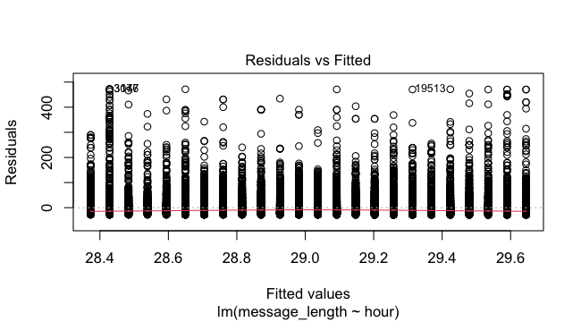

This sheet covers the describing and inferencing commands. Most are from base R's **stats**; the
effect-size lines are from **effectsize**, and the two planning lines are from **pwr**. Each entry
says what the command does, shows it on the course Twitch data, and shows the exact output. **On
your data** rewrites the call with plain column names, and **If it breaks** names the likely
error.

A test answers one of three questions: does a number differ across groups (t-test, ANOVA), do two
categories go together (chi-square), or does one number move with another (regression,
correlation). Report the test **and** its effect size: the test says whether a difference is real,
the effect size says whether it is big.

Every inferencing worksheet starts with these lines:

```
library(tidyverse)    # data steps
library(v2v)           # the course package
library(effectsize)    # cramers_v(), cohens_d(), eta_squared(): how big each result is
options(scipen = 10)  # p-values print in full, not as 2e-16
```

## The data these examples use

`dat` is the analysis table trimmed to the columns the tests use, with the blanks removed:

```
dat <- analysis %>%
  filter(!is.na(channel_type), !is.na(message_length)) %>%
  transmute(message_length,
            channel_type = factor(channel_type),
            viewer_band  = factor(viewer_band),
            viewers,
            hour = hour(ts))
```

# Describe a number

## `mean()`, `median()`, `sd()`, `IQR()` inside `summarize()`

The four numbers that describe one variable: its average, its middle, how spread out it is, and
the spread of its middle half. Build them in one `summarize()`.

```
dat %>%
  summarize(
    n      = n(),
    mean   = mean(message_length),
    median = median(message_length),
    sd     = sd(message_length),
    IQR    = IQR(message_length)
  )
```

```
# A tibble: 1 × 5
      n  mean median    sd   IQR
  <int> <dbl>  <dbl> <dbl> <dbl>
1 34762  29.0     17  41.2    28
```

**On your data:** `your_data %>% summarize(mean = mean(col, na.rm = TRUE), sd = sd(col, na.rm = TRUE))`

**If it breaks:** a result of `NA` means a blank is in the column. Add `na.rm = TRUE` inside each
function, or `filter(!is.na(col))` first, as `dat` does.

## `quantile()`: the cut points of a distribution

Returns the values below which a given share of the data falls. The 25%, 50%, and 75% points are
the quartiles.

```
quantile(dat$message_length, probs = c(.25, .5, .75))
```

```
25% 50% 75%
  7  17  35
```

**On your data:** `quantile(your_data$col, probs = c(.25, .5, .75))`

**If it breaks:** `missing values and NaN's not allowed` means blanks are present; add
`na.rm = TRUE`.

# Do two categories go together?

## `xtabs()`: a cross-tabulation

Counts the rows for each pair of two categories, as a table of rows by columns. This table is what
the chi-square test reads.

```
counts <- xtabs(~ viewer_band + channel_type, data = dat)
counts
```

```
           channel_type
viewer_band gaming non-gaming
     small   25308       2457
     medium   4000       1000
     large    1997          0
```

**On your data:** `xtabs(~ group_a + group_b, data = your_data)`

**If it breaks:** a cell of `0`, as `large / non-gaming` above, is a real count, not an error, but
it does weaken a chi-square (see the next entry).

## `chisq.test()`: is the pairing more than chance?

Tests whether two categories are associated. A small p-value says the pattern in the cross-tab is
unlikely to be chance.

```
chi <- chisq.test(counts)
chi
```

```

	Pearson's Chi-squared test

data:  counts
X-squared = 822.22, df = 2, p-value < 2.2e-16
```

**On your data:** `chisq.test(xtabs(~ group_a + group_b, data = your_data))`

**If it breaks:** `Chi-squared approximation may be incorrect` means some expected counts are
under 5, often from a near-empty cell. Report the warning, or collapse small categories together.

## `cramers_v()`: how strong is the association?

From **effectsize**. Scales the chi-square to a number from 0 (none) to 1 (perfect), so you can say
how strong the pairing is, not only that it is real. Use `adjust = FALSE` to match the worksheet.

```
cramers_v(counts, adjust = FALSE)
```

```
Cramer's V |       95% CI
-------------------------
0.15       | [0.14, 1.00]

- One-sided CIs: upper bound fixed at [1.00].
```

**On your data:** `cramers_v(your_crosstab, adjust = FALSE)`

**If it breaks:** `could not find function "cramers_v"` means effectsize is not loaded. Add
`library(effectsize)`.

# Does a number differ between two groups?

## `t.test()`: compare two group means

Tests whether the average of a number differs between two groups. Write it as
`number ~ group`. The output gives the two means, the p-value, and a confidence interval for
their difference.

```
t.test(message_length ~ channel_type, data = dat)
```

```

	Welch Two Sample t-test

data:  message_length by channel_type
t = -4.9418, df = 3768.7, p-value = 0.0000008077
alternative hypothesis: true difference in means between group gaming and group non-gaming is not equal to 0
95 percent confidence interval:
 -7.280115 -3.144345
sample estimates:
    mean in group gaming mean in group non-gaming
                28.49011                 33.70234
```

**On your data:** `t.test(number_col ~ group_col, data = your_data)`

**If it breaks:** `grouping factor must have exactly 2 levels` means the group column has more than
two values. Use ANOVA (`aov()`) for three or more groups.

## `cohens_d()`: how big is the gap?

From **effectsize**. Reports the difference between the two means in standard deviations, so 0.2 is
small, 0.5 medium, and 0.8 large, whatever the unit of the original number.

```
cohens_d(message_length ~ channel_type, data = dat)
```

```
Cohen's d |         95% CI
--------------------------
-0.13     | [-0.16, -0.09]

- Estimated using pooled SD.
```

**On your data:** `cohens_d(number_col ~ group_col, data = your_data)`

**If it breaks:** a sign that surprises you is only about which group R put first; the size is what
matters. Read it alongside the group means from the t-test.

# Does a number differ across three or more groups?

## `aov()` with `summary()`: one-way ANOVA

Tests whether a number's average differs across three or more groups. `aov()` fits it; `summary()`
prints the table with the F value and p-value.

```
fit_anova <- aov(message_length ~ viewer_band, data = dat)
summary(fit_anova)
```

```
               Df   Sum Sq Mean Sq F value Pr(>F)
viewer_band     2   225521  112761   66.53 <2e-16 ***
Residuals   34759 58910792    1695
---
Signif. codes:  0 ‘***’ 0.001 ‘**’ 0.01 ‘*’ 0.05 ‘.’ 0.1 ‘ ’ 1
```

**On your data:** `summary(aov(number_col ~ group_col, data = your_data))`

**If it breaks:** printing `fit_anova` alone gives a sparse summary; wrap it in `summary()` for the
F and p-value table, as above.

## `eta_squared()` and `omega_squared()`: share of variation explained

From **effectsize**. Both say how much of the variation in the number the groups account for, from
0 to 1. `omega_squared()` is the slightly more conservative of the two.

```
eta_squared(fit_anova)
```

```
For one-way between subjects designs, partial eta squared is
  equivalent to eta squared. Returning eta squared.
# Effect Size for ANOVA

Parameter   |     Eta2 |       95% CI
-------------------------------------
viewer_band | 3.81e-03 | [0.00, 1.00]

- One-sided CIs: upper bound fixed at [1.00].
```

**On your data:** `eta_squared(your_anova_fit)` or `omega_squared(your_anova_fit)`

**If it breaks:** the "equivalent to eta squared" note is a message, not an error; it appears for
any one-way design.

## `oneway.test()`: ANOVA that does not assume equal spread

Welch's ANOVA, which answers the same question as `aov()` but does not assume the groups have the
same spread. Report it when the boxplots show very different box heights.

```
oneway.test(message_length ~ viewer_band, data = dat)
```

```

	One-way analysis of means (not assuming equal variances)

data:  message_length and viewer_band
F = 110.06, num df = 2, denom df = 4560, p-value < 2.2e-16
```

**On your data:** `oneway.test(number_col ~ group_col, data = your_data)`

**If it breaks:** nothing to break; it reads exactly like `aov()`. The denominator degrees of
freedom are adjusted, which is why they are not a whole number.

## `TukeyHSD()`: which groups differ from which

After a significant ANOVA, compares every pair of groups and gives an adjusted p-value for each,
so you can say *which* groups differ, not only that some do.

```
TukeyHSD(fit_anova)
```

```
  Tukey multiple comparisons of means
    95% family-wise confidence level

Fit: aov(formula = message_length ~ viewer_band, data = dat)

$viewer_band
                    diff         lwr       upr     p adj
medium-small   0.8348554  -0.6474483  2.317159 0.3839721
large-small  -10.7466059 -12.9820258 -8.511186 0.0000000
large-medium -11.5814613 -14.1356197 -9.027303 0.0000000
```

**On your data:** `TukeyHSD(your_anova_fit)`

**If it breaks:** `no applicable method` means you passed an `lm()` fit, not an `aov()` fit.
`TukeyHSD()` needs the model built with `aov()`.

# Does one number move with another?

## `lm()` with `summary()`: linear regression

Fits a straight-line relationship, `outcome ~ predictor`. `summary()` prints the slope (the
`predictor` row), its p-value, and the R-squared, the share of the outcome the line explains.

```
fit_lm <- lm(message_length ~ hour, data = dat)
summary(fit_lm)
```

```

Call:
lm(formula = message_length ~ hour, data = dat)

Residuals:
   Min     1Q Median     3Q    Max
-28.65 -21.59 -12.48   5.80 471.58

Coefficients:
            Estimate Std. Error t value Pr(>|t|)
(Intercept) 28.37310    0.43700  64.927   <2e-16 ***
hour         0.05531    0.03281   1.686   0.0918 .
---
Signif. codes:  0 ‘***’ 0.001 ‘**’ 0.01 ‘*’ 0.05 ‘.’ 0.1 ‘ ’ 1

Residual standard error: 41.24 on 34760 degrees of freedom
Multiple R-squared:  8.176e-05,	Adjusted R-squared:  5.299e-05
F-statistic: 2.842 on 1 and 34760 DF,  p-value: 0.09183
```

**On your data:** `summary(lm(outcome_col ~ predictor_col, data = your_data))`

**If it breaks:** the `hour` row, not `(Intercept)`, holds the slope and its p-value. The intercept
is the predicted value when the predictor is 0, rarely the point of interest.

## `standardize_parameters()`: the slope in standard units

From **effectsize**. Re-fits the regression in standard units, so the predictor's coefficient
becomes an effect size you can compare across different variables.

```
standardize_parameters(fit_lm)
```

```
# Standardization method: refit

Parameter   | Std. Coef. |        95% CI
----------------------------------------
(Intercept) |  -7.54e-17 | [-0.01, 0.01]
hour        |   9.04e-03 | [ 0.00, 0.02]
```

**On your data:** `standardize_parameters(your_lm_fit)`

**If it breaks:** a standardized intercept near 0 is expected and not meaningful; read the
predictor's row.

## `cor.test()`: correlation between two numbers

Tests whether two numbers move together, and gives the correlation `r`, from -1 to 1, with its
p-value.

```
cor.test(dat$message_length, dat$viewers)
```

```

	Pearson's product-moment correlation

data:  dat$message_length and dat$viewers
t = -10.56, df = 34749, p-value < 2.2e-16
alternative hypothesis: true correlation is not equal to 0
95 percent confidence interval:
 -0.06703394 -0.04607324
sample estimates:
        cor
-0.05655982
```

**On your data:** `cor.test(your_data$col_a, your_data$col_b)`

**If it breaks:** `cor.test()` takes two columns with `$`, not a formula. A tiny `r` with a tiny
p-value, as above, means the link is real but weak, which a large sample can show.

## `plot()` on a model: the regression's diagnostics

Drawing a fitted model gives diagnostic charts. `which = 1` is residuals against fitted values: the
red line should stay flat near zero and the points spread evenly if a straight line fits well.

```
plot(fit_lm, which = 1)
```

{fig-alt="Residuals versus fitted plot from the regression of message length on hour. The points fan out in vertical stripes and the red smooth line stays close to zero, showing even centering but uneven spread."}

**On your data:** `plot(your_lm_fit, which = 1)`, and `which = 2` for the normal Q-Q plot.

**If it breaks:** `plot()` draws four charts in turn if you omit `which`, pausing for each. Name
`which = 1` or `which = 2` to get just the one you want.

# Plan a sample size

## `pwr.t.test()`: how many you need per group

From **pwr**. Given an effect size `d`, a significance level, and a target power, it returns the
number of cases needed in **each** group to detect an effect that size.

```
pwr.t.test(d = 0.2, sig.level = .05, power = .80)
```

```

     Two-sample t test power calculation

              n = 393.4057
              d = 0.2
      sig.level = 0.05
          power = 0.8
    alternative = two.sided

NOTE: n is number in *each* group
```

**On your data:** `pwr.t.test(d = 0.5, sig.level = .05, power = .80)`

**If it breaks:** you must leave exactly one value out for pwr to solve for it. Give `d`,
`sig.level`, and `power` to get `n`; give `n` instead of `power` to get the power you would have.

## `pwr.t2n.test()`: power for two groups of set sizes

From **pwr**. For two groups whose sizes you already know and cannot change, it finds the effect
size you could detect at a given power.

```
pwr.t2n.test(n1 = 3457, n2 = 31309, sig.level = .05, power = .80)
```

```

     t test power calculation

             n1 = 3457
             n2 = 31309
              d = 0.05019191
      sig.level = 0.05
          power = 0.8
    alternative = two.sided
```

**On your data:** `pwr.t2n.test(n1 = 40, n2 = 60, sig.level = .05, power = .80)`

**If it breaks:** as with `pwr.t.test()`, leave exactly one value out. Here `d` is left out, so pwr
solves for the smallest effect these two group sizes could detect.
