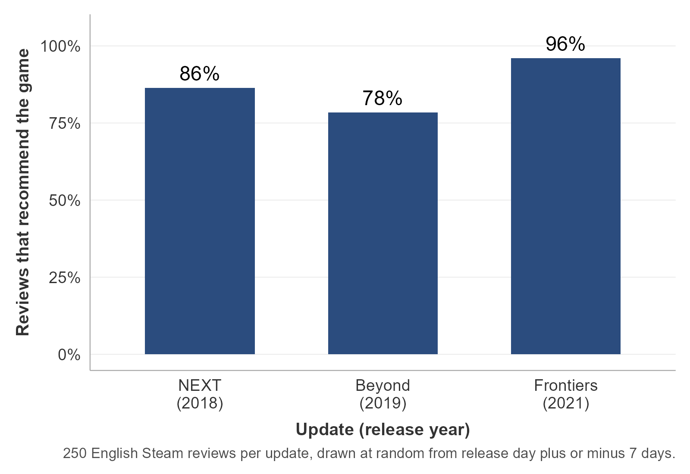
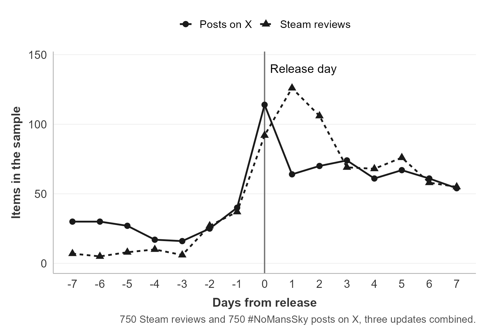

Your White Paper is one way to publish a study. Most people who work in mass communication publish the same kind of work in other forms: a campaign brief, a news story, a video. This page takes one real study and shows it four ways. Nothing here is graded.

## Key terms {#key-terms}

- **Output:** the finished thing a study becomes for a particular reader, such as a paper, a brief, a story, or a video.
- **Audience:** the people an output is written for. The same finding is told differently to a client, a newspaper reader, and a viewer.
- **Finding:** one thing the data showed, with its number.

## The study {#study}

No Man's Sky is a video game that launched badly in 2016 and was rebuilt through years of free updates. This study asks how players responded to three of those updates: NEXT (2018), Beyond (2019), and Frontiers (2021).

- **Data:** 750 English Steam reviews and 750 posts on X tagged #NoMansSky, 250 of each per update, drawn at random from release day plus or minus seven days. It is the MC 427 course dataset, built by the instructor.
- **Variables:** the update, the reviewer's own verdict (Steam makes every reviewer recommend the game or not), the review's length in words, the hours played before reviewing, the day the item was posted, and, for posts on X, whether it carried an image or video and how many likes it drew.
- **Limits:** only people who chose to write are here; Steam shows a review's current text and verdict, and 135 of the 750 reviews were edited after posting; like counts were read years later, not in the week of release.

## What it found {#findings}

{fig-alt="A bar chart of the share of Steam reviews that recommend No Man's Sky for three updates. NEXT in 2018 is 86 percent, Beyond in 2019 is 78 percent, and Frontiers in 2021 is 96 percent, the tallest bar."}

1. **Frontiers drew the warmest reviews.** 96 percent recommended the game, against 86 percent for NEXT and 78 percent for Beyond: chi-square(2, N = 750) = 34.18, p < .001, Cramer's V = .21, a small to moderate difference.
2. **Unhappy reviewers write more.** Reviews that did not recommend the game averaged 92.7 words, against 57.6 for those that did: Welch t(110.7) = 2.65, p = .009, Cohen's d = 0.38, a small difference.
3. **Unhappy reviewers had played less.** Half of them had played under 13.6 hours when they wrote, against 37.9 hours for those who recommended it (Wilcoxon test, p < .001).
4. **Talk peaks on release day and the day after.** Posts on X peaked on release day (114 of 750). Reviews peaked the day after (126 of 750), and 43 percent of all reviews arrived from release day through day two.
5. **Posts with an image or video drew more likes.** 443 of the 750 posts carried one; their median was 2 likes, against 1 for text-only posts (Wilcoxon test, p < .001). This shows the two go together, not that the image caused the likes.

{fig-alt="A line chart of items per day from seven days before release to seven days after, three updates combined. Posts on X run about 15 to 40 a day before release, jump to 114 on release day, then settle between about 55 and 75. Steam reviews run under 40 a day before release, reach 92 on release day, peak at 126 the day after, then settle near 55 to 75."}

## The same study, four ways {#four-ways}

| Output | Reader | What it leads with | Where the numbers go |
|:--|:--|:--|:--|
| White Paper | Researchers and instructors | The question and the theory | Every test, in full, in Results |
| [Strategic Communication and Advertising](strategic-communication.qmd) | A client or brand team | What to do next | Three numbers that drive the plan |
| [Journalism](journalism.qmd) | The public | What happened, and why it matters | One or two numbers in the story, the rest in a box |
| [Media Production](media-production.qmd) | A producer, then a viewer | The story arc and the pictures | On screen, one number at a time |

As a White Paper, the study opens with an abstract like this one:

> This study asked how players responded to three free updates to No Man's Sky. A random sample of 750 English Steam reviews and 750 posts on X, drawn from release day plus or minus seven days for NEXT (2018), Beyond (2019), and Frontiers (2021), was analyzed in R. The share of reviews recommending the game differed by update, from 78 percent for Beyond to 96 percent for Frontiers (Cramer's V = .21). Reviews that did not recommend the game were longer and came from players with fewer hours played. Talk on both platforms peaked within a day of release. The findings suggest that a live game's reception is renegotiated with each update, and that the first days after release carry a large share of the public response.

## Using this data {#handling}

These are real reviews and posts by real people. Every number on these pages is an aggregate; no review or post is quoted or republished, which is the handling rule for this dataset. Hello Games did not commission any of these examples: they are course exercises that show what a study's findings look like in each format.
