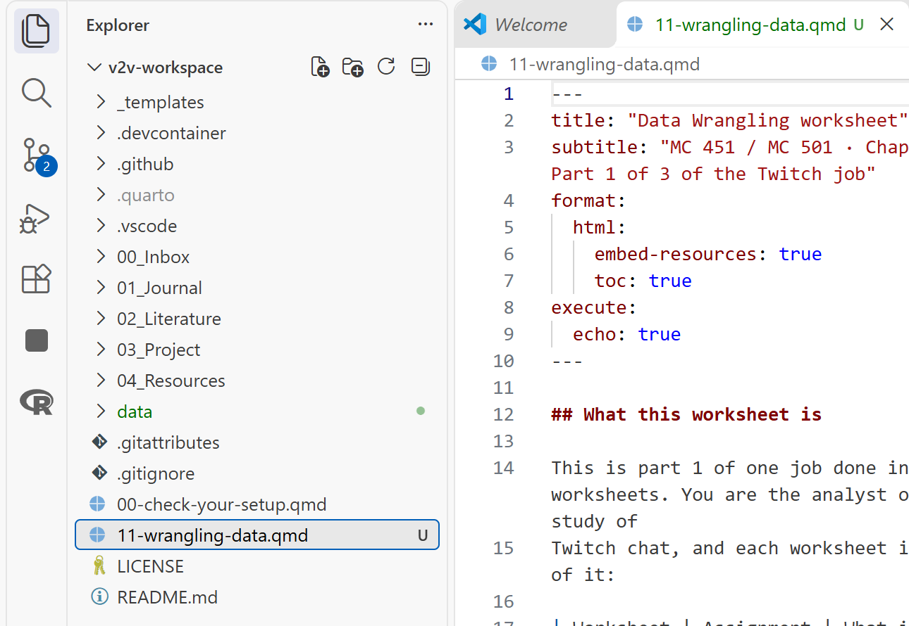
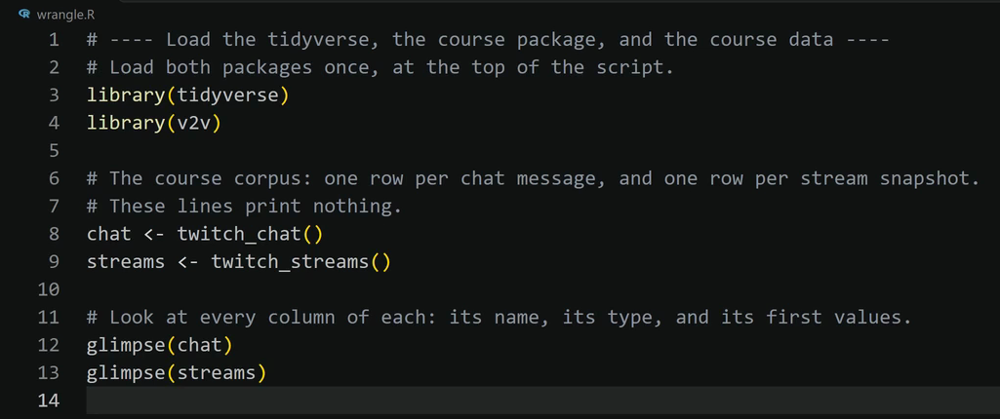

This page goes with the Data Wrangling worksheet, `11-wrangling-data.qmd`. Nothing here is
graded. Each task in the worksheet links to its section below. The first three sections apply to
every task.

## Find your way around VS Code {#around}

- **Explorer:** the list of folders and files down the left side of VS Code. If you do not see
  it, select **View**, then **Explorer**.
- **Top folder of your workspace:** the folder named at the top of the Explorer. The worksheet
  sits there, at the same level as `README.md`, as in the picture below.
- **The `data` folder:** the folder named `data` in that same list. `data/twitch_analysis.RDS`
  means: start in the top folder, go into the folder named `data`, and find the file
  `twitch_analysis.RDS`.
- **Chunk:** a gray box of R code in the worksheet. The words **Run Cell** sit at the top left
  of each gray box. Clicking them runs that chunk.
- **Blank:** three underscores, `___`, in a chunk. It stands for a piece of code you type in
  its place. This page says what kind of word each blank needs and links the cheat sheet that
  shows it. It does not hand you the word, because finding it is part of the graded work. When
  a task below lists an R Companion menu item, that item writes the finished line for you, and
  using it is allowed.
- **Your answer:** where the worksheet says **Write:**, type on the empty line under
  *Your answer:* and leave that line as it is.
- **Terminal panel:** the panel along the bottom of VS Code. R prints its answers there, in the
  terminal named **R (AURA)**. When the worksheet says "what R prints", look there. Scroll up in
  that panel if the answer has already gone past.
- **Command Palette:** select **View**, then **Command Palette...**. A box opens at the top of
  VS Code. Type the name of a command, such as `AURA: Write R code`, and press **Enter**.
- **Check what R has loaded:** click in the **R (AURA)** terminal, type `ls()`, and press
  **Enter**. R prints the names of the tables it has loaded.

{fig-alt="VS Code with the Explorer on the left showing the workspace folder v2v-workspace. The folder named data and the file 11-wrangling-data.qmd sit in the list at the same level as README.md, and the worksheet is open in the editor on the right."}

If the worksheet is not in the top folder yet, follow *Put a Worksheet in Your Workspace*:
[MC 451](../../guides/mc451/14-put-a-worksheet-in-your-workspace.md) or
[MC 501](../../guides/mc501/14-put-a-worksheet-in-your-workspace.md).

## Let the R Companion write a step {#companion}

The R Companion is the course add-on in VS Code. Its menu can write the code for many steps.
What it writes lands in your file and counts as your code, so be ready to explain every line.

1. In the chunk you are working on, click at the end of the last line before the closing
   three backticks and press **Enter**. Your cursor now sits on a new empty line.
2. Select **View**, then **Command Palette...**.
3. Type `AURA: Write R code` and press **Enter**. A menu opens at the top of VS Code.
4. Select the group and then the menu item that this page lists for your task (for example,
   the group **R2 Data**).
5. A message at the bottom right of VS Code asks **Run it now?** Select **Run it**.

The code appears where your cursor was, with a comment above each step, as in the picture
below. The chunk now holds that step twice: the finished lines the menu wrote and the unfinished
lines with `___`. Delete the unfinished lines.

{fig-alt="The VS Code editor after the R Companion wrote a block of code. Each step has a comment line above it, then the code: library(tidyverse), library(v2v), chat <- twitch_chat(), streams <- twitch_streams(), glimpse(chat), and glimpse(streams)."}

## When R prints an error {#errors}

- `object '___' not found`: a blank is still empty in that chunk. Fill it and run the chunk
  again.
- `there is no package called ...` or `could not find function ...`: open the
  [Command Palette](#around), type `AURA: Check my setup`, and press **Enter**. A list opens at
  the top of VS Code. Click **Install what is missing** in it. If a box asks about an open R
  terminal, click **Close R terminals and install**; if no box asks, go on. Installing can take a
  few minutes. Wait until a box at the bottom right says **Installed and confirmed**. Then click
  **Run Cell** on every chunk again, starting from the first chunk at the top of the worksheet.
  It worked when the chunk that showed the error now runs with no error.
- Any other error: follow *Explain an R Error*:
  [MC 451](../../guides/mc451/03-explain-an-r-error.md) or
  [MC 501](../../guides/mc501/03-explain-an-r-error.md).
- Still stuck after fifteen minutes: email me the exact error text and the task number.

## Help by task

### Setup {#setup}

The lines about "conflicts" are normal. If R says `there is no package called 'janitor'`, see
[When R prints an error](#errors).

### Task 0.1: Draw the coding sample {#task-0-1}

Everyone in the class codes the same thirty messages: fifteen from `bobross` (a non-gaming
channel) and fifteen from `giantwaffle` (a gaming channel). There is no blank here. If your
thirty messages differ from a classmate's, run the whole chunk again from its first line, so the
seed line runs right before the draw.

### Task 0.2: Write the coding sheet {#task-0-2}

The chunk makes the `data` folder if it is not there yet and saves the thirty messages in it.
After you run it, look in the Explorer: click the small arrow beside `data`, and
`coding-form.csv` is listed under it. Rendering the worksheet skips this chunk, so it never
wipes out the codes you type. If `coding-form.csv` was already in `data`, leave it: it holds the
same thirty messages.

### Task 0.3: Code each message by hand {#task-0-3}

An emote is a small picture that a Twitch viewer posts by typing its name, such as `LUL` or
`Kappa`. In the data it shows up as that name.

To find the file on your computer, right-click `coding-form.csv` in the Explorer and select
**Reveal in File Explorer** (on a Mac, **Reveal in Finder**). A window opens on the `data`
folder with the file in it.

To code in a spreadsheet:

1. Open Excel, Google Sheets, or Numbers, and open the file `coding-form.csv` from the `data`
   folder in your workspace.
2. Type `reaction_only` in the first empty cell of the top row, and `coder_notes` in the cell to
   its right.
3. Type `0` or `1` in every row of the `reaction_only` column. Do not change the `id` column.
4. Save it as a CSV with the same name, in the same folder. In Excel: **File**, then
   **Save As**, then choose **CSV UTF-8 (Comma delimited)** in the file type list. In Google
   Sheets: **File**, then **Download**, then **Comma Separated Values (.csv)**, then move the
   downloaded file into `data` in place of the old one. In Numbers: **File**, then
   **Export To**, then **CSV**.

To code inside VS Code instead, with no spreadsheet and no saving step, follow *Read and Code
Data in the Data Viewer*, which has pictures of every step:
[MC 451](../../guides/mc451/05-data-viewer-and-coding-columns.md) or
[MC 501](../../guides/mc501/05-data-viewer-and-coding-columns.md).

### Task 1.1: Load from the course package {#task-1-1}

The Twitch data ships inside the course package, `v2v`, so there is no file to find. Each blank
is the name of the function that loads one of the two tables. To find the names, open
[The data in the examples](../cheat-sheets/index.qmd#the-data-in-the-examples) on the cheat sheets
page: it names the three loading commands in the course package and says what each one loads.

R Companion menu: **R2 Data**, then **Load the course Twitch corpus**.

To check that it worked, click in the **R (AURA)** terminal, type `ls()`, and press **Enter**.
R prints `"chat"` and `"streams"` among the names.

### Task 1.2: First look {#task-1-2}

There is no blank. Look at the `date` column in what R prints: it is a run of thirteen-digit
numbers. Task 3.1 turns them into times.

### Task 2.1: Missing values {#task-2-1}

There is no blank. `is.na()` asks, for every row, whether a cell is empty. `TRUE` counts the
empty ones. Part 6 comes back to these numbers.

### Task 2.2: Two columns called `id` {#task-2-2}

A chat `id` names a message and a stream `id` names a snapshot. Joining the two tables on `id`
would run without an error and pair messages with unrelated snapshots. Your coding sheet does
join on `id` (Task 5.3), because its `id` is the chat `id`. The
[Data Wrangling risks guide](../risks/data-wrangling.qmd) shows what the wrong join looks like.

### Task 2.3: Categories {#task-2-3}

There is no blank. The first table counts snapshots in each category, most common first. The
last number is how many channels the data holds.

### Task 3.1: Make the timestamps readable {#task-3-1}

The blank, the same in both places, is the lubridate function that turns a count of seconds into
a date and time. The [lubridate cheat sheet](../cheat-sheets/lubridate.qmd) has it, with a
worked example on this data.

R Companion menu: **R2 Data**, then **Turn the date column into a time**.

If the year R prints is in the tens of thousands, the `/ 1000` is missing from the line.

### Task 3.2: Message length {#task-3-2}

The first blank is the stringr function that counts the characters in a piece of text. The
second blank is the column that holds the text. The
[stringr cheat sheet](../cheat-sheets/stringr.qmd) has it.

R Companion menu: **R2 Data**, then **Add a column (mutate)**.

### Task 4.1: Match each message to its stream {#task-4-1}

A stream snapshot is taken about once a minute. The blank is the dplyr join that keeps every row
of `chat`. The [dplyr cheat sheet](../cheat-sheets/dplyr.qmd) lists the joins.

R Companion menu: **R2 Data**, then **Join two tables by a key and nearest earlier time**.

The first number must still be `35267`: a join must not add or lose rows. Eleven messages came
before their channel's first snapshot, so they have nothing to match.

### Task 4.2: Join the channel labels onto the messages {#task-4-2}

The course package ships a table with one row per channel. It says whether the channel counts as
gaming (`is_gaming`, and the same thing in words, `channel_type`) and how big its audience is
(`viewer_band`). The first blank is the function that loads that table. To find its name, open
[The data in the examples](../cheat-sheets/index.qmd#the-data-in-the-examples) on the cheat sheets
page: it names the three loading commands in the course package and says what each one loads. The
second blank is the name of the column both tables share.

The words after `#` on that line are a comment: a note to the reader, which R ignores. Delete
the words after `#` and type your own note naming the shared column and why it is the right one
to join on. The same goes for the line in Task 5.3.

R Companion menu: **R2 Data**, then **Label each channel by its top category**, then **Join the
channel labels onto the messages**. The menu adds the labels to `chat_streams`, so type
`analysis <- chat_streams` on the line under its block and run it.

The 501 messages with `NA` come from the two channels that never recorded a category. An honest
`NA` is the right answer.

If R says `could not find function "twitch_channels"`, your copy of `v2v`, the course's add-on
for R, is older than this worksheet. Do the steps in the bullet that starts
`there is no package called` under [When R prints an error](#errors). In the list that opens, the
`v2v` line says **NEEDS UPDATE**, and **Install what is missing** updates it. It worked when
Task 4.2 runs with no error.

### Task 4.3: Check the audience bands {#task-4-3}

There is no blank. `viewer_band` came in with the join. It sorts channels into small, medium,
and large audiences, in that order. The large band is two streamers.

### Task 4.4: Check the channel type {#task-4-4}

There is no blank. `channel_type` says gaming or non-gaming in words. Every later table and test
groups by it.

### Task 5.1: Read the coding sheet {#task-5-1}

The first blank is the readr function that reads a CSV file. The second is the janitor function
that makes column names lowercase with underscores. The
[readr cheat sheet](../cheat-sheets/readr.qmd) has the first.

If you coded in the data viewer: put your cursor on an empty line in this chunk, select
**Insert rebuild code** in the viewer, run the block it writes, and then replace the chunk's two
lines with `codes <- coded_data %>% clean_names()`.

### Task 5.2: Make the codes a labeled factor {#task-5-2}

The first blank is the function that makes a factor. The second is the two code values, in the
same order as the labels. With the instructor's codes the count is `commentary` `17` and
`reaction` `13`; yours may differ by a few, because five of the thirty are deliberately
borderline.

If the count has an `NA` row, a code is something other than `0` or `1`: an empty cell, a space
after the number, or a word. Fix it in the coding sheet and run Task 5.1 again.

If R says `object 'reaction_only' not found`, click **Run Cell** on the Task 5.1 chunk, then on
this chunk again. If R still says it, open `coding-form.csv` the way you did in
[Task 0.3](#task-0-3). In the column where you typed your `0`s and `1`s, click the cell in the
first row, above your first `0` or `1`. Delete what it holds, type `reaction_only`, and save the
file the way you did in Task 0.3. Then click **Run Cell** on Task 5.1, then on this chunk. It
worked when R prints a small table with a `commentary` row and a `reaction` row and no error.

### Task 5.3: Join the codes onto the analysis table {#task-5-3}

The blank is the name of the column both tables share. Only your thirty messages carry a code;
every other message is `NA` on this variable, and that is correct.

- The row count went up: the coding sheet has the same `id` twice.
- The coded rows add to fewer than 30: an `id` in your coding sheet no longer matches a message.
  Check that the `id` column was not changed when you saved.

### Part 6: Missing values {#part-6}

There is no blank. No message is missing on two of these at once, so 516 messages carry a
missing value in all. Nothing in this worksheet deletes or fills in a missing value: each one
stays as `NA`. That is the decision your **Write:** answer reports.

### Part 7: Export {#part-7}

The first blank is the readr function that saves a table as an `.RDS` file (the
[readr cheat sheet](../cheat-sheets/readr.qmd) has it). The second is the
file name. Describing Data and Inferencing Data both read that exact name. An `.RDS` file keeps
every column exactly as you built it; a `.csv` would lose the order of small, medium, and large.

R Companion menu: **R2 Data**, then **Save a table as an RDS file**. A box asks for the file
name: leave `data/twitch_analysis.RDS` and press **Enter**.

### Render and submit {#before-you-submit}

To make the HTML file, follow *Render a Quarto Document*:
[MC 451](../../guides/mc451/11-render-a-quarto-document.md) or
[MC 501](../../guides/mc501/11-render-a-quarto-document.md). It worked if the Terminal panel
ends with `Output created: 11-wrangling-data.html`. The last section of that guide shows how to
make the ZIP file you turn in.

## If your worksheet was downloaded before November 4

Some of its lines use `sample_messages()`, `write_coding_form()`, `clean_dates()`, or
`join_chat_streams()`. Those still work and give the same results, so keep your work as it is.

## Key terms

| Term | What it means |
|---|---|
| **Row** | One of the things you study. Here, one row is one chat message. |
| **Variable** | One thing you record about every row, such as a message's length or its channel. Each variable is one column. |
| **Hand-code** | Read each message yourself and record a value for it, following a written rule. The rule is the codebook entry in Task 0.3. |
| **Pipe (`%>%`)** | Read it as "and then": it hands the result of one line to the next line. |
| **Timestamp** | The date and time something happened. In this data it is stored as a count of milliseconds since January 1, 1970. |
| **Missing value (`NA`)** | A cell with nothing in it. R prints `NA`, short for "not available." |
| **Key** | The column two tables share, which tells R which row in one table goes with which row in the other. |
| **Join** | Putting two tables together by matching their keys, so each row picks up the other table's columns. |
| **Factor** | R's way of storing a category (small, medium, large) with its labels in an order you choose. |
| **RDS file** | R's own file format. It saves a table exactly as you built it, factors and times included. |

