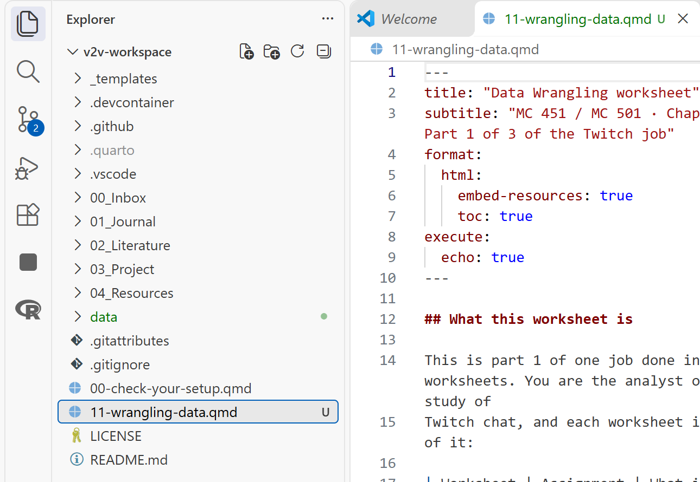
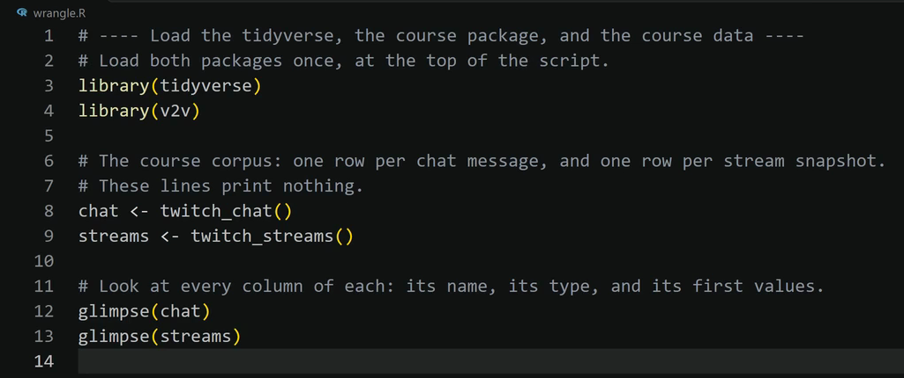

This page goes with the Describing Data worksheet (`12-describing-data-mc451.qmd` or
`12-describing-data-mc501.qmd`). Nothing here is graded. Each task in the worksheet links to its
section below. The first three sections apply to every task.

## Find your way around VS Code {#around}

- **Explorer:** the list of folders and files down the left side of VS Code. If you do not see
  it, select **View**, then **Explorer**.
- **Top folder of your workspace:** the folder named at the top of the Explorer. The worksheet
  sits there, at the same level as `README.md`, as in the picture below.
- **The `data` folder:** the folder named `data` in that same list. `data/twitch_analysis.RDS`
  means: start in the top folder, go into the folder named `data`, and find the file
  `twitch_analysis.RDS`.
- **Chunk:** a gray box of R code in the worksheet. The words **Run Cell** sit at the top left
  of each gray box. Clicking them runs that chunk.
- **Blank:** three underscores, `___`, in a chunk. It stands for a piece of code you type in
  its place. This page says what kind of word each blank needs and links the cheat sheet that
  shows it. It does not hand you the word, because finding it is part of the graded work. When
  a task below lists an R Companion menu item, that item writes the finished line for you, and
  using it is allowed.
- **Your answer:** where the worksheet says **Write:**, type on the empty line under
  *Your answer:* and leave that line as it is.
- **Terminal panel:** the panel along the bottom of VS Code. R prints its answers there, in the
  terminal named **R (AURA)**. When the worksheet says "what R prints", look there. Scroll up in
  that panel if the answer has already gone past.
- **Command Palette:** select **View**, then **Command Palette...**. A box opens at the top of
  VS Code. Type the name of a command, such as `AURA: Write R code`, and press **Enter**.
- **Workspace panel:** the list of tables R has loaded. To open it, open the Command Palette,
  type `AURA: Show what is loaded in R (Workspace panel)`, and press **Enter**.

{fig-alt="VS Code with the Explorer on the left showing the workspace folder v2v-workspace. The folder named data and the file 11-wrangling-data.qmd sit in the list at the same level as README.md, and the worksheet is open in the editor on the right."}

If the worksheet is not in the top folder yet, follow *Put a Worksheet in Your Workspace*:
[MC 451](../../guides/mc451/14-put-a-worksheet-in-your-workspace.md) or
[MC 501](../../guides/mc501/14-put-a-worksheet-in-your-workspace.md).

## Let the R Companion write a step {#companion}

The R Companion is the course add-on in VS Code. Its menu can write the code for many steps.
What it writes lands in your file and counts as your code, so be ready to explain every line.

1. In the chunk you are working on, click at the end of the last line before the closing
   three backticks and press **Enter**. Your cursor now sits on a new empty line.
2. Select **View**, then **Command Palette...**.
3. Type `AURA: Write R code` and press **Enter**. A menu opens at the top of VS Code.
4. Select the group and then the menu item that this page lists for your task (for example,
   the group **R3 Describe**).
5. A message at the bottom right of VS Code asks **Run it now?** Select **Run it**.

The code appears where your cursor was, with a comment above each step, as in the picture
below. The chunk now holds that step twice: the finished lines the menu wrote and the unfinished
lines with `___`. Delete the unfinished lines.

{fig-alt="The VS Code editor after the R Companion wrote a block of code. Each step has a comment line above it, then the code: library(tidyverse), library(v2v), chat <- twitch_chat(), streams <- twitch_streams(), glimpse(chat), and glimpse(streams)."}

## When R prints an error {#errors}

- `object '___' not found`: a blank is still empty in that chunk. Fill it and run the chunk
  again.
- `there is no package called ...` or `could not find function ...`: open the Command Palette,
  run **AURA: Check my setup**, select **Install what is missing**, and run the chunk again.
- Any other error: follow *Explain an R Error*:
  [MC 451](../../guides/mc451/03-explain-an-r-error.md) or
  [MC 501](../../guides/mc501/03-explain-an-r-error.md).
- Still stuck after fifteen minutes: email me the exact error text and the task number.

## Help by task

Every blank in this worksheet is a short piece of code: a column name, a function name, or a
word in quotation marks. The [dplyr cheat sheet](../cheat-sheets/dplyr.qmd) covers the tables
and the [ggplot2 cheat sheet](../cheat-sheets/ggplot2.qmd) covers the charts, each with a worked
example and the output it prints. The guide *Describe the Data: Tables and Charts* walks through
the same steps on another dataset:
[MC 451](../../guides/mc451/09-describing-tables-and-charts.md) or
[MC 501](../../guides/mc501/09-describing-tables-and-charts.md). The
[Describing Data risks guide](../risks/describing-data.qmd) shows the traps on this job.

### Setup {#setup}

The chunk loads the table you saved in Data Wrangling. With the instructor's codes the two coded
groups are `commentary` `17` and `reaction` `13`; yours may differ by a few.

R Companion menu: **R2 Data**, then **Load your saved analysis (RDS)**.

If R says `cannot open the connection`, this worksheet is not in the same folder as the `data`
folder from Data Wrangling. Move the worksheet into the top folder of your workspace: see
[Find your way around VS Code](#around).

### Task 1.1: Channel type {#task-1-1}

There is no blank. Read the chunk line by line: it is the model for Tasks 1.2 and 1.3.

### Task 1.2: Viewer band {#task-1-2}

This chunk is the Task 1.1 chunk with one word changed. The first blank is the function Task
1.1 uses on its second line. The second blank is `viewer_band`.

R Companion menu: **R3 Describe**, then **Frequency table**. Select **Choose columns from a data
file**, open the `data` folder, select `twitch_analysis.RDS`, then select `viewer_band`.

### Task 1.3: Your hand-coded variable {#task-1-3}

The blank is the column that holds your hand code. Its name is on the next line of the chunk,
inside `count()`. With the instructor's codes the table reads `commentary` `17` (56.7%) and
`reaction` `13` (43.3%). Yours may differ by a few, and that is fine.

### Task 2.1: Message length, all messages {#task-2-1}

There is no blank. `n` is how many messages have a length, `mean` is the average, `median` is
the middle value, and `sd` is the standard deviation.

### Task 2.2: By channel type, and by your code {#task-2-2}

In the first half of the chunk, the first blank is the dplyr function that splits a table
into groups (the second half of the chunk uses it by name), and the second blank is the column
that holds the channel type. In the second half, both blanks are the column that holds your
hand code, the same one as in Task 1.3.

R Companion menu: **R3 Describe**, then **Summary by group**.

With the instructor's codes the second table reads `commentary` n `17`, mean `29.2`, median
`21`, sd `27.9`, max `119`; `reaction` n `13`, mean `15.6`, median `9`, sd `23.5`, max `90`.

### Task 3.1: Viewer band by channel type {#task-3-1}

The blanks are column names: viewer band first, then channel type, then channel type again.
The Setup chunk prints every column name. This is the table Inferencing Data runs the
chi-square test on. `count()` with two columns
counts every combination of the two categories, one row per combination. `pivot_wider()` then
turns those rows into a grid: one row per value of the first column, one column per value of the
second, with the counts in the cells. `values_fill = 0` writes a `0` where a combination never
occurs. The 501 messages with no channel type cannot be placed, so the filter leaves them out.

R Companion menu: **R3 Describe**, then **Crosstab with proportions**. It writes this grid and
the shares in Task 3.2.

### Task 3.2: As proportions of each band {#task-3-2}

The blank is the same grouping function as in Task 2.2. `group_by()` makes `sum(n)` add up within each viewer band instead of across the whole table, so
each band's shares add up to 1. The large band has no non-gaming row at all: `count()` prints
only the combinations it finds, and that count is `0`.

### Task 4.1: Channel type within each viewer band {#task-4-1}

The first blank is the column that colors the bars. The second is the position word that
makes every bar the same height; the ggplot2 cheat sheet shows it in its bar chart example.
Keep the quotation marks around it.

On the `#| fig-alt:` line, replace the words inside the quotation marks with your own sentence
and keep the quotation marks. A disclosure sentence tells the reader one choice you made that
changes how the chart looks, such as a category you left out. In the finished chart the non-gaming part
shrinks from small to medium to none at all in large.

### Task 4.2: Message length by your code {#task-4-2}

The first blank is the column on the x axis, the one that holds your hand code. The second is
the ggplot2 function that draws a boxplot; its name starts with `geom_`, and the ggplot2 cheat
sheet shows it. In the finished chart the commentary box sits higher, with a point far above each box
(119 and 90 with the instructor's codes).

### Task 4.3: A figure of your own choice {#task-4-3}

Two charts that suit this table: a histogram of `message_length` (decide where to cap the axis,
since 361 messages run past 200 characters), or a line chart of messages per hour.

1. Click the `YOUR TURN` line in the chunk.
2. Follow [Let the R Companion write a step](#companion). The group is **R3 Describe**. Select
   **Histogram** or **Line chart over time**.
3. The menu writes the complete chart. Fill in its title, axis labels, and caption.
4. Keep the `fig_own <-` and `ggsave()` lines so the figure is saved.

**Line chart over time** draws from `streams`, so add `streams <- twitch_streams()` to the setup
chunk first.

### Task 5.1: The counts the chi-square will expect (MC 501) {#task-5-1}

The figure is the claim; the diagnostic is whether you are allowed to make it. The chi-square in
Inferencing Data needs every expected count to be at least 5. `xtabs()` builds the grid of
counts from a formula naming the two columns, `chisq.test()` runs the test on it, and
`$expected` pulls out the counts the test expected if the two were unrelated. Here, read only
the expected counts.

### Task 5.2: Spread and outliers behind the boxplot (MC 501) {#task-5-2}

A boxplot draws a point on its own for every value more than 1.5 times the interquartile range
beyond the box. This filter finds those messages within each group: `quantile(..., 0.75)` is the
top of the box and `IQR()` is its height. With the instructor's codes the sds are `27.9` and
`23.5`, and four messages sit beyond the upper whisker of their own box: `90` in reaction, and
`59`, `119`, and `62` in commentary.

### Task 5.3: Shape across viewer bands (MC 501) {#task-5-3}

There is no blank. Compare the three sds, and compare each band's mean with its median.

### Render and submit {#before-you-submit}

To make the HTML file, follow *Render a Quarto Document*:
[MC 451](../../guides/mc451/11-render-a-quarto-document.md) or
[MC 501](../../guides/mc501/11-render-a-quarto-document.md). It worked if the Terminal panel
ends with `Output created:` and the worksheet's name ending in `.html`. The last section of that
guide shows how to make the ZIP file you turn in.

## Key terms

| Term | What it means |
|---|---|
| **Frequency table** | A count of how many rows fall in each category, often with each count as a percent of the total. |
| **Mean** | The average: add up the values and divide by how many there are. A few very large values pull it up. |
| **Median** | The middle value once the values are sorted. Half the messages are shorter, half are longer. |
| **Standard deviation (sd)** | How far values typically sit from the mean. A bigger sd means the values are more spread out. |
| **Skew** | A lopsided shape. Message length is skewed right: most messages are short and a few are very long, which puts the mean above the median. |
| **Outlier** | A value far from the rest, such as one 441-character message among messages of 10 or 20. |
| **Cross-tabulation** | A table that counts every combination of two categories, such as viewer band by channel type. |
| **Proportion** | A share of a whole, written as a decimal: 0.2 is 20 percent. |
| **Boxplot** | A chart of a variable's middle half (the box), its median (the line), and its outliers (points beyond the whiskers). |
| **Histogram** | A bar chart of a number variable, where each bar counts the values that fall in one range, such as 0 to 5 characters. |
| **Alt text** | A sentence that says what a chart shows, for a reader who cannot see it. A screen reader reads it aloud. |
| **Expected count** | The count a cell of a cross-tabulation would hold if the two variables were unrelated. The chi-square test compares it with the real count. |
| **Interquartile range (IQR)** | The width of the boxplot's box: the spread of the middle half of the values. |

