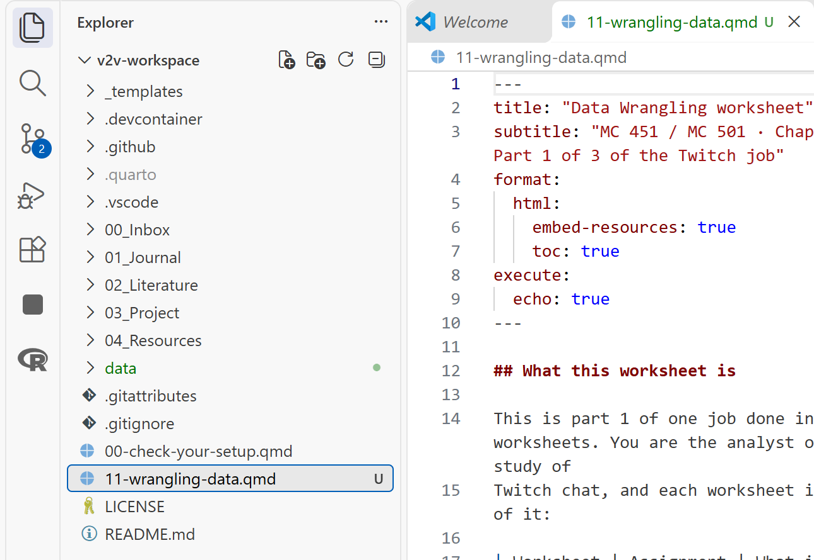
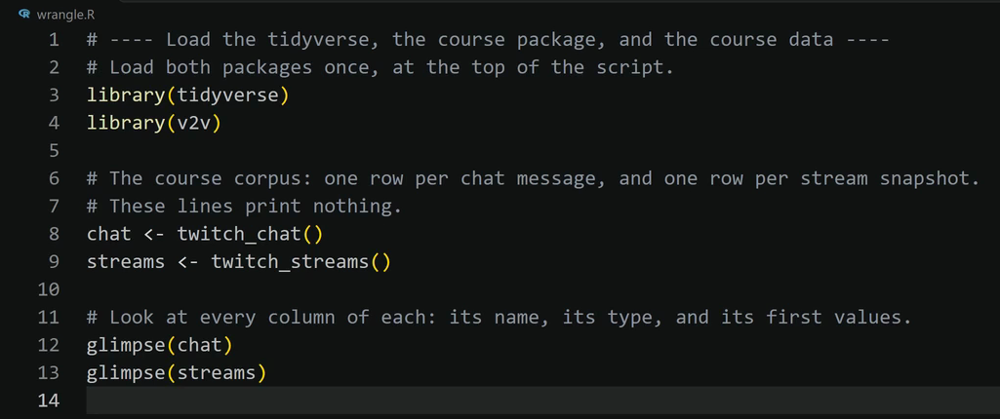

This page goes with the Inferencing Data worksheet (`13-inferencing-data-mc451.qmd` or
`13-inferencing-data-mc501.qmd`). Nothing here is graded. Each task in the worksheet links to
its section below. The first three sections apply to every task.

## Find your way around VS Code {#around}

- **Explorer:** the list of folders and files down the left side of VS Code. If you do not see
  it, select **View**, then **Explorer**.
- **Top folder of your workspace:** the folder named at the top of the Explorer. The worksheet
  sits there, at the same level as `README.md`, as in the picture below.
- **The `data` folder:** the folder named `data` in that same list. `data/twitch_analysis.RDS`
  means: start in the top folder, go into the folder named `data`, and find the file
  `twitch_analysis.RDS`.
- **Chunk:** a gray box of R code in the worksheet. The words **Run Cell** sit at the top left
  of each gray box. Clicking them runs that chunk.
- **Blank:** three underscores, `___`, in a chunk. It stands for a piece of code you type in
  its place. This page says what kind of word each blank needs and links the cheat sheet that
  shows it. It does not hand you the word, because finding it is part of the graded work. When
  a task below lists an R Companion menu item, that item writes the finished line for you, and
  using it is allowed.
- **Your answer:** where the worksheet says **Write:**, type on the empty line under
  *Your answer:* and leave that line as it is.
- **Terminal panel:** the panel along the bottom of VS Code. R prints its answers there, in the
  terminal named **R (AURA)**. When the worksheet says "what R prints", look there. Scroll up in
  that panel if the answer has already gone past.
- **Command Palette:** select **View**, then **Command Palette...**. A box opens at the top of
  VS Code. Type the name of a command, such as `AURA: Write R code`, and press **Enter**.
- **Check what R has loaded:** click in the **R (AURA)** terminal, type `ls()`, and press
  **Enter**. R prints the names of the tables it has loaded.

{fig-alt="VS Code with the Explorer on the left showing the workspace folder v2v-workspace. The folder named data and the file 11-wrangling-data.qmd sit in the list at the same level as README.md, and the worksheet is open in the editor on the right."}

If the worksheet is not in the top folder yet, follow *Put a Worksheet in Your Workspace*:
[MC 451](../../guides/mc451/14-put-a-worksheet-in-your-workspace.md) or
[MC 501](../../guides/mc501/14-put-a-worksheet-in-your-workspace.md).

## Let the R Companion write a step {#companion}

The R Companion is the course add-on in VS Code. Its menu can write the code for many steps.
What it writes lands in your file and counts as your code, so be ready to explain every line.

1. In the chunk you are working on, click at the end of the last line before the closing
   three backticks and press **Enter**. Your cursor now sits on a new empty line.
2. Select **View**, then **Command Palette...**.
3. Type `AURA: Write R code` and press **Enter**. A menu opens at the top of VS Code.
4. Select the group and then the menu item that this page lists for your task (for example,
   the group **R4 Test**).
5. A message at the bottom right of VS Code asks **Run it now?** Select **Run it**.

The code appears where your cursor was, with a comment above each step, as in the picture
below. The chunk now holds that step twice: the finished lines the menu wrote and the unfinished
lines with `___`. Delete the unfinished lines.

{fig-alt="The VS Code editor after the R Companion wrote a block of code. Each step has a comment line above it, then the code: library(tidyverse), library(v2v), chat <- twitch_chat(), streams <- twitch_streams(), glimpse(chat), and glimpse(streams)."}

## When R prints an error {#errors}

- `object '___' not found`, with three underscores between the quote marks: a blank is still
  empty in that chunk. Fill it and run the chunk again.
- `object '` and then a name, such as `object 'analysis' not found`: in the worksheet, scroll to the
  top. Click **Run Cell** on the gray box under the worksheet's heading **Part 1: The settings block**. Then click
  **Run Cell** on each gray box below it, one at a time from top to bottom, and stop after the
  gray box where the error appeared. It worked when R prints no message that begins with `Error`.
- `could not find function ...` or `there is no package called ...`: click **Run Cell** on the
  gray box under the worksheet's heading **Part 1: The settings block**, then on the chunk that showed the error. It worked
  when R prints no message that begins with `Error`. If the same message comes back, open the
  [Command Palette](#around), type `AURA: Check my setup`, and press **Enter**. A list opens at
  the top of VS Code. Click **Install what is missing** in it. If a box asks about an open R
  terminal, click **Close R terminals and install**; if no box asks, go on. Installing can take a
  few minutes. Wait until a box at the bottom right says **Installed and confirmed**. Then click
  **Run Cell** on the gray box under **Part 1: The settings block** and on each gray box below it, top to bottom,
  down to the one that showed the error. It worked when that chunk prints no message that begins
  with `Error`.
- Any other error: follow *Explain an R Error*:
  [MC 451](../../guides/mc451/03-explain-an-r-error.md) or
  [MC 501](../../guides/mc501/03-explain-an-r-error.md).
- Still stuck after fifteen minutes: email me the exact error text and the task number.

## Help by task

Every blank in Parts 2 to 5 is one of the six names on the left of an `=` sign in the
settings block in Part 1: `outcome`, `group2`, `group3`, `predictor`, `cat_a`, or `cat_b`. The
note after `#` on the blank's own line says which column it means, and the notes above the
settings block say which name holds that column. The
[stats cheat sheet](../cheat-sheets/stats.qmd) shows each test with a worked example and the
output it prints. The guide *Run a Test and Check Your Test Choice* walks through the same steps:
[MC 451](../../guides/mc451/10-tests-and-check-my-test-choice.md) or
[MC 501](../../guides/mc501/10-tests-and-check-my-test-choice.md). The
[Inferencing Data risks guide](../risks/inferencing-data.qmd) shows the traps on this job.

To check an APA sentence you wrote, use the R Companion menu: **R4 Test**, then **APA numbers
to check your sentence**. It prints a test's numbers.

### Part 0: Four hypotheses, before any code {#part-0}

Write all four before you run any chunk. A hypothesis written after the result is a description
of the result. The guide *Choose Your Test and Write It in APA* shows how two variables' types
point to a test: [MC 451](../../guides/mc451/17-choose-your-test-and-write-it-in-apa.md) or
[MC 501](../../guides/mc501/17-choose-your-test-and-write-it-in-apa.md).

### Part 1: The settings block {#part-1}

The blank is the column that holds your hand code, the one the worksheet's table of tests
names for Test 2. Only this block knows the Twitch column names. The same code runs on your own data for the White
Paper when you change this block and nothing else.

R Companion menu: **R4 Test**, then **Settings block (name the test variables)**. It writes this
block with `group2 = factor(channel_type)`; change that one line to your hand-coded variable.

If R says `there is no package called 'effectsize'` (or `'pwr'`, in MC 501), see
[When R prints an error](#errors).

### Task 2.1: The test and its effect size {#task-2-1}

`xtabs()` builds the grid of counts from a formula naming the two categories, the same grid as
the cross-tabulation in Describing Data. `chisq.test()` runs the test on that grid and reports
the chi-square statistic, its df, and p. `cramers_v()` turns the result into Cramér's V, the
effect size for two categories, from 0 (no relationship) to 1.

R Companion menu: **R4 Test**, then **Chi-square test with Cramer's V**. It writes these lines
for `cat_a` and `cat_b`.

### Task 2.2: The assumption and the cells driving it (MC 501) {#task-2-2}

`chi` holds everything the test computed. `$expected` is the grid of counts the test expected if
the two were unrelated (every one should be at least 5). `$stdres` is the standardized
residuals: how far each real count sits from its expected count. A cell beyond 2 or -2 drives
the result. Here the medium band holds far more non-gaming chat than chance would put there.

### Task 3.1: How many messages the test uses {#task-3-1}

The second table gives the n, mean, and sd of each group that the APA sentence needs. It counts
only rows that have both a group and a message length, as the test does. With the instructor's
codes: `commentary` `17` and `reaction` `13`, then `commentary` mean `29.2`, sd `27.9` and
`reaction` mean `15.6`, sd `23.5`.

### Task 3.2: The test and its effect size {#task-3-2}

`t.test()` with a formula (`a number ~ a two-group category`) runs Welch's t-test, R's default,
which does not assume the two groups spread out equally. `cohens_d()` with the same formula
gives Cohen's d: the gap between the two means, measured in standard deviations.

R Companion menu: **R4 Test**, then **Welch t-test with Cohen's d**.

With the instructor's codes R prints `t = 1.4499`, `df = 27.701`, `p-value = 0.1583`,
`mean in group commentary` `29.23529`, `mean in group reaction` `15.61538`, then `Cohen's d`
`0.52`. Your numbers differ wherever your codes do.

### Task 3.3: Power for this focal test (MC 501) {#task-3-3}

The two blanks are your two group sizes: the two `n` values R printed in Task 3.1, in the same
order. The stats cheat sheet explains the line that starts with `pwr::pwr.t2n.test(`:
[pwr.t2n.test()](../cheat-sheets/stats.qmd#pwr.t2n.test-power-for-two-groups-of-set-sizes).

R Companion menu: **R4 Test**, then **Power analysis for your sample size**. It writes the line
that starts with `pwr::pwr.t.test(`, the second one in this chunk.

### Task 4.1: The test and its effect size {#task-4-1}

`aov()` fits the ANOVA for a number across three or more groups, and `summary()` prints F, both
df, and p. `eta_squared()` gives eta squared: the share of the variation in message length that
the groups account for, from 0 to 1. The first table gives each group's n, mean, and sd for the
report.

R Companion menu: **R4 Test**, then **One-way ANOVA with eta squared**.

### Task 4.2: Welch's ANOVA, and which groups differ (MC 501) {#task-4-2}

`oneway.test()` is Welch's ANOVA, which does not assume the groups spread out equally.
`omega_squared()` is a less biased cousin of eta squared; report both. `TukeyHSD()` is the
follow-up that says which pairs of bands differ, with p adjusted for making three comparisons.
Under Tukey, R prints `large-small` `diff` `-10.7466059`, `p adj` `0.0000000`; `large-medium`
`diff` `-11.3791998`, `p adj` `0.0000000`; and `medium-small` `diff` `0.6325938`, `p adj`
`0.5497618`.

### Task 5.1: The test and its effect size {#task-5-1}

`lm()` fits a straight line from one number to another. `summary()` prints the slope (the
`Estimate` on the predictor's row: characters gained per hour), the intercept, R-squared (the
share of the variation the line explains), and the F-test with its df and p.

R Companion menu: **R4 Test**, then **Linear regression**.

### Task 5.2: The standardized slope, the interval, and the residuals (MC 501) {#task-5-2}

`standardize_parameters()` reports the slope in standard deviations: the change in message
length, in standard deviations, per standard deviation of the hour. The other two chunks draw
R's two standard diagnostic plots from the fitted model. In them, the residuals stack in a
stripe at each hour, and the Q-Q points bend sharply upward at the right.

### Render and submit {#before-you-submit}

To make the HTML file, follow *Render a Quarto Document*:
[MC 451](../../guides/mc451/11-render-a-quarto-document.md) or
[MC 501](../../guides/mc501/11-render-a-quarto-document.md). It worked if the Terminal panel
ends with `Output created:` and the worksheet's name ending in `.html`. The last section of that
guide shows how to make the ZIP file you turn in.

## Key terms

| Term | What it means |
|---|---|
| **Hypothesis** | A sentence, written before you look, that says what you expect to find about two variables. |
| **Statistical test** | A calculation that asks whether a pattern in the data is bigger than chance alone would produce. |
| **p-value** | How likely a pattern at least this big would be if the two variables were really unrelated. Below .05 is called *statistically significant*. R prints a very small one as `< 2.2e-16`, which you report as *p* < .001. |
| **Statistically significant** | The p-value is under .05. It says a pattern is unlikely to be chance. It does not say the pattern is big or important. |
| **Effect size** | How big a difference or relationship is, on a scale that does not grow with the number of messages. |
| **Chi-square test** | The test for two categories, such as viewer band and channel type. It compares the real counts with the counts you would expect if the two were unrelated. |
| **t-test** | The test for a number across two groups, such as message length for commentary and reaction. |
| **ANOVA** | The test for a number across three or more groups, such as message length across the three viewer bands. |
| **Linear regression** | The test for two numbers. It fits a straight line and reports its slope: how much one number changes when the other goes up by one. |
| **Degrees of freedom (df)** | A number each test reports beside its result, set by how many groups and rows went into it. You copy it into the report. |
| **Confidence interval** | A range of values the true effect probably falls in. A wide interval means the estimate is uncertain. |
| **Null result** | A test that is not significant. It means the data could not tell the pattern apart from chance, not that there is no pattern. |
| **Assumption** | A condition a test needs to give trustworthy answers, such as groups that spread about equally. |
| **Residual** | The gap between a real value and the value the model predicts for it. |
| **Power** | The chance a test would detect a difference of a given size, if that difference is real. Small samples have low power. |

