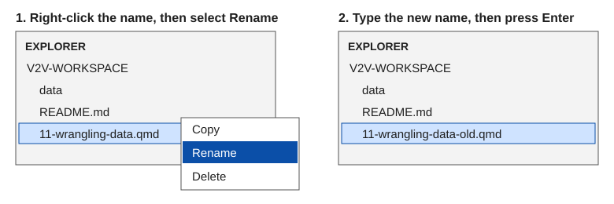
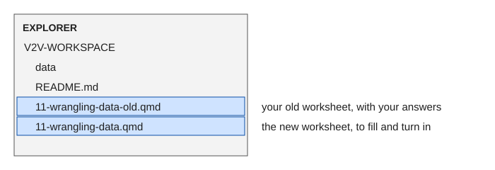
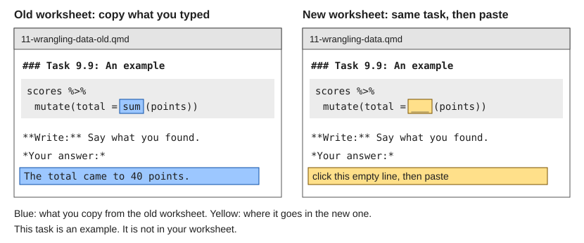

The three R worksheets (Data Wrangling, Describing Data, and Inferencing Data) have a new layout.
The questions are the same, in the same order, under the same task headings. This page moves the
answers you already typed into the new worksheet. Do it on your laptop.

## Which case is yours? {#which-case}

Go through this page once for each worksheet.

- **You have typed nothing into that worksheet:** skip Step 1. Do Step 2, then stop.
- **You have typed at least one answer into it, even if it is not finished:** do Steps 1, 2, 3,
  and 4, in that order.

## Step 1: Rename your old worksheet {#rename}

Renaming keeps your old answers safe when the new worksheet arrives with the same name.

1. Open VS Code. In the Explorer, the list of file names down the left side of the VS Code
   window, find the worksheet you typed in. The table below gives its name.
2. Right-click that name. A small menu opens. Click **Rename** in that menu. The name turns into
   a box you can type in, and part of the name is highlighted.
3. Type the new name from the table. Typing replaces the highlighted part, so you do not delete
   anything first. Do not type `.qmd`. Those letters stay on the end of the name by themselves.
   Then press **Enter**.

| Worksheet | Its name now | Type this |
|---|---|---|
| Data Wrangling | `11-wrangling-data.qmd` | `11-wrangling-data-old` |
| Describing Data, MC 451 | `12-describing-data-mc451.qmd` | `12-describing-data-mc451-old` |
| Describing Data, MC 501 | `12-describing-data-mc501.qmd` | `12-describing-data-mc501-old` |
| Inferencing Data, MC 451 | `13-inferencing-data-mc451.qmd` | `13-inferencing-data-mc451-old` |
| Inferencing Data, MC 501 | `13-inferencing-data-mc501.qmd` | `13-inferencing-data-mc501-old` |

{fig-alt="Two drawings of the VS Code Explorer. In the first, the name 11-wrangling-data.qmd is right-clicked and a small menu shows Copy, Rename, and Delete, with Rename picked. In the second, the same file is now named 11-wrangling-data-old.qmd."}

**What you should see:** the name in the Explorer now ends in `-old.qmd`, as in the second half
of the picture.

## Step 2: Get the new worksheet {#get-it}

1. Click the link for your worksheet and your course once.
   - [Data Wrangling, both courses](https://aura-lab.siue.edu/v2v-hub/starters/11-wrangling-data.qmd){download="11-wrangling-data.qmd"}
   - [Describing Data, MC 451](https://aura-lab.siue.edu/v2v-hub/starters/12-describing-data-mc451.qmd){download="12-describing-data-mc451.qmd"}
   - [Describing Data, MC 501](https://aura-lab.siue.edu/v2v-hub/starters/12-describing-data-mc501.qmd){download="12-describing-data-mc501.qmd"}
   - [Inferencing Data, MC 451](https://aura-lab.siue.edu/v2v-hub/starters/13-inferencing-data-mc451.qmd){download="13-inferencing-data-mc451.qmd"}
   - [Inferencing Data, MC 501](https://aura-lab.siue.edu/v2v-hub/starters/13-inferencing-data-mc501.qmd){download="13-inferencing-data-mc501.qmd"}

   **What you should see:** the page does not change. Your web browser saves the file in your
   Downloads folder and shows the file's name in a small list near the top of the browser window.
2. Move the file from your Downloads folder into VS Code. The guide named Put a Worksheet in
   Your Workspace shows each click, with a picture and a video. Open the one for your course,
   follow its steps, then come back to this page.
   - [Put a Worksheet in Your Workspace, MC 451](../../guides/mc451/14-put-a-worksheet-in-your-workspace.md)
   - [Put a Worksheet in Your Workspace, MC 501](../../guides/mc501/14-put-a-worksheet-in-your-workspace.md)
3. If VS Code shows a box asking whether to replace a file that has the same name, click
   **Replace**. If no box appears, go on.

**What you should see:** the new worksheet's name in the Explorer. If you did Step 1, the
Explorer shows two names, as in the picture below.

{fig-alt="The VS Code Explorer listing two worksheets, one under the other: 11-wrangling-data-old.qmd, labeled your old worksheet with your answers, and 11-wrangling-data.qmd, labeled the new worksheet to fill and turn in."}

## Step 3: Copy your answers across {#copy}

You typed two kinds of answer.

- **Code:** a word you typed in a gray box, where three underscores (`___`) used to be.
- **A sentence:** what you typed on the line under *Your answer:*.

Start at the top of the old worksheet and do these steps for one answer at a time.

1. In the Explorer, click the name that ends in `-old.qmd`. Your old worksheet opens.
2. Find the first answer you typed. Read the task heading above it. A task heading is a line
   that starts with `###`, such as `### Task 1.1`.
3. Put the mouse pointer just before the first letter of your answer. Hold the mouse button down,
   move to just after the last letter, and let go. This works the same when the answer runs
   over more than one line. Your answer now has a colored background, as
   in the left half of the picture below.
4. Hold **Ctrl** and press **C**. On a Mac, hold **Command** and press **C**. Nothing changes on
   the screen.
5. In the Explorer, click the name of the new worksheet, the one without `-old`.
6. Scroll down the new worksheet until you reach the line that starts with `###` and has the
   task number you read in step 2.
7. If what you copied is code, drag across the three underscores in the gray box, the same way
   as in step 3. When a gray box has more than one set of underscores, they are in the same
   order as in your old worksheet. If what you copied is a sentence, click the empty line
   under *Your answer:*.
8. Hold **Ctrl** and press **V**. On a Mac, hold **Command** and press **V**.

{fig-alt="Two drawings of the VS Code editor side by side. On the left, the old worksheet: a word typed in the gray code box and a sentence under Your answer are both marked in blue as the parts to copy. On the right, the new worksheet under the same task heading: the three underscores in the gray code box and the empty line under Your answer are marked in yellow as the places to paste."}

**What you should see:** your answer in the new worksheet, where the underscores or the empty line
were.

Then start this numbered list again at its line 1, clicking the name that ends in `-old.qmd`,
for the next answer down the old worksheet. You are done when
you reach the bottom of the old worksheet, or a task where you had not typed anything yet.

## Step 4: Save, then carry on {#save}

1. With the new worksheet open, hold **Ctrl** and press **S**. On a Mac, hold **Command** and
   press **S**. Your work is saved. If a round dot showed beside the worksheet's name on its
   tab above the page, the dot is gone.
2. Keep working in the new worksheet from the first task you have not answered. The section
   named **What to submit**, near the top of the new worksheet, says what to turn in and where.

You turn in the new worksheet. The old one can stay where it is.
